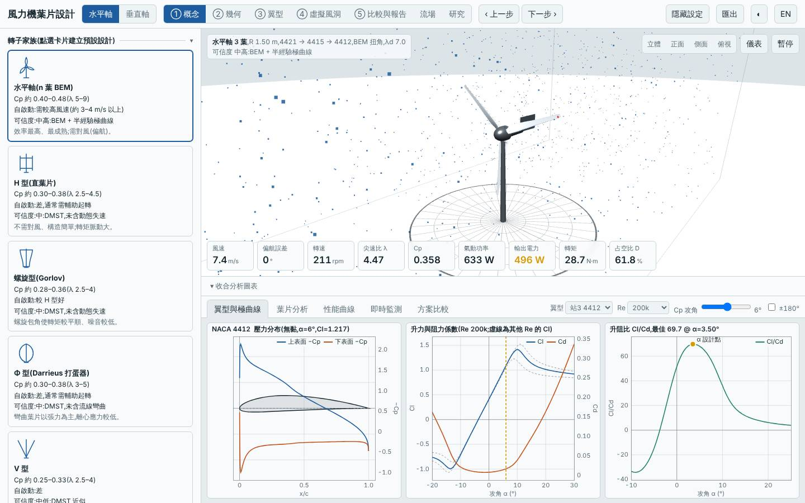
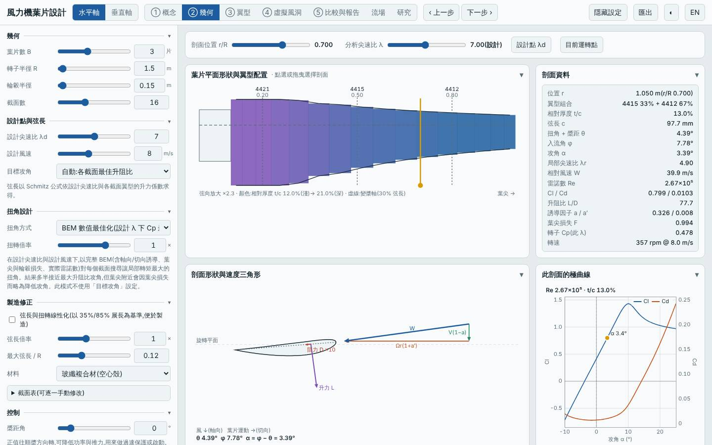
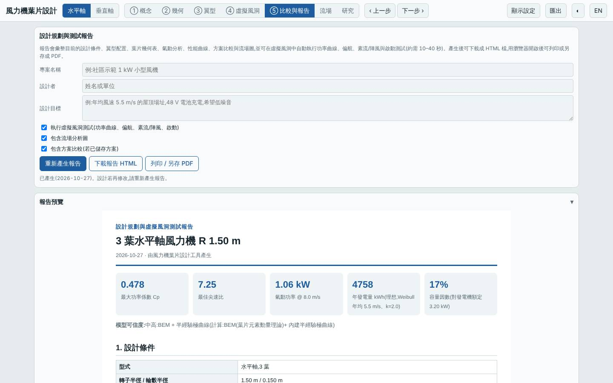
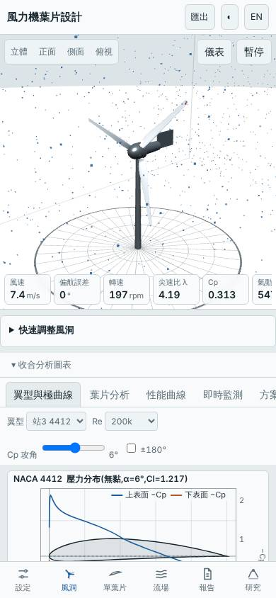

# 基準:預設三葉水平軸

- 日期:2026-10-27
- 用途:排行榜的比較基準(工具預設設計,未做任何修改)
- 設定:3 葉、R 1.5 m、輪轂 0.15 m、λd 7、設計風速 8 m/s、翼型 NACA 4421 → 4415 → 4412、BEM 扭角、玻纖空心殼

## 結果(模型預測)

| 項目 | 值 |
|---|---|
| Cp,max | 0.478 @ λ 7.25 |
| 年發電量(理想 MPPT,Weibull 5.5 m/s、k 2)| 4758 kWh |
| LCOE(概估)| 2.75 NT$/kWh |
| 轉子質量 | 4.3 kg |
| 起轉風速(靜摩擦估算)| 3.7 m/s |
| 模擬自啟動(靜止起步 60 s)| 3、4 m/s 否;5 m/s 是 |
| 最小安全係數(設計點 / 極端風速)| 5.97 / 2.65 |
| MPPT 追蹤率 6 / 9 m/s | 95% / 97% |

## 截圖

   
