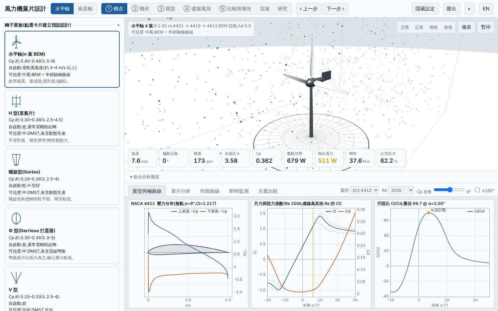
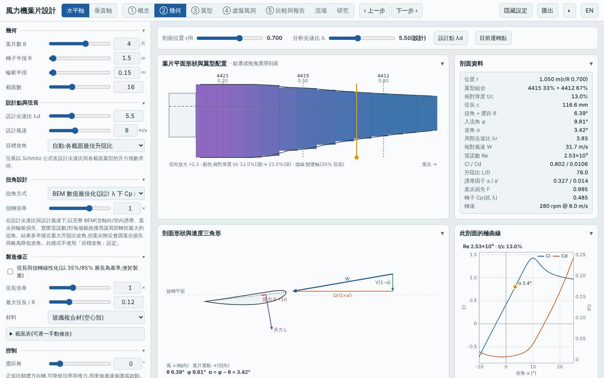
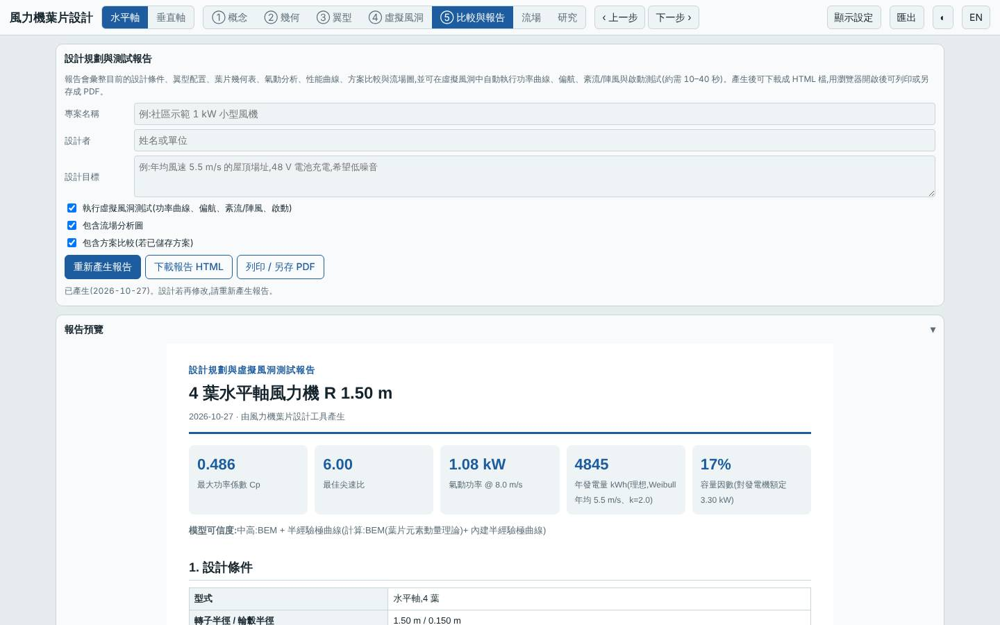
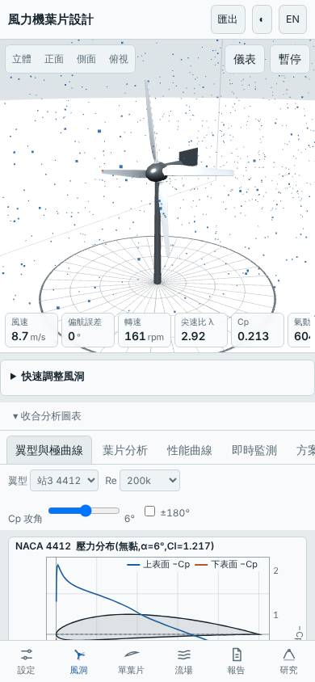

# 四葉低尖速比(λd 5.5)

- 日期:2026-10-27
- 相對基準的變更:葉片數 3 → 4,設計尖速比 λd 7 → 5.5(其餘同基準)

## 假設

預設三葉 λd 7 在 4 m/s 無法自行啟動。改成 4 葉並把設計尖速比降到 5.5,實度提高,低 λ 的扭矩係數變大,預期起轉風速下降;代價是葉片較寬、較重。想知道 Cp,max 與年發電量會不會因此變差。

## 結果(模型預測,與基準比較)

| 項目 | 本設計 | 基準 | 差異 |
|---|---|---|---|
| Cp,max | 0.486 @ λ 6.00 | 0.478 @ λ 7.25 | +1.7% |
| 年發電量 | 4845 kWh | 4758 kWh | +1.8% |
| LCOE(概估)| 2.79 NT$/kWh | 2.75 NT$/kWh | +1.5% |
| 轉子質量 | 6.7 kg | 4.3 kg | +56% |
| 起轉風速(靜摩擦估算)| 2.7 m/s | 3.7 m/s | −1.0 m/s |
| 模擬自啟動 | 4 m/s 起 | 5 m/s 起 | 提早 1 m/s |
| 最小安全係數(設計點 / 極端)| 12.9 / 3.45 | 5.97 / 2.65 | 更保守 |
| 葉尖撓度 | 15.5 mm | 33.9 mm | 更硬 |
| MPPT 追蹤率 6 / 9 m/s | 95% / 97% | 95% / 97% | 相同 |

介面驗證:在網頁中以「方案載入」流程載入後,介面算出的 Cp,max 與 Node 評估一致(< 1%),報告的虛擬風洞測試正常完成,桌面與手機版無錯誤。

## 結論

假設成立:起轉風速降約 1 m/s,模擬中 4 m/s 即可自行啟動,Cp,max 與年發電量沒有變差(反而略高 2%)。代價是質量多 56%,使材料成本上升,LCOE 略差 1.5%。適合低風速、重視自啟動的場址。

限制:極曲線為半經驗模型,4 葉低 λ 的葉根區雷諾數較低,實際阻力可能比模型高;起轉估算以 1% 額定轉矩作為靜摩擦,只供相對比較。

## 下一次可以試

- 4 葉 λd 5.5 改用木材或 PLA,看質量與成本能否壓回來(安全係數仍有餘裕)
- 3 葉 λd 6 + 加寬最大弦長,看能否只靠實度取得相同的自啟動改善

## 截圖

   
