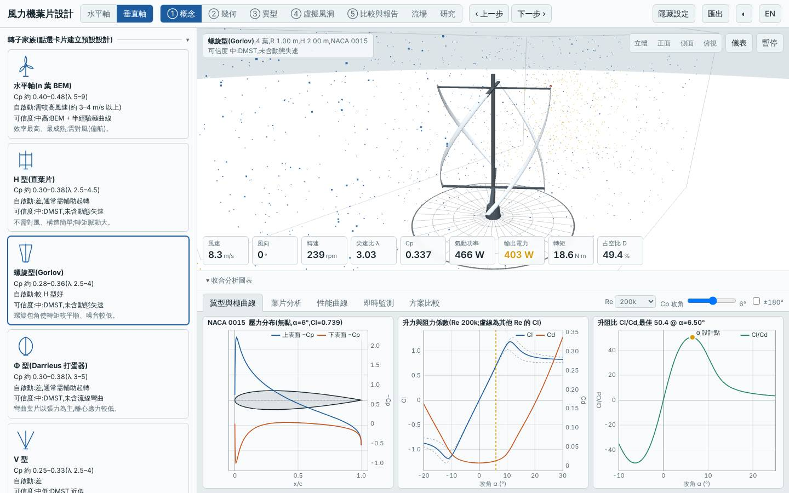
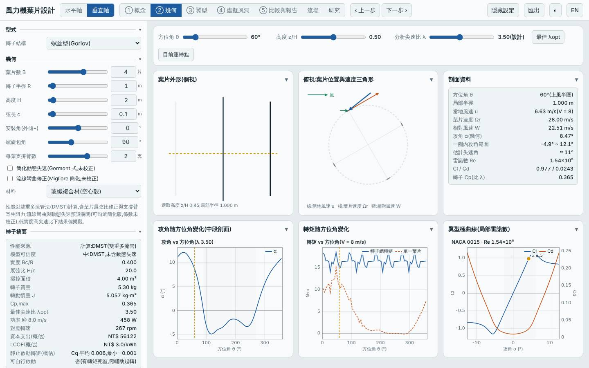
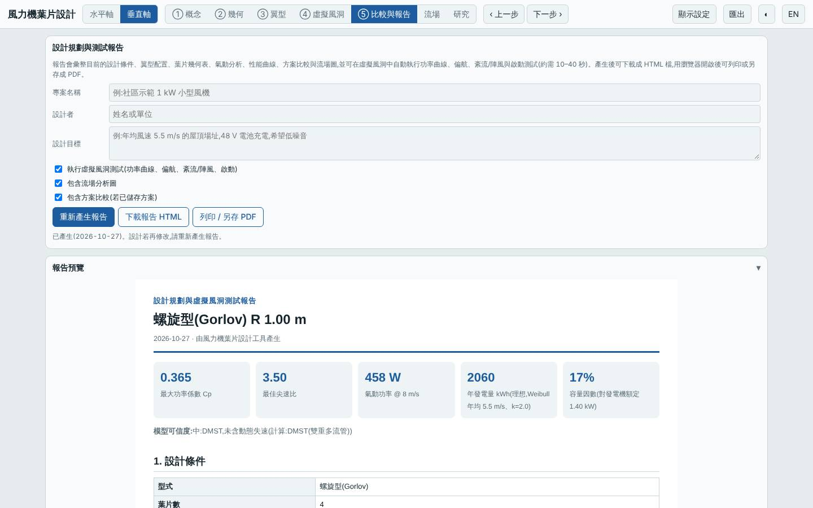
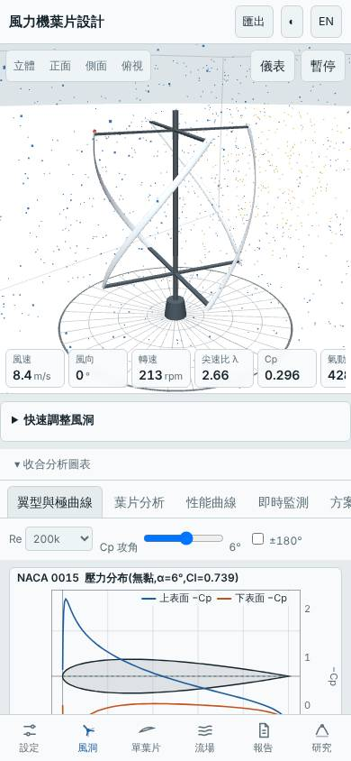

# 四葉細長螺旋型垂直軸(弦長 0.10 m)

- 日期:2026-10-27
- 相對基準的變更:垂直軸 H 型(3 葉、弦長 0.15 m、NACA 0018)→ 螺旋型 4 葉、扭轉 90°、弦長 0.10 m、翼型 NACA 0015(R 1.0 m、H 2.0 m 不變)
- 基準:本工具預設垂直軸 H 型(同風況 Weibull 5.5 m/s、k 2)

## 假設

預設 H 型實度約 0.225,葉片材料多、質量與成本偏高。改成 4 葉螺旋、弦長縮到 0.10 m(實度 0.20),預期質量與 LCOE 明顯下降、Cp,max 不降,螺旋也讓轉矩較平順;代價是葉片雷諾數變低,DMST 在這個區域偏樂觀,結果要保守解讀。

## 結果(模型預測,與基準比較)

| 項目 | 本設計 | 基準 H 型 | 差異 |
|---|---|---|---|
| Cp,max | 0.365 @ λ 3.5 | 0.334 @ λ 3.5 | +9.4% |
| 年發電量(理想 MPPT)| 2060 kWh | 1886 kWh | +9.2% |
| LCOE(概估)| 3.00 NT$/kWh | 3.22 NT$/kWh | −6.7% |
| 轉子質量 | 5.3 kg | 10.4 kg | −49% |
| 起轉風速(靜摩擦估算)| 2.8 m/s | 2.7 m/s | +0.1 m/s(相近)|
| 模擬自啟動(靜止起步 60 s)| 3、4、5 m/s 皆否(5 m/s 達 λ 1.14)| 皆否(5 m/s 達 λ 0.46)| 都需輔助起轉 |
| MPPT 追蹤率 6 / 9 m/s | 95% / 97% | 93% / 96% | 略佳 |

介面驗證:以「方案載入」流程載入建置後的網頁,介面算出的 Cp,max 0.3652 與 Node 評估一致,掃掠面積 4.00 m²、質量 5.30 kg 一致,報告的虛擬風洞測試正常完成,桌面與手機版無 console 錯誤;截圖確認畫面為四片螺旋葉片。

## 結論

假設大致成立:質量減半、年發電量 +9%、LCOE −7%。但仍不能自行啟動(5 m/s 靜止起步未達半個最佳 λ),實務上與 H 型一樣需要輔助起轉或加 Savonius 內轉子。

限制:弦長 0.10 m 在此尺寸的雷諾數偏低,極曲線是半經驗模型,DMST 未含動態失速與流線彎曲,細長葉片的優勢可能被高估;垂直軸沒有結構負載評估,0.10 m 弦長葉片的剛性與離心應力需另外檢核。所有數值為模型預測,非實測。

## 下一次可以試

- 同一設計開啟 `dynStall` 與 `curvature`,看細長葉片的優勢在較保守的模型下還剩多少
- 加大高寬比(R 0.7 m、H 3 m)並維持掃掠面積,看 LCOE 與起轉風速的變化

## 截圖

   
