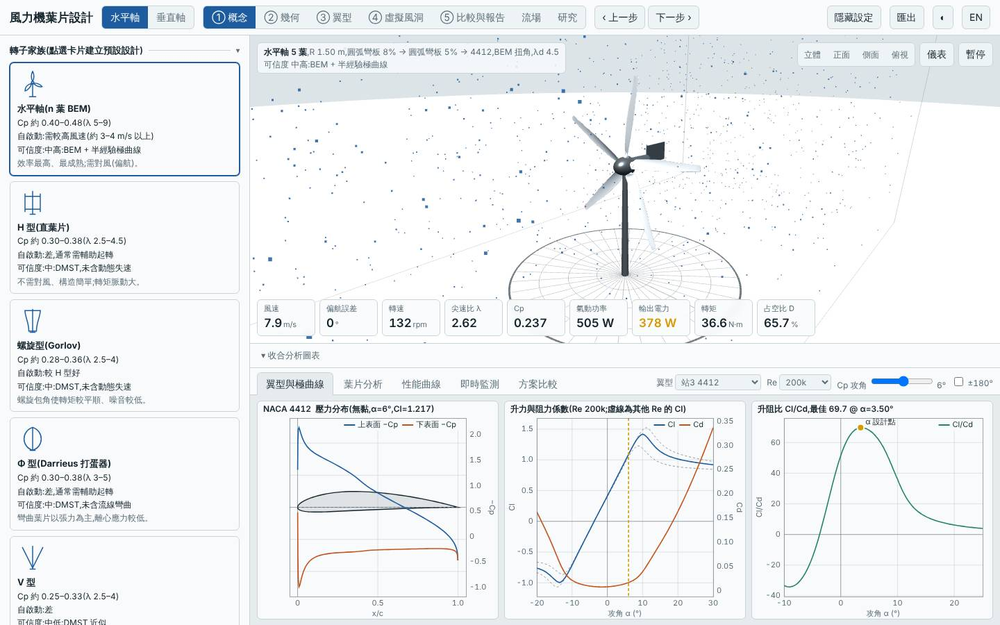
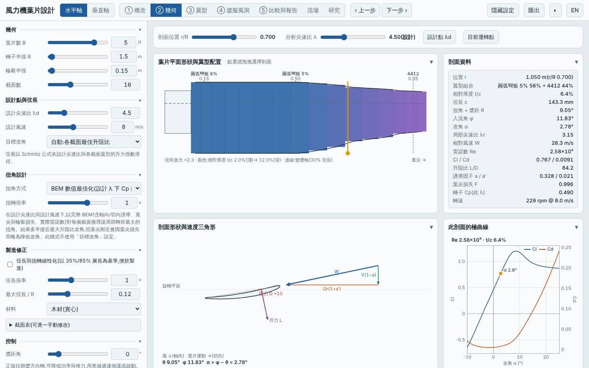
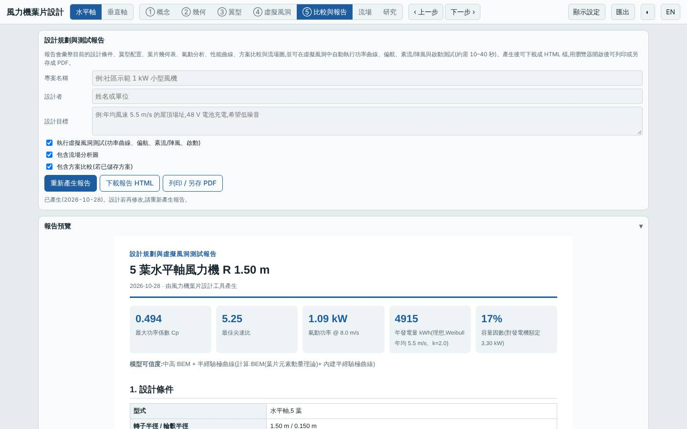
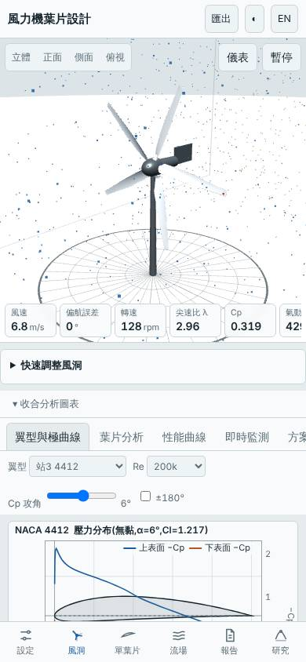

# 五葉圓弧板低風速轉子(λd 4.5、木材)

- 日期:2026-10-28
- 相對基準的變更:3 葉 → 5 葉、設計尖速比 7 → 4.5、材料玻纖 → 實心木材;翼型站由預設改為根部(r/R 0.15)圓弧板 8%、中段(0.5)圓弧板 5%、葉尖(0.95)NACA 4412
- 基準:預設三葉水平軸(同風況 Weibull 5.5 m/s、k 2,R 1.5 m)

## 假設

低風速場址用多葉、低尖速比、薄圓弧板翼型的木質葉片,預期起轉風速明顯下降、質量減少、LCOE 下降;代價是薄翼型的結構強度與剛性,預期安全係數與葉尖撓度會是瓶頸。

## 結果(模型預測,與基準比較)

| 項目 | 本設計 | 基準 | 差異 |
|---|---|---|---|
| Cp,max | 0.494 @ λ 5.25 | 0.478 @ λ 7.25 | +3.3% |
| 年發電量(理想 MPPT)| 4915 kWh | 4758 kWh | +3.3% |
| LCOE(概估)| 2.70 NT$/kWh | 2.75 NT$/kWh | −1.8% |
| 轉子質量 | 2.9 kg | 4.3 kg | −32% |
| 起轉風速(靜摩擦估算)| 2.1 m/s | 3.7 m/s | −1.6 m/s |
| 模擬自啟動(靜止起步 60 s)| 3、4、5 m/s 皆可 | 僅 5 m/s 可 | 明顯改善 |
| MPPT 追蹤率 6 / 9 m/s | 95% / 97% | 95% / 97% | 相當 |
| 50 m 雜訊 | 39.7 dB(A) | 46.7 dB(A) | −7.0 dB |
| 最小安全係數(額定/極端)| 1.15 / 0.14 | 5.97 / 2.65 | 大幅惡化 |
| 葉尖撓度 | 187 mm | 34 mm | 約 5.5 倍 |

介面驗證:以「方案載入」流程載入建置後的網頁,介面 Cp,max 0.4939 與 Node 評估一致,掃掠面積 7.07 m²、質量 2.95 kg 一致,報告的虛擬風洞測試正常完成,桌面與手機版無 console 錯誤;截圖確認為 5 葉、圓弧板 8%/5%/4412 的配置。

## 結論

假設部分成立:氣動與啟動性能如預期改善(起轉風速 3.7 → 2.1 m/s、3 m/s 即可自啟動、年發電量 +3.3%、雜訊低 7 dB),但**結構面不成立**:極端工況最小安全係數 0.14(< 1)、葉尖撓度 187 mm,以 2%–6% 厚度的木質薄板無法承受載荷。氣動優勢不能直接當成可製造的設計;若要實用,必須加厚翼型或換材料(例如 CFRP)再評估,質量與 LCOE 的優勢也會隨之縮小。

限制:極曲線為半經驗模型,對薄圓弧板的升力與失速估計誤差較大;Re 在 10⁵ 量級,模型偏樂觀的可能性高;結構評估只含根部彎曲與簡化撓度,未含顫振與疲勞。所有數值為模型預測,非實測。

## 下一次可以試

- 同一氣動配置,材料改 CFRP(或根部改 n4:0015 等較厚翼型),找出安全係數 ≥ 2 所需的最小質量增量
- 改探索 Savonius(`sav`)或 V 型垂直軸的低風速自啟動,與本設計的 2.1 m/s 起轉比較

## 截圖

   
