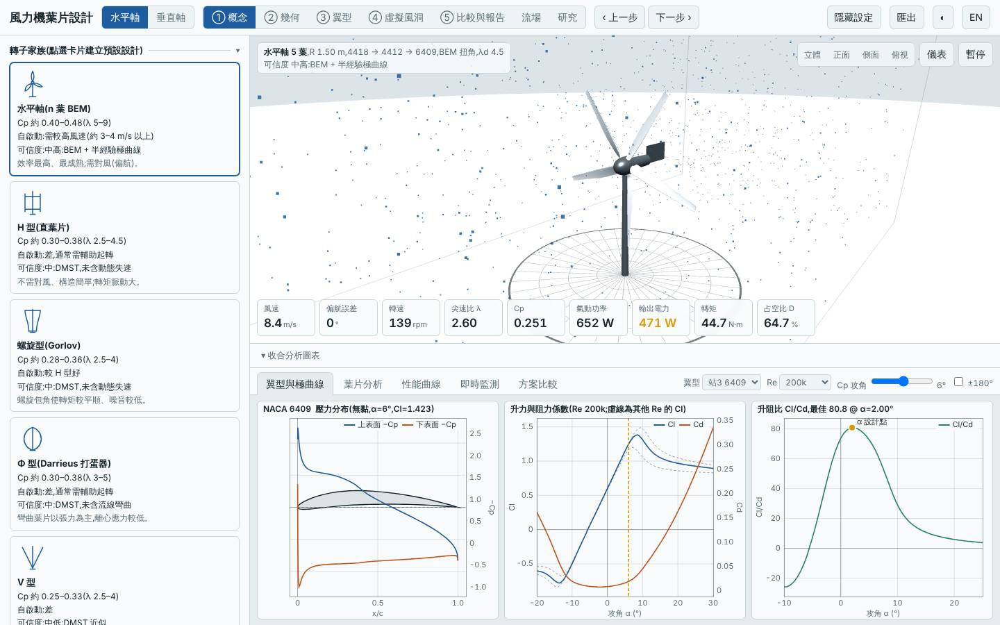
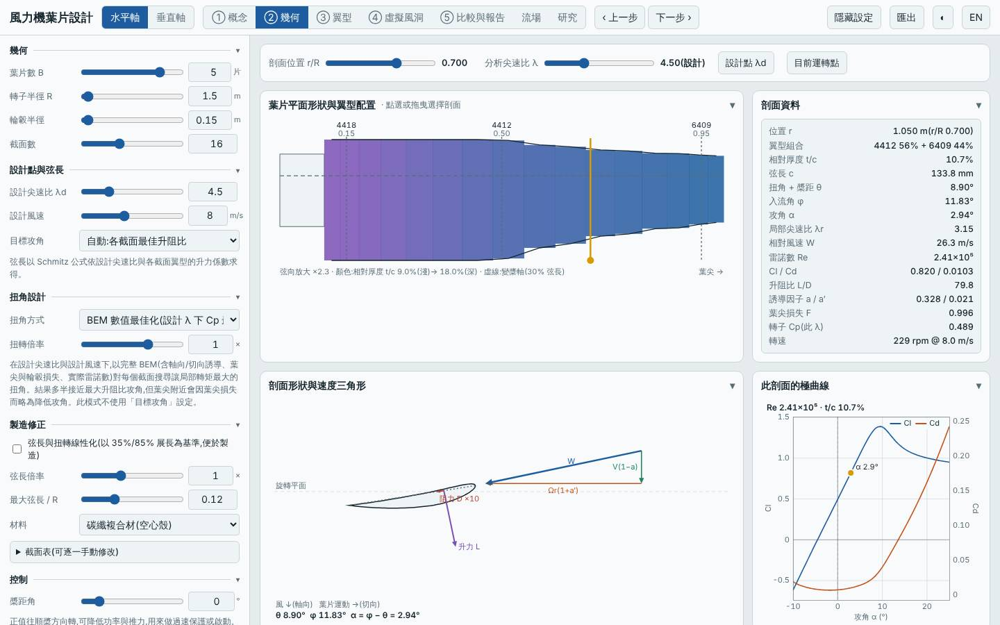
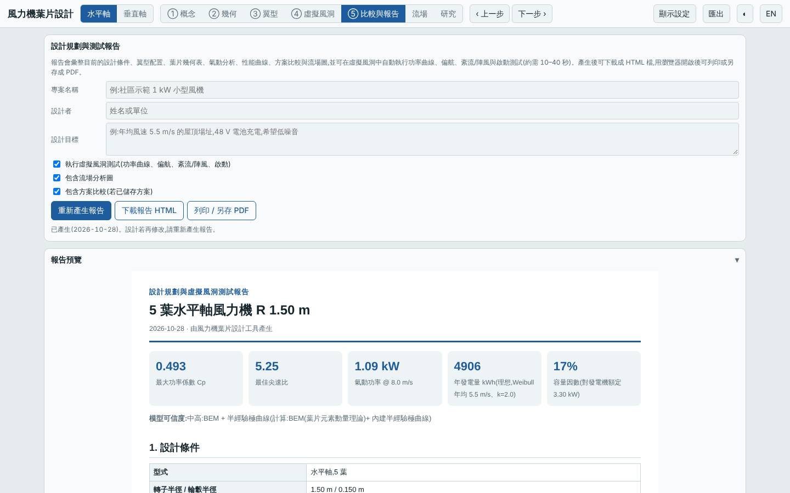
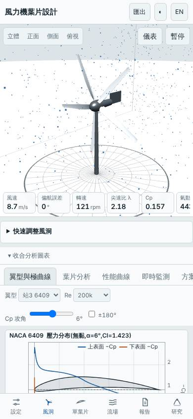

# 五葉低風速轉子(λd 4.5、CFRP、根部加厚)

- 日期:2026-10-28
- 相對基準的變更:3 葉 → 5 葉、設計尖速比 7 → 4.5、材料玻纖 → 碳纖維複合材(空心殼);翼型站為根部(r/R 0.15)NACA 4418、中段(0.5)NACA 4412、葉尖(0.95)NACA 6409
- 基準:預設三葉水平軸(同風況 Weibull 5.5 m/s、k 2,R 1.5 m)
- 延續前一個設計(五葉圓弧板、木材,結構不可行)的「下一次可以試」:同一氣動配置,以較厚翼型與 CFRP 補回結構

## 假設

沿用五葉 λd 4.5 低風速配置,改用較厚的 NACA 4 位數翼型與 CFRP。預期起轉風速仍低於基準(< 2.7 m/s)、年發電量不低於基準,最小安全係數 ≥ 2、葉尖撓度 < 60 mm;代價是質量與 LCOE 高於木質圓弧板版本。

## 結果(模型預測,與基準、前一版比較)

| 項目 | 本設計 | 基準 | 五葉圓弧板木材版 |
|---|---|---|---|
| Cp,max | 0.493 @ λ 5.25 | 0.478 @ λ 7.25 | 0.494 |
| 年發電量(理想 MPPT)| 4906 kWh(+3.1%)| 4758 kWh | 4915 kWh |
| LCOE(概估)| 2.92 NT$/kWh(+6.3%)| 2.75 | 2.70 |
| 轉子質量 | 5.1 kg(+18%)| 4.3 kg | 2.9 kg |
| 起轉風速(靜摩擦估算)| 2.2 m/s | 3.7 m/s | 2.1 m/s |
| 模擬自啟動(靜止起步 60 s)| 3、4、5 m/s 皆可 | 僅 5 m/s 可 | 3、4、5 m/s 皆可 |
| MPPT 追蹤率 6 / 9 m/s | 95% / 97% | 95% / 97% | 95% / 97% |
| 50 m 雜訊 | 39.7 dB(A) | 46.7 dB(A) | 39.7 dB(A) |
| 最小安全係數(額定 / 極端)| 33.1 / 4.61 | 5.97 / 2.65 | 1.15 / 0.14 |
| 葉尖撓度 | 5.4 mm | 34 mm | 187 mm |

介面驗證:以「方案載入」流程載入建置後的網頁,介面 Cp,max 0.4930 與 Node 評估一致,掃掠面積 7.069 m²、質量 5.10 kg 一致,報告的虛擬風洞測試正常完成,桌面與手機版無 console 錯誤;截圖確認為 5 葉、4418/4412/6409 的配置。

## 結論

假設成立:氣動性能與起轉特性與木質圓弧板版本幾乎相同(Cp,max 0.493、起轉風速 2.2 m/s、3 m/s 即可自啟動),結構問題則消失(極端安全係數 0.14 → 4.61、撓度 187 → 5.4 mm)。代價是質量 2.9 → 5.1 kg,LCOE 2.70 → 2.92 NT$/kWh,比基準高約 6%。換言之,在本模型下這個低風速轉子年發電量只多約 3%,成本卻較高,**主要價值是低風速自啟動與低雜訊**,而非經濟性。安全係數 33 顯示 CFRP 在此尺寸下結構過度充裕,仍有減重空間。

限制:極曲線為半經驗模型,Re 在 10⁵ 量級,模型偏樂觀的可能性高;結構評估只含根部彎曲與簡化撓度,未含顫振與疲勞;CFRP 成本為概估。所有數值為模型預測,非實測。

## 3D 模型

`model/` 內含以本工具幾何放樣(與介面匯出 STL 同一函式)產生的單葉片 `blade.stl`(mm)、五葉轉子 `rotor.stl`、`rotor.obj`,以及 Blender 匯入腳本 `blender_import.py`(匯入、材質、相機、存成 .blend)。排程容器沒有 Blender,腳本未實際執行過,.blend 需在本機執行腳本產生。

## 下一次可以試

- 材料降為 GFRP 或 wood 搭配本翼型組,找出安全係數 ≈ 2 的最輕、最便宜組合
- 改為 4 葉或 6 葉(同 λd 4.5)比較葉片數對 LCOE 與起轉風速的影響

## 截圖

   
