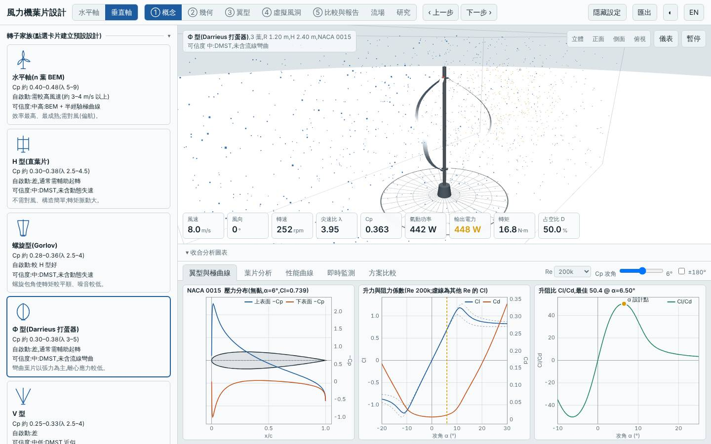
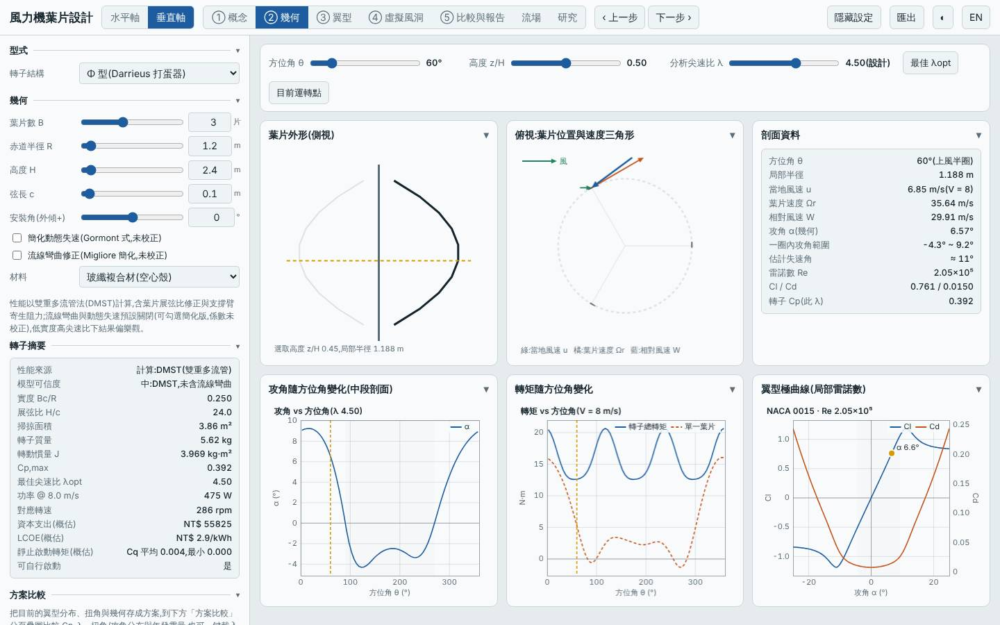
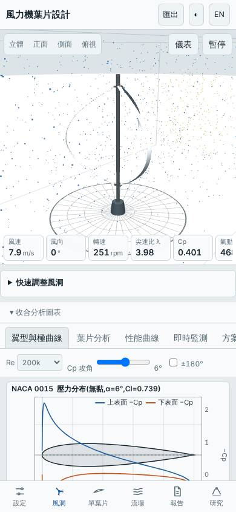

# 三葉細長 Φ 型垂直軸(R 1.2 m、弦長 0.10 m)

- 日期:2026-10-29
- 相對基準的變更:H 型 → Φ 型(曲線葉片)、R 1.0 → 1.2 m、H 2.0 → 2.4 m、弦長 0.15 → 0.10 m、翼型 NACA 0018 → 0015
- 基準:預設 H 型垂直軸(同風況 Weibull 5.5 m/s、k 2);另與前一個垂直軸設計(四葉細長螺旋)比較
- 延續:前一個垂直軸設計只探索螺旋家族,本次換成 Φ 型

## 假設

Φ 型曲線葉片靠張力承載、不需橫桿;三葉、細長弦長、較大半徑,預期 Cp,max ≥ 0.38、年發電量高於基準 H 型與螺旋細長版、質量低於基準;代價是低雷諾數下 DMST 偏樂觀,且起轉風速仍高。

## 結果(模型預測)

| 項目 | 本設計 | 基準 H 型 | 四葉細長螺旋 |
|---|---|---|---|
| Cp,max | 0.392 @ λ 4.5 | 0.334 @ λ 3.5 | 0.365 @ λ 3.5 |
| 年發電量(理想 MPPT)| 2126 kWh(+12.7%)| 1886 kWh | 2060 kWh |
| LCOE(概估)| 2.89 NT$/kWh(−10.2%)| 3.22 | 3.00 |
| 轉子質量 | 5.6 kg(−45.9%)| 10.4 kg | 5.3 kg |
| 掃掠面積 | 3.86 m² | 4.0 m² | 4.0 m² |
| 起轉風速(靜摩擦估算)| 2.8 m/s | 2.7 m/s | 2.8 m/s |
| 模擬自啟動(3/4/5 m/s)| 皆否 | — | 皆否 |
| MPPT 追蹤率 6 / 9 m/s | 95% / 97% | — | 95% / 97% |

介面驗證:以方案載入流程載入建置後網頁,介面 Cp,max 0.3924 與 Node 評估一致,掃掠面積 3.859 m²、質量 5.62 kg 一致,報告與虛擬風洞測試完成,桌面與手機版無 console 錯誤;截圖確認為 Φ 型三葉、R 1.20 m、H 2.40 m、NACA 0015。

## 結論

假設大致成立:Cp,max、年發電量、質量與 LCOE 都優於基準 H 型,Cp,max 也高於螺旋細長版;但三個風速的靜止起步模擬都無法自行啟動,仍需輔助起轉。Cp 的優勢落在 λ 3.75–5.75、弦長 0.10 m 的低雷諾數區,**正是 DMST 已知偏樂觀的區域**,且模型含曲線葉片的只有流線彎曲以外的簡化,實際優勢應打折看待。適合有輔助起轉、場址風速中等的小型垂直軸。

限制:極曲線為半經驗模型;DMST 未含動態失速與流線彎曲;未評估垂直軸結構(安全係數為空);所有數值為模型預測,非實測。

## 3D 模型

`model/` 內含以本工具幾何放樣(與介面匯出 STL 同一函式 `GEO.vawtBlade`)產生的單葉片 `blade.stl`(mm)、三葉轉子 `rotor.stl`(mm)、`rotor.obj`(m),以及 Blender 匯入腳本 `blender_import.py`。排程容器沒有 Blender,腳本只做過語法檢查、未實際執行,.blend 需在本機執行腳本產生。

## 下一次可以試

- 同一 Φ 型加大弦長(0.15–0.20 m)並開啟 `dynStall`,看自啟動是否改善、Cp 損失多少
- 改試 Savonius 或 Savonius 與 Darrieus 的搭配思路(`vawt.type: sav`),專攻低風速自啟動

## 截圖

   
