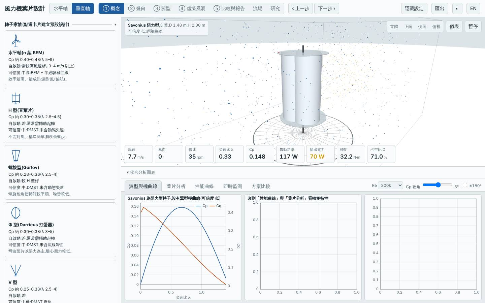
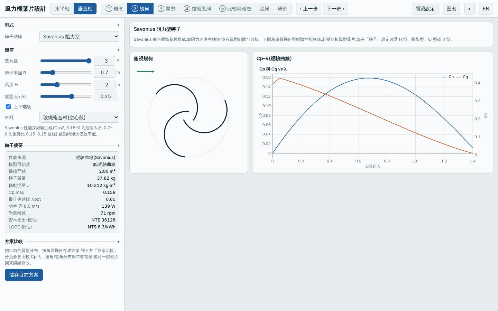
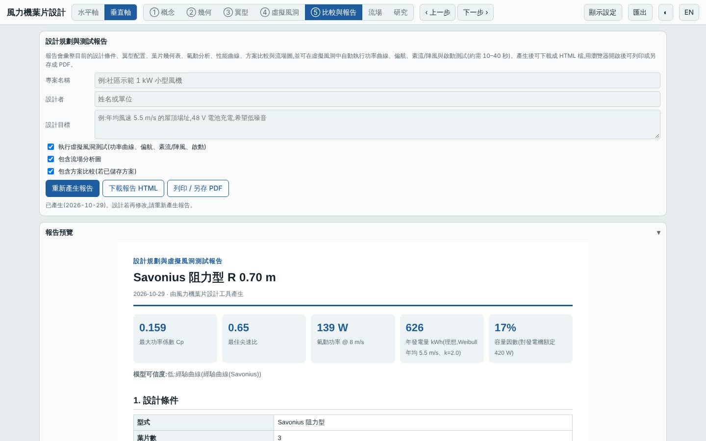
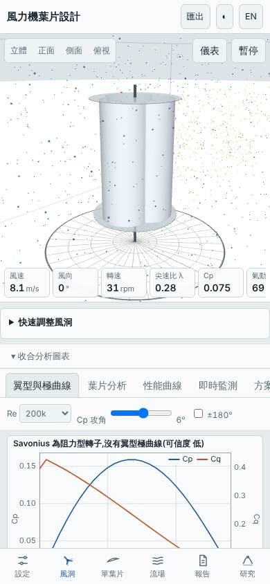

# 三葉 Savonius 阻力型垂直軸(重疊比 0.25、端板)

- 日期:2026-10-29
- 相對基準的變更:垂直軸預設 H 型(3 葉、R 1 m、H 2 m、NACA 0018)→ Savonius 阻力型,3 葉、重疊比 0.25、加端板、R 0.7 m、H 2 m、玻纖
- 基準:同模式預設設計(H 型),同風況 Weibull 5.5 m/s、k 2

## 假設

阻力型 Savonius 靜止即可啟動、雜訊低、構造簡單。預期起轉風速 < 2 m/s,代價是 Cp,max 僅 0.2 級、年發電量與 LCOE 遠劣於 H 型。曲線為經驗模型,可信度低,只作相對趨勢參考。

## 結果(模型預測,與同模式基準比較)

| 項目 | 本設計 | 基準(H 型)|
|---|---|---|
| Cp,max | 0.159 @ λ 0.65 | 0.334 @ λ 3.5 |
| 年發電量(理想 MPPT)| 626 kWh(−66.8%)| 1886 kWh |
| LCOE(概估)| 6.35 NT$/kWh(+97%)| 3.22 |
| 轉子質量 | 37.8 kg(+264%)| 10.4 kg |
| 起轉風速(靜摩擦估算)| 0.7 m/s | 2.7 m/s |
| 模擬自啟動(靜止起步 60 s)| 3、4、5 m/s 皆可 | 需輔助起轉 |
| MPPT 追蹤率 6 / 9 m/s | 88% / 93% | — |

介面驗證:以方案載入流程載入建置後的網頁,介面 Cp,max 0.1588 與 Node 評估一致,掃掠面積 2.800 m²、質量 37.82 kg 一致,報告的虛擬風洞測試完成,桌面與手機版無 console 錯誤;截圖確認為三葉 Savonius 加端板。

## 結論

假設成立:起轉風速 0.7 m/s、3 m/s 起即可自啟動,是目前排行榜中唯一不需輔助起轉的垂直軸;但 Cp,max 只有基準的 48%,年發電量約 1/3、質量為 3.6 倍,LCOE 近兩倍。適合「極低風速、需要自啟動、不在意效率」的場合,不適合發電量導向。6 m/s 的 MPPT 追蹤率 88%,略低於 90% 門檻(該門檻是 e2e 對預設設計的要求,本實驗不適用)。

限制:Savonius 為經驗曲線,可信度低;質量估算依簡化殼厚,實際結構與強度未評估;模型不含轉矩脈動。所有數值為模型預測,非實測。

## 3D 模型

`model/` 內含 `make_model.mjs`(純 Node,以與介面 3D 風洞相同的幾何產生三個半圓筒葉片、兩片端板與轉軸)、`rotor.stl`(mm)、`rotor.obj`(m)與 Blender 匯入腳本 `blender_import.py`。排程容器沒有 Blender 且無法安裝,腳本未實際執行,`.blend` 需在本機執行腳本產生。

## 下一次可以試

- 兩葉 Savonius 搭配較大重疊比(0.3–0.35),看 Cp,max 與起轉風速的取捨
- Φ 型或 V 型垂直軸(尚未探索),加 `dynStall` 與 `curvature` 修正比較

## 截圖

   
