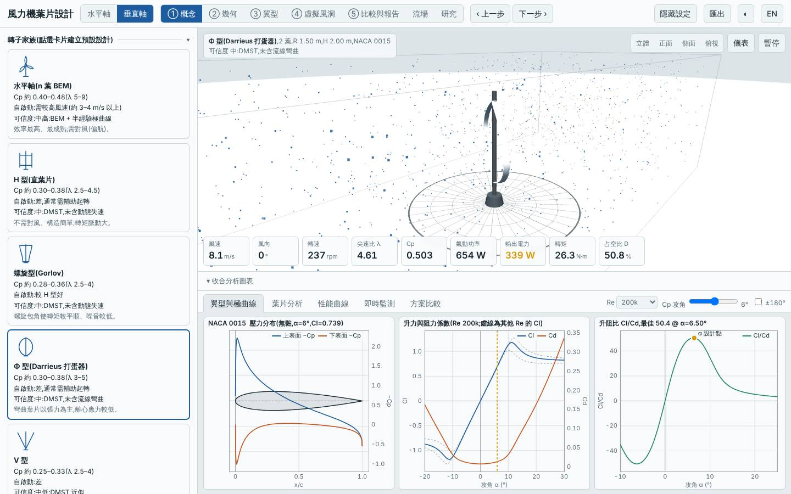
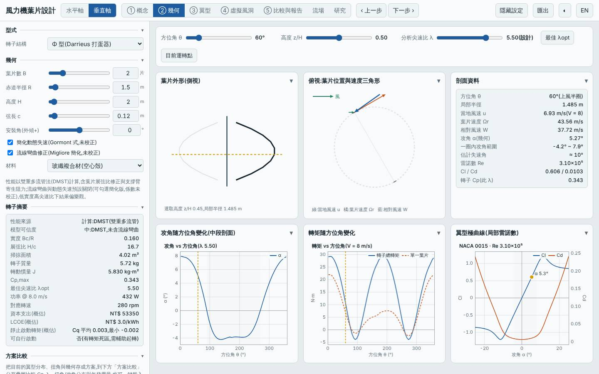
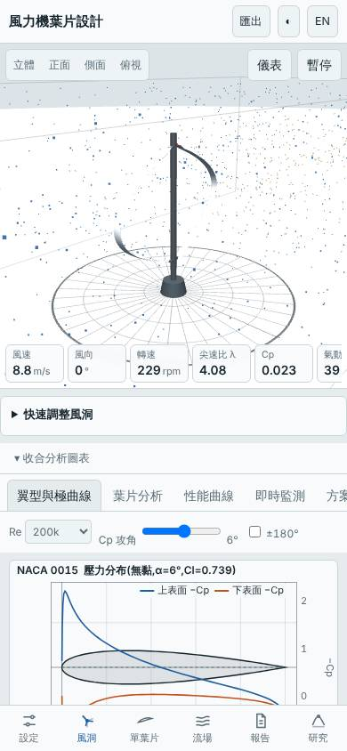

# 兩葉 Φ 型垂直軸放大(R 1.5 m、開啟流線彎曲與動態失速)

- 日期:2026-10-30
- 相對基準的變更:垂直軸 H 型(3 葉、R 1 m、c 0.15 m、NACA 0018)→ Φ 型、2 葉、R 1.5 m、c 0.12 m、NACA 0015、開啟 `curvature` 與 `dynStall`(H 2 m 不變)
- 基準:同模式預設設計(H 型),同風況 Weibull 5.5 m/s、k 2
- 承接上一個設計(三葉 Φ 型 R 1 m)的「下一次可以試」兩項;此處合併為一個設計,因此 Cp 的變化來自半徑、葉片數與保守假設三者疊加,無法單獨拆分

## 假設

上一個三葉 Φ 型 Cp,max 高但掃掠面積小,年發電量少 24%。放大半徑到 1.5 m(掃掠面積 4.02 m²,與基準 4.00 m² 相當)並改兩葉,預期年發電量不低於基準、質量仍明顯較輕;同時開啟較保守的流線彎曲與動態失速修正,檢查 Φ 型優勢在較保守假設下是否仍在。代價:稀實度使 Cp,max 下降、起轉風速仍高。

## 結果(模型預測)

| 項目 | 本設計 | 基準(預設 H 型) | 差異 |
|---|---|---|---|
| Cp,max | 0.343 @ λ 5.5 | 0.334 @ λ 3.5 | +2.8% |
| 掃掠面積 | 4.02 m² | 4.00 m² | +0.5% |
| 年發電量(理想 MPPT)| 1941 kWh | 1886 kWh | +2.9% |
| LCOE(概估)| 3.02 NT$/kWh | 3.22 | −6.0% |
| 轉子質量 | 5.7 kg | 10.4 kg | −45% |
| 起轉風速(靜摩擦估算)| 2.77 m/s | 2.70 m/s | +0.07 m/s |
| 模擬自啟動(3/4/5 m/s 靜止起步 60 s)| 皆否 | — | 需輔助起轉 |
| MPPT 追蹤率 6 / 9 m/s | 92% / 96% | — | |

介面驗證(`lab:ui`):以方案載入流程載入建置後網頁,介面 Cp,max 0.3430 與 Node 評估一致,掃掠面積 4.020 m²、質量 5.72 kg 一致;報告的虛擬風洞測試完成,桌面與手機版無 console 錯誤;截圖確認為 Φ 型 2 葉 R 1.50 m、NACA 0015,且 `curvature`/`dynStall` 已勾選。

## 結論

大致成立:掃掠面積補回後年發電量 +2.9%、質量 −45%、LCOE −6%,Φ 型在保守假設下仍保有優勢。但年發電量優勢很小,且 Cp,max 的 +2.8% 落在 DMST 模型誤差內,不宜解讀為氣動上更好;主要收益來自質量(成本)。兩葉在 λ 5.5 才達最大 Cp,轉速高、起轉風速未改善,仍需輔助起轉。

限制:DMST 未含完整流線彎曲/動態失速(此處用的是簡化版修正),弦長 0.12 m 的 Re 偏低、λ 5.5 屬 DMST 偏樂觀區;結構強度與離心負載未評估(垂直軸無安全係數指標)。所有數值為本工具的模型預測,非實測。

## 3D 模型

`model/` 內有以本工具幾何放樣(與介面匯出 STL 同一函式)產生的單葉片 `blade.stl`、兩葉轉子 `rotor.stl`(mm、Y 軸向上),以及 Blender 匯入腳本 `blender_import.py`。排程容器沒有 Blender(也無法安裝 bpy),.blend 未產生,腳本未實際執行過,需在本機執行。

## 下一次可以試

- 兩葉 Φ 型改 NACA 0018 或 0021、弦長 0.15 m,檢查較厚翼型在低 Re 下是否改善起轉並提高結構裕度
- 水平軸兩葉高尖速比(λd 9、R 1.5 m)與本設計比較同一掃掠面積下的年發電量與質量

## 截圖

   
