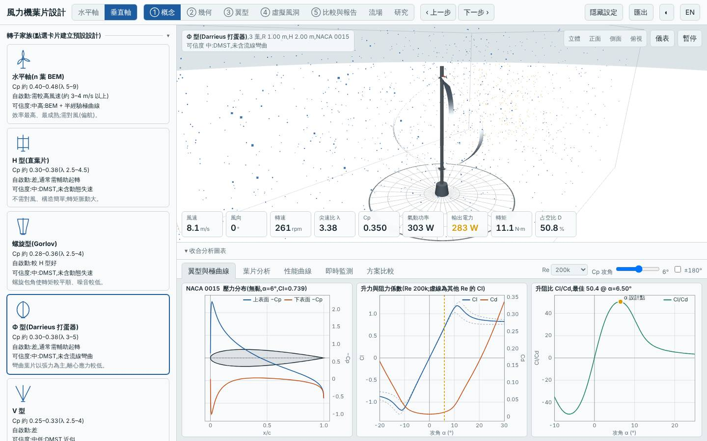
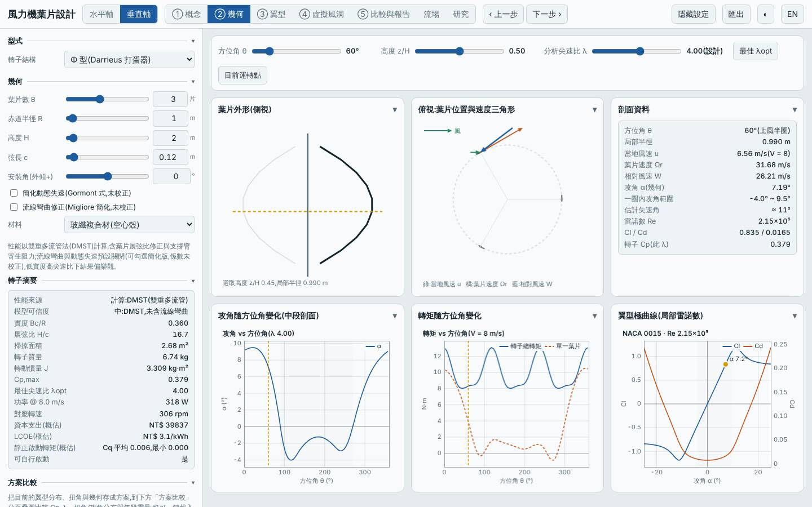
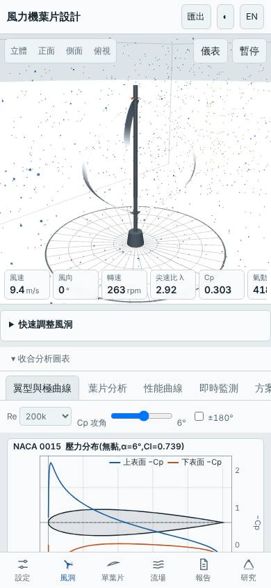

# 三葉 Φ 型(打蛋器)垂直軸(弦長 0.12 m、NACA 0015)

- 日期:2026-10-30
- 相對基準的變更:垂直軸 H 型(3 葉、c 0.15 m、NACA 0018)→ Φ 型、3 葉、弦長 0.12 m、NACA 0015(R 1 m、H 2 m 不變)
- 基準:同模式預設設計(H 型),同風況 Weibull 5.5 m/s、k 2
- 前幾個設計以水平軸與螺旋型為主,本次改探索尚未試過的 Φ 型

## 假設

Φ 型彎曲葉片受力以張力為主、無支臂,且葉片分布於不同半徑,預期 Cp,max 高於預設 H 型、起轉風速較低、質量較小;代價是掃掠面積較小(2.68 vs 4 m²),年發電量因而下降,且 DMST 未含流線彎曲而偏樂觀。

## 結果(模型預測)

| 項目 | 本設計 | 基準(預設 H 型) | 差異 |
|---|---|---|---|
| Cp,max | 0.379 @ λ 4.0 | 0.334 @ λ 3.5 | +13.5% |
| 掃掠面積 | 2.68 m² | 4.00 m² | −33% |
| 年發電量(理想 MPPT)| 1431 kWh | 1886 kWh | −24.2% |
| LCOE(概估)| 3.06 NT$/kWh | 3.22 | −4.8% |
| 轉子質量 | 6.7 kg | 10.4 kg | −35% |
| 起轉風速(靜摩擦估算)| 2.48 m/s | 2.70 m/s | −0.2 m/s |
| 模擬自啟動(3/4/5 m/s 靜止起步 60 s)| 皆否 | — | 仍需輔助起轉 |
| MPPT 追蹤率 6 / 9 m/s | 94% / 97% | — | |

介面驗證:以方案載入流程載入建置後網頁,介面 Cp,max 0.3788 與 Node 評估一致,掃掠面積 2.680 m²、質量 6.74 kg 一致;報告的虛擬風洞測試完成,桌面與手機版無 console 錯誤;截圖確認為 Φ 型 3 葉 NACA 0015。

## 結論

部分成立:Cp,max 提高 13.5%、質量減 35%、LCOE 降 4.8%,起轉風速略降,但掃掠面積小三分之一,年發電量反而少 24%,且與所有垂直軸一樣在 3–5 m/s 無法自行啟動。適合「單位重量與成本」優先、場地寬度受限的情況,不適合追求總發電量。

限制:DMST 未含流線彎曲與動態失速,Re 低(弦長 0.12 m)區域偏樂觀,Cp 優勢可能被高估。所有數值為本工具的模型預測,非實測。

## 3D 模型

`model/` 內有以本工具幾何放樣(與介面匯出 STL 同一函式)產生的單葉片 `blade.stl`、三葉轉子 `rotor.stl`(mm、Y 軸向上),以及 Blender 匯入腳本 `blender_import.py`。排程容器沒有 Blender,.blend 未產生,需在本機執行腳本。

## 下一次可以試

- 兩葉 Φ 型加大半徑(R 1.3 m),把掃掠面積補回,看年發電量能否超越 H 型基準
- 開啟 `curvature`/`dynStall` 選項,檢查 Φ 型優勢在較保守假設下是否仍存在

## 截圖

   
