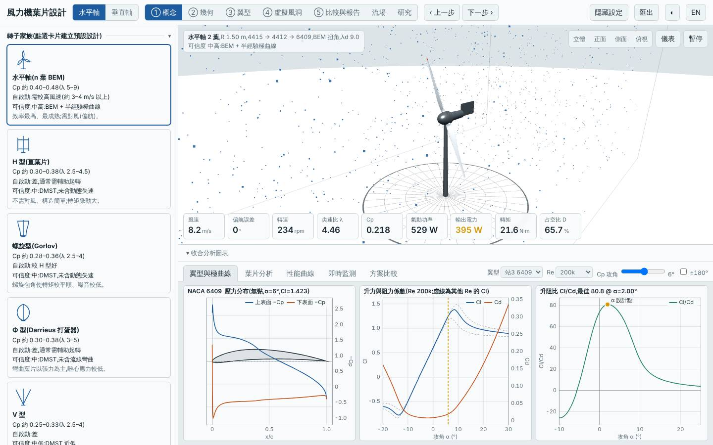
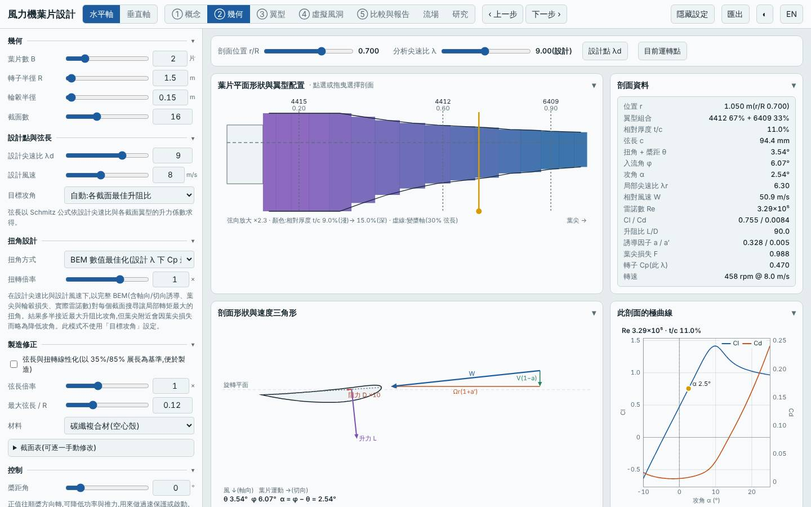
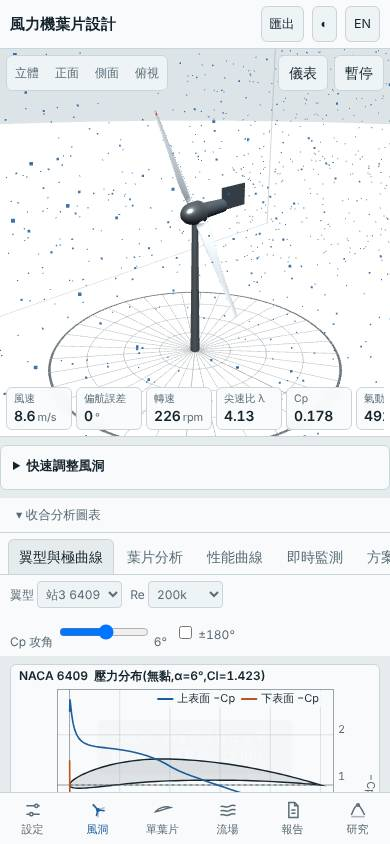

# 兩葉高尖速比水平軸(λd 9、薄翼型、CFRP)

- 日期:2026-10-31
- 相對基準的變更:預設三葉水平軸(λd 7、GFRP、4421/4415/4412)→ 兩葉、λd 9、CFRP、翼型站 4415(r/R 0.2)/ 4412(0.6)/ 6409(0.9);R 1.5 m 不變
- 基準:同模式預設設計,同風況 Weibull 5.5 m/s、k 2
- 前面水平軸都是往「多葉低 λ」走(四葉 λd 5.5、五葉 λd 4.5),本次反向探索「少葉高 λ」

## 假設

兩葉高尖速比的稀實度轉子,葉片總面積小,質量應大幅下降;Cp,max 因高 λ 下翼型升阻比利用率高而與基準相近。代價預期是起轉風速升高(低 λ 扭矩小)、雜訊上升,且低風速場址(平均 5.5 m/s)年發電量未必勝過基準。

## 結果(模型預測)

| 項目 | 本設計 | 基準(預設三葉) | 差異 |
|---|---|---|---|
| Cp,max | 0.470 @ λ 9.25 | 0.478 @ λ 7.25 | −1.8% |
| Cp ≥ 90% 的 λ 範圍 | 6.75–12.25 | — | 寬 |
| 年發電量(理想 MPPT)| 4684 kWh | 4758 kWh | −1.5% |
| LCOE(概估)| 2.82 NT$/kWh | 2.75 | +2.5% |
| 轉子質量 | 1.43 kg | 4.33 kg | −67% |
| 起轉風速(靜摩擦估算)| 5.63 m/s | 3.73 m/s | +1.9 m/s |
| 模擬自啟動(3/4/5 m/s 靜止起步 60 s)| 皆否 | 5 m/s 可 | 惡化 |
| 最小安全係數 / 極端 | 5.47 / 3.61 | 5.97 | 略低但仍 > 3 |
| 葉尖撓度 | 35 mm | — | 可接受 |
| 雜訊(50 m)| 52 dB(A)| — | 高 λ 預期偏高 |
| MPPT 追蹤率 6 / 9 m/s | 96% / 97% | — | |

介面驗證(`lab:ui`):以方案載入流程載入建置後網頁,介面 Cp,max 0.4697 與 Node 評估一致,掃掠面積 7.069 m²、質量 1.43 kg 一致;報告的虛擬風洞測試完成,桌面與手機版無 console 錯誤;截圖確認為兩葉轉子、翼型站 6409。

## 結論

大致成立:質量降 67%(4.3 → 1.4 kg),Cp,max 與年發電量只差 −1.8% / −1.5%,Cp ≥ 90% 範圍很寬(λ 6.75–12.25)。代價是起轉風速 3.7 → 5.6 m/s 且 3–5 m/s 皆無法自行啟動,在平均風速 5.5 m/s 的場址需要輔助起轉或加大起轉扭矩;LCOE 因 CFRP 材料單價高而略升 2.5%(質量省下的錢被材料吃掉)。適合有輔助起轉、風速較高或重量/慣量敏感(如需快速偏航)的場合,不適合低風速自啟動優先的場址。

限制:弦長小、高 λ 的 Re 偏低,半經驗極曲線在此區域偏樂觀,Cp 與年發電量的損失可能被低估;雜訊為經驗估算;起轉風速為靜摩擦估算。所有數值為本工具的模型預測,非實測。

## 3D 模型

`model/` 內有 `make_model.mjs`(純 Node,以本工具 `hawtBlade` 放樣,與介面匯出 STL 同一函式)產生的單葉片 `blade.stl`、兩葉轉子 `rotor.stl`(mm、轉子軸 Z,含輪轂與主軸),以及 Blender 匯入腳本 `blender_import.py`。排程容器沒有 Blender(也無法安裝 bpy),.blend 未產生、腳本未實際執行過,需在本機執行。

## 下一次可以試

- 兩葉高 λ 轉子改用 GFRP 或木材,確認 LCOE 能否回到基準以下;並加大根部弦長(`maxChord`)改善起轉
- 三葉 λd 9 與本設計比較:同為高 λ 時,第三片葉片換來的起轉與 Cp 是否值得多出的質量

## 截圖

   
