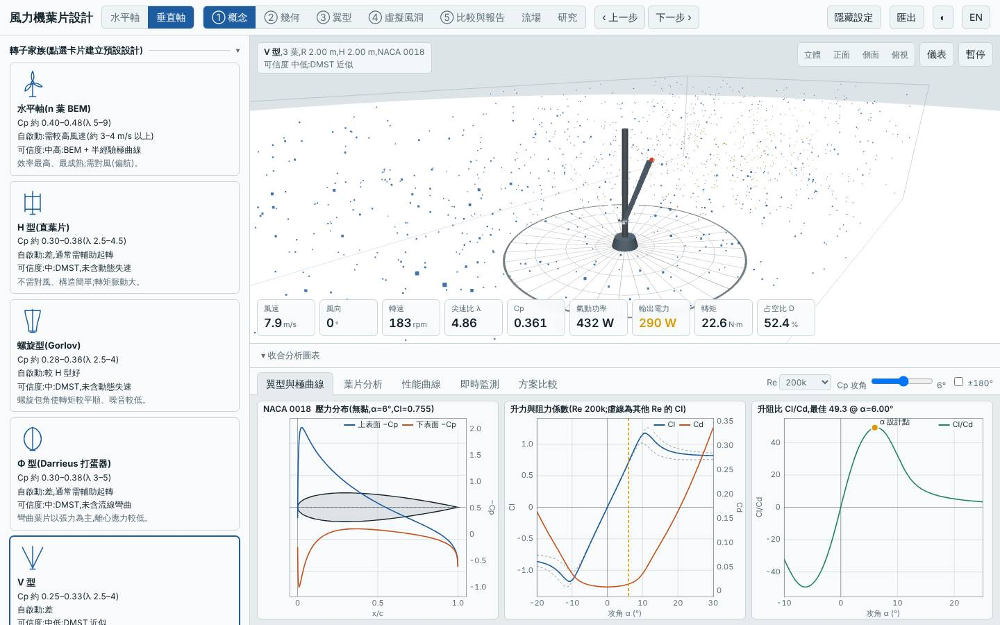
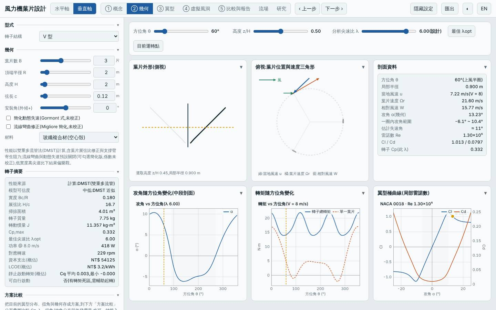
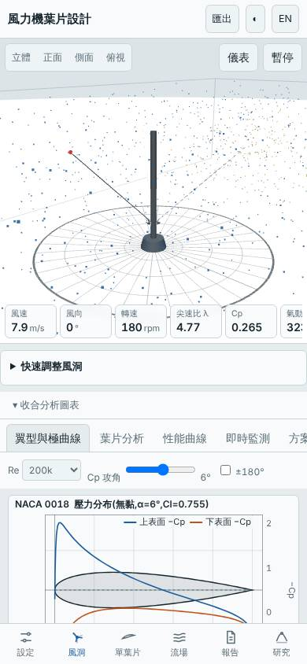

# 三葉 V 型垂直軸(頂端 R 2 m、弦長 0.12 m、NACA 0018)

- 日期:2026-11-01(承接 #171 同日合併的 R 1 m 三葉 V 型,本設計把頂端半徑放大到 2 m 以補回掃掠面積)
- 相對基準的變更:垂直軸 H 型(3 葉、R 1 m、H 2 m、c 0.15 m)→ V 型、3 葉、頂端半徑 R 2 m、H 2 m、c 0.12 m(翼型 NACA 0018 不變)
- 基準:同模式預設設計(H 型),同風況 Weibull 5.5 m/s、k 2
- V 型是排行榜上第一個此家族的設計;先前垂直軸探索過螺旋型、Φ 型與 Savonius

## 假設

V 型葉片向兩側斜張,只有頂端半徑為 R,平均掃掠半徑較小。把頂端半徑放大到 2 m,使掃掠面積約 4.0 m²(與 H 型基準相當),預期 Cp,max 與年發電量和基準相近、短弦長使質量下降;代價是 DMST 對斜葉片的可信度較低、起轉風速仍高。

## 結果(模型預測)

| 項目 | 本設計 | 基準(預設 H 型) | 差異 |
|---|---|---|---|
| Cp,max | 0.332 @ λ 6.0 | 0.334 @ λ 3.5 | −0.5% |
| 掃掠面積 | 4.01 m² | 4.00 m² | +0.2% |
| 年發電量(理想 MPPT)| 1882 kWh | 1886 kWh | −0.2% |
| LCOE(概估)| 3.16 NT$/kWh | 3.22 | −1.6% |
| 轉子質量 | 7.75 kg | 10.38 kg | −25% |
| 起轉風速(靜摩擦估算)| 2.67 m/s | 2.70 m/s | 幾乎相同 |
| 模擬自啟動(3/4/5 m/s 靜止起步 60 s)| 皆否 | — | 需輔助起轉 |
| MPPT 追蹤率 6 / 9 m/s | 97% / 97% | — | |

介面驗證(`lab:ui`):介面 Cp,max 0.3323 與 Node 評估一致,掃掠面積 4.008 m²、質量 7.75 kg 一致;報告的虛擬風洞測試完成,桌面與手機版無 console 錯誤;截圖確認為 V 型 3 葉、頂端 R 2 m、NACA 0018。

## 結論

大致成立:同一掃掠面積下,V 型與 H 型的 Cp,max 與年發電量幾乎相同(差 −0.5% / −0.2%,在 DMST 誤差內),質量降 25%、LCOE 降 1.6%。V 型沒有帶來氣動上的優勢,收益主要來自較短弦長;最佳 λ 由 3.5 升到 6.0,轉速高、起轉風速未改善,仍需輔助起轉。風切下是否有利,本工具無地面邊界層,無法驗證。

限制:λ 6 屬 DMST 偏樂觀區,0.12 m 弦長的 Re 偏低;V 型斜葉片的結構強度、離心與彎矩未評估,實際還需要支撐臂;DMST 對傾斜葉片的修正是近似。所有數值為本工具的模型預測,非實測。

## 3D 模型

`model/` 內有 `make_model.mjs`(純 Node,以本工具 `vawtBlade` 放樣,與介面匯出 STL 同一函式)產生的單葉片 `blade.stl`、三葉轉子 `rotor.stl`(mm、Y 軸向上,含示意中心軸、不含支撐臂),以及 Blender 匯入腳本 `blender_import.py`。排程容器沒有 Blender(也無法安裝 bpy),.blend 未產生、腳本未實際執行過,需在本機執行。

## 下一次可以試

- V 型改兩葉、頂端 R 2.2 m 加高度 1.8 m,檢查降低葉片數對 Cp 與質量的影響
- 水平軸三葉 λd 9 與先前兩葉 λd 9 比較第三片葉片換來的起轉與質量代價

## 截圖

   
