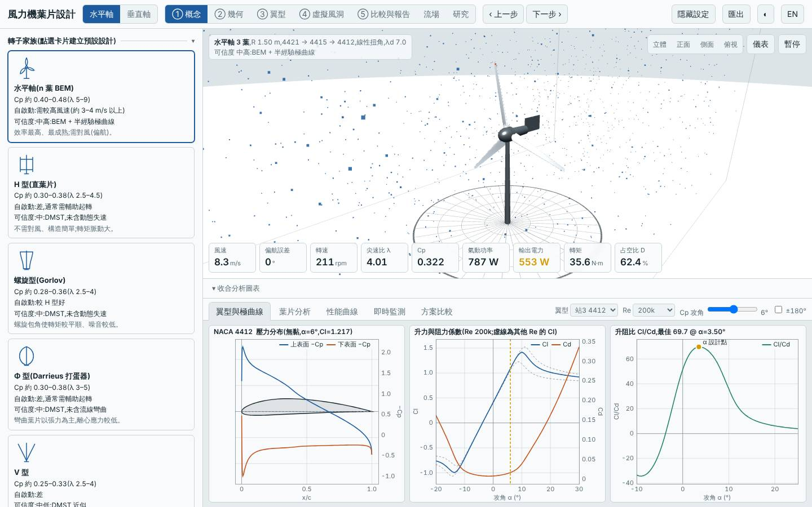
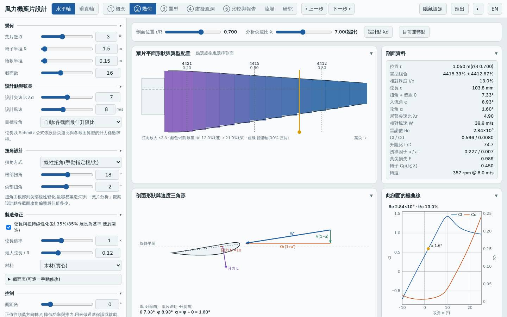
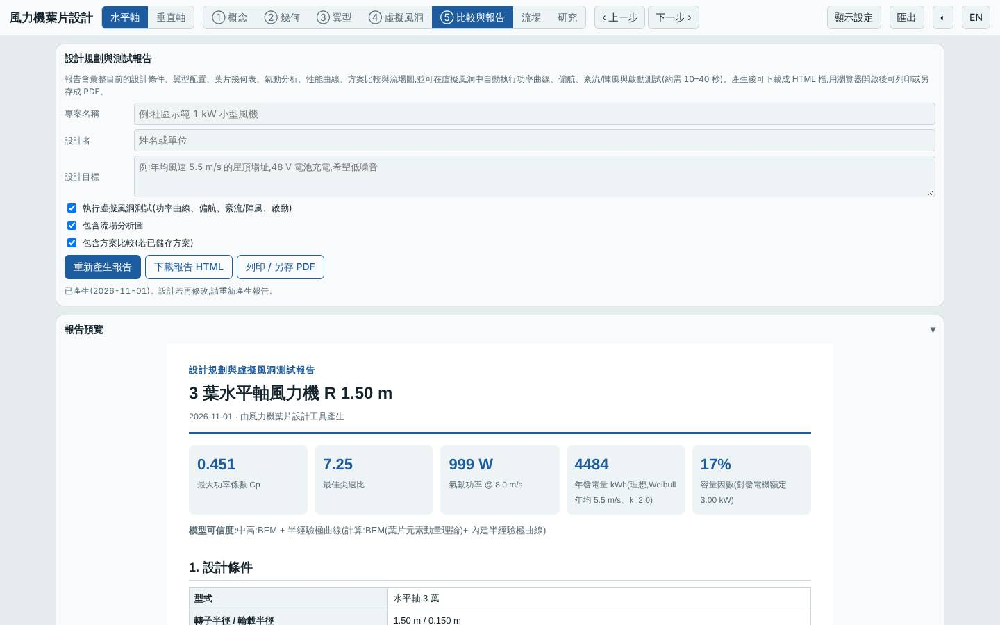
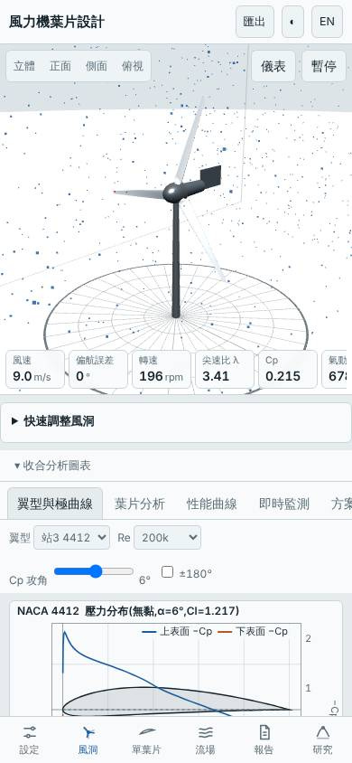

# 三葉易製造線性化葉片(線性弦長與線性扭角、木材)

- 日期:2026-11-01
- 相對基準的變更:預設三葉水平軸(BEM 最佳扭角、GFRP)→ 開啟弦長與扭角線性化、扭角方式改「線性」(根 18° → 尖 2°)、材料改木材;其餘(B 3、λd 7、R 1.5 m、翼型站 4421/4415/4412)不變
- 基準:同模式預設設計,同風況 Weibull 5.5 m/s、k 2
- 前幾次水平軸探索的是葉片數與 λ;本次改探索「可製造性」方向(直線邊緣葉片 + 線性扭角 + 低成本材料)

## 假設

線性弦長 + 線性扭角的葉片可用平板與簡單治具加工,質量與 LCOE 應下降;Cp,max 損失預期小於 5%。代價是起轉扭矩與結構強度(木材)可能變差。

## 結果(模型預測)

| 項目 | 本設計 | 基準(預設三葉) | 差異 |
|---|---|---|---|
| Cp,max | 0.451 @ λ 7.25 | 0.478 @ λ 7.25 | −5.7% |
| Cp ≥ 90% 的 λ 範圍 | 5.25–10.25 | — | 寬 |
| 年發電量(理想 MPPT)| 4484 kWh | 4758 kWh | −5.8% |
| LCOE(概估)| 2.74 NT$/kWh | 2.75 | −0.2%(持平)|
| 轉子質量 | 4.50 kg | 4.33 kg | +4% |
| 起轉風速(靜摩擦估算)| 2.93 m/s | 3.73 m/s | −0.8 m/s |
| 模擬自啟動(3/4/5 m/s)| 4、5 m/s 可 | 5 m/s 可 | 改善 |
| 最小安全係數 / 極端 | 7.03 / 2.65 | 5.97 | 極端工況 < 3,偏低 |
| 葉尖撓度 | 24.8 mm | — | 可接受 |
| 雜訊(50 m)| 46.7 dB(A)| — | |
| MPPT 追蹤率 6 / 9 m/s | 95% / 97% | — | |

介面驗證(`lab:ui`):以方案載入流程載入建置後網頁,介面 Cp,max 0.4508 與 Node 評估一致,掃掠面積 7.069 m²、質量 4.50 kg 一致;報告的虛擬風洞測試完成,桌面與手機版無 console 錯誤;截圖確認為線性扭角 18° → 2°、線性化弦長與木材設定。

## 結論

部分成立:Cp,max 損失 5.7%、年發電量 −5.8%,略超出預期的 5%;LCOE 與基準持平(2.74 vs 2.75),沒有成本優勢,因為木材質量較重(4.5 kg)抵消了單價較低的好處。意外的好處是起轉風速由 3.7 降到 2.9 m/s、4 m/s 即可自啟動(線性扭角根部扭角較大,低 λ 起轉扭矩較高)。極端工況安全係數 2.65 < 3,木材在此尺寸偏弱。適合重視手工製作與低風速自啟動、能接受約 6% 發電損失的場合;追求發電量或成本則仍以 BEM 最佳扭角為宜。

限制:半經驗極曲線非 XFOIL;起轉風速為靜摩擦估算;木材強度與疲勞為概估;LCOE 為概念性估計。所有數值為本工具的模型預測,非實測。

## 3D 模型

`model/` 內有 `make_model.mjs`(純 Node,以本工具 `hawtBlade` 放樣,與介面匯出 STL 同一函式)產生的單葉片 `blade.stl`、三葉轉子 `rotor.stl`(mm、轉子軸 Z,含輪轂與主軸),以及 Blender 匯入腳本 `blender_import.py`。排程容器沒有 Blender 與 bpy,.blend 未產生、腳本未實際執行過,需在本機執行。

## 下一次可以試

- 線性扭角根/尖改 14°/0° 或 22°/4°,找出可製造性與 Cp 的折衷;並以 GFRP 對照材料的影響
- 垂直軸 `free` 類型或改變風況(高風速場址 Vavg 7.5 m/s)下的設計,尚未探索

## 截圖

   
