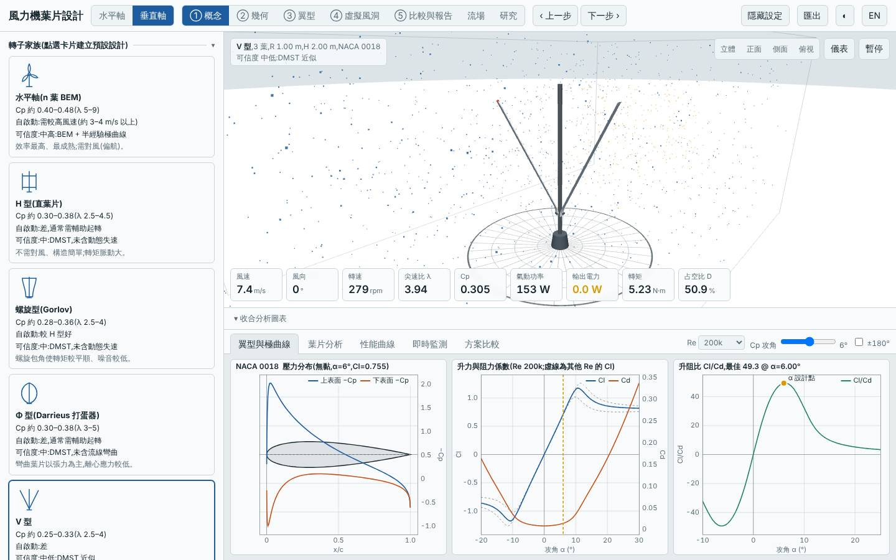
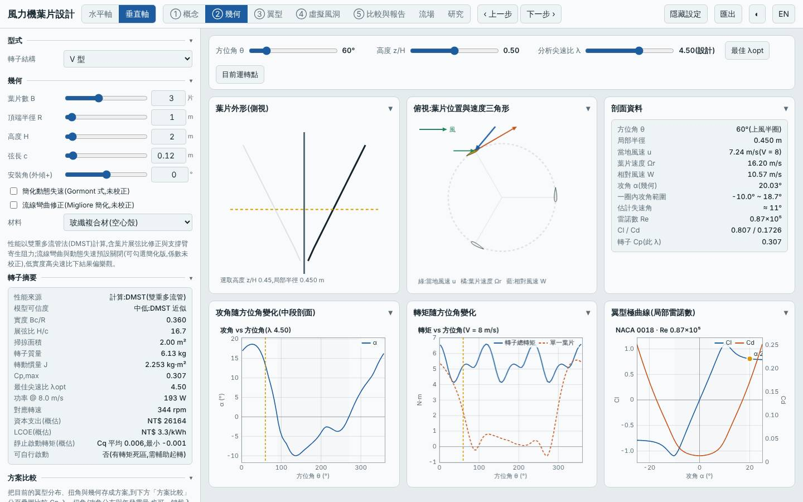
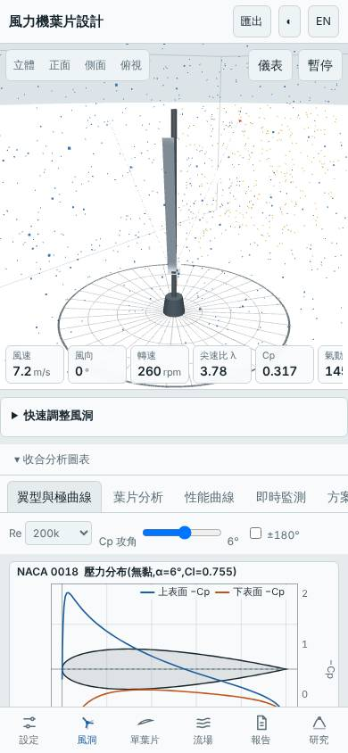

# 三葉 V 型垂直軸(弦長 0.12 m、NACA 0018)

- 日期:2026-11-01
- 相對基準的變更:同模式預設 H 型(R 1 m、H 2 m、B 3、弦長 0.15 m、NACA 0018)→ 型式改 V 型(葉片自輪軸向上傾斜展開,頂端半徑 R 1 m),弦長 0.12 m;其餘不變
- 基準:同模式預設 H 型,同風況 Weibull 5.5 m/s、k 2
- 前幾次垂直軸都是 Φ 型 / 螺旋型 / Savonius,本次補探索尚未試過的 V 型

## 假設

V 型葉片沿高度半徑不同,各截面的攻角與相對風速隨高度變化,預期起轉風速比 H 型低、Cp,max 相近;弦長縮小降低質量。代價預期是掃掠面積縮小(三角形包絡,約 H 型一半)使年發電量下降,且 DMST 未含動態失速而偏樂觀。

## 結果(模型預測)

| 項目 | 本設計 | 基準(預設 H 型) | 差異 |
|---|---|---|---|
| Cp,max | 0.307 @ λ 4.5 | 0.334 @ λ 3.5 | −8.2% |
| Cp ≥ 90% 的 λ 範圍 | 3.75–5.75 | — | |
| 掃掠面積 | 2.00 m² | 4.00 m² | −50% |
| 年發電量(理想 MPPT)| 866 kWh | 1886 kWh | −54% |
| LCOE(概估)| 3.32 NT$/kWh | 3.22 | +3.3% |
| 轉子質量 | 6.13 kg | 10.38 kg | −41% |
| 起轉風速(靜摩擦估算)| 2.37 m/s | 2.70 m/s | −0.33 m/s |
| 模擬自啟動(3/4/5 m/s 靜止起步 60 s)| 皆否 | 皆否 | 相同 |
| MPPT 追蹤率 6 / 9 m/s | 89.9% / 93.5% | — | 6 m/s 略低於 90% |

介面驗證(`lab:ui`):介面 Cp,max 0.3065 與 Node 評估一致,掃掠面積 2.004 m²、質量 6.13 kg 一致;報告虛擬風洞測試完成,桌面與手機版無 console 錯誤;截圖確認為 V 型三葉轉子。

## 結論

部分成立、整體不划算:起轉風速略降(2.7 → 2.4 m/s)、質量 −41%,但 Cp,max 反而低 8%,掃掠面積只剩一半,年發電量 −54%,LCOE +3%,且仍無法自行啟動。V 型的優勢(結構簡單、葉根集中)在本模型中沒有轉成氣動優勢;只有在安裝空間有限(高度受限、需要錐形外形)且接受低發電量時才有意義。

限制:DMST 未含動態失速與流線彎曲,V 型各截面傾斜角大,該區域的準確度更低,Cp 可能偏樂觀;MPPT 6 m/s 追蹤率 89.9% 為模擬隨機波動範圍內的數值;起轉風速為靜摩擦估算。所有數值為本工具的模型預測,非實測。

## 3D 模型

`model/` 內有 `make_model.mjs`(純 Node,以本工具 `vawtBlade` 放樣,與介面 3D 風洞同一函式)產生的單葉片 `blade.stl`、三葉轉子 `rotor.stl`(mm、轉子軸 Y 向上,含輪轂與主軸),以及 Blender 匯入腳本 `blender_import.py`。本次在排程容器以 pip 安裝的 `bpy`(Blender 5.2 Python 模組)實際執行匯入腳本,產生 `rotor.blend`(含 GFRP 材質、日光與相機);腳本與此版本的 Blender 相容。

## 下一次可以試

- V 型加大頂端半徑 R 與高度 H(例如 R 1.4 m、H 2.4 m)補回掃掠面積,檢查年發電量是否能追上 H 型
- 水平軸改用 CFRP 兩葉 λd 8 並加大根部弦長(`maxChord`),處理 λd 9 設計的起轉問題(接續 2026-10-31 的建議)

## 截圖

   
