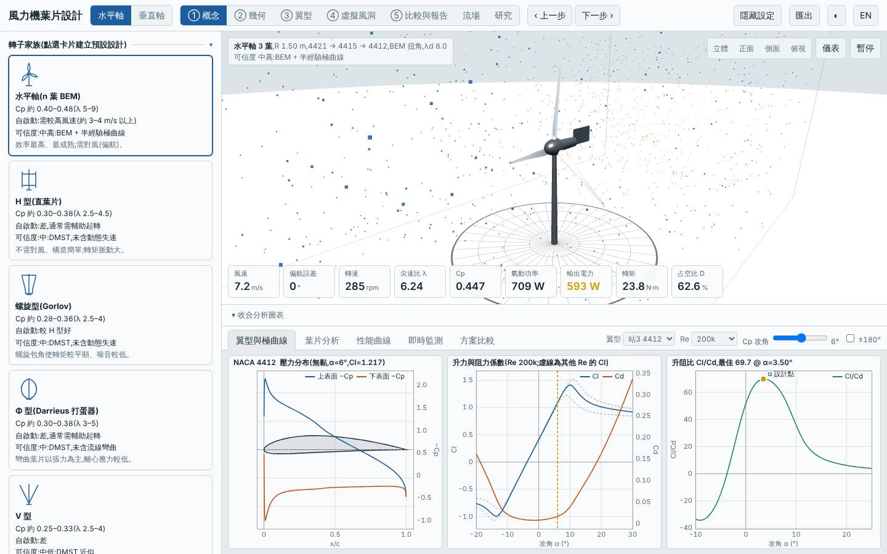
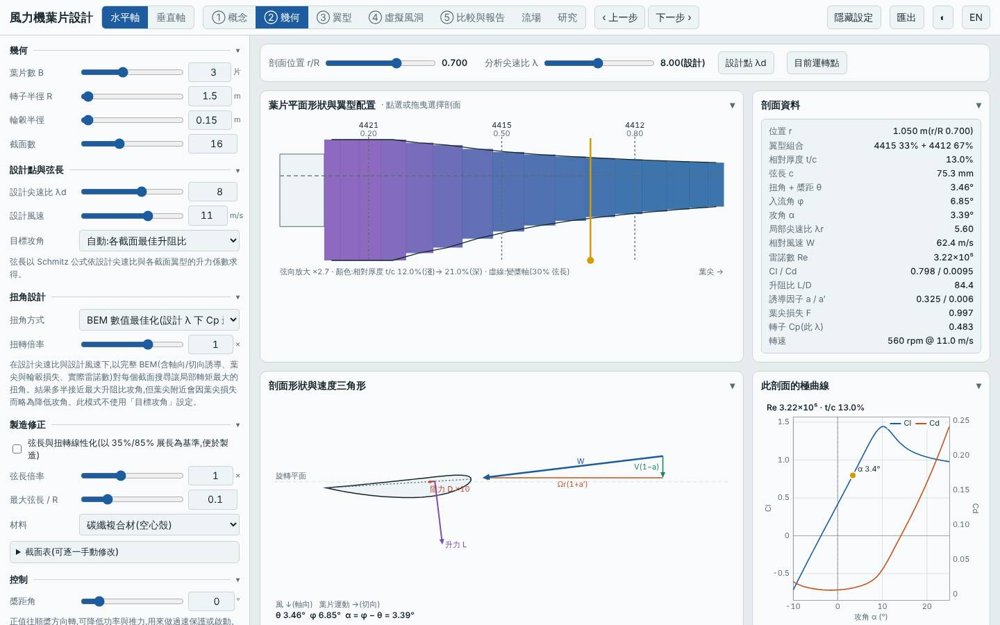
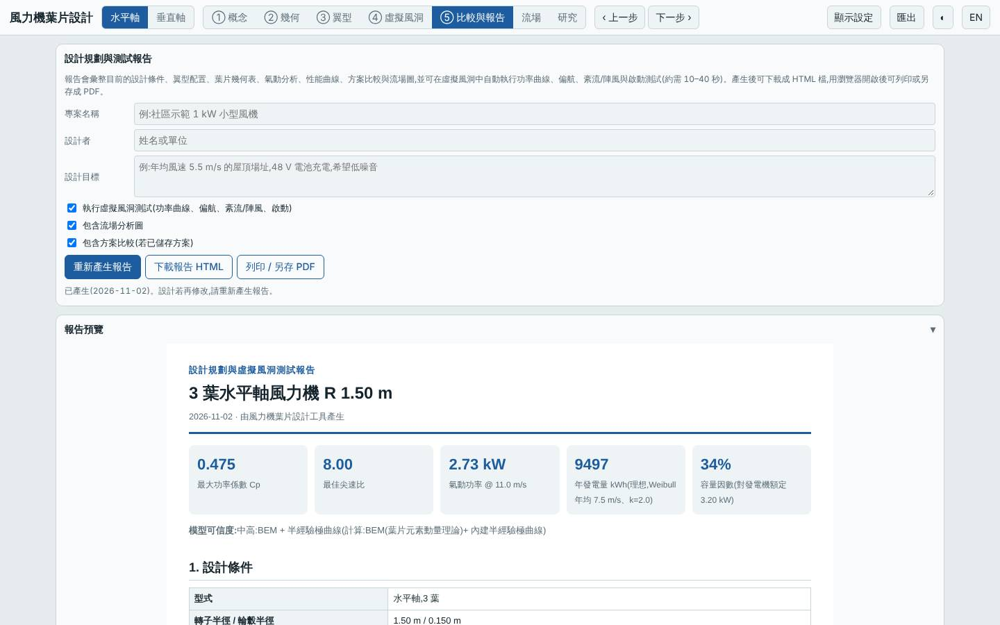
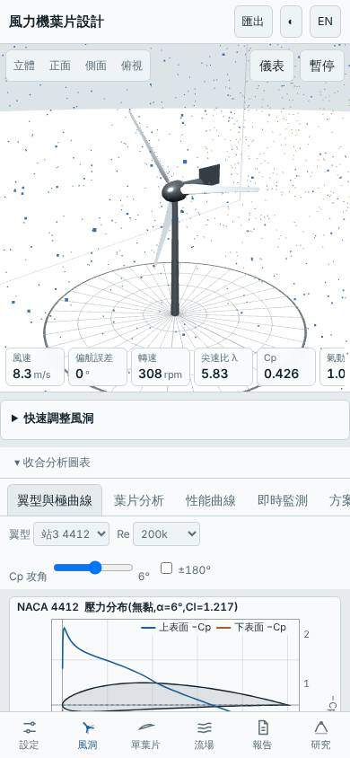

# 三葉高風速場址轉子(Vd 11 m/s、λd 8、弦長上限 0.10 m、CFRP)

- 日期:2026-11-02
- 相對基準的變更:預設三葉水平軸 → 設計風速 Vd 8 → 11 m/s、λd 7 → 8、`maxChord` 0.12 → 0.10 m、材料 GFRP → CFRP;R 1.5 m、B 3、翼型站不變
- 基準:同模式預設設計,**本次風況改為 Weibull 平均 7.5 m/s、k 2**(為高風速場址設計,基準也在同風況下重算,故年發電量與其他設計的 5.5 m/s 數字不可直接比較)
- 前幾次探索葉片數、λ、可製造性;本次改探索「設計風速與場址」方向

## 假設

為年平均風速 7.5 m/s 的場址,提高設計風速與 λd、縮小弦長並改用 CFRP:Cp,max 損失 < 2%,質量減少 35% 以上、LCOE 下降;代價是起轉風速升高(> 6 m/s)、無法低風速自啟動,極端結構裕度下降。

## 結果(模型預測,風況 7.5 m/s、k 2)

| 項目 | 本設計 | 基準(預設三葉) | 差異 |
|---|---|---|---|
| Cp,max | 0.475 @ λ 8.00 | 0.478 @ λ 7.25 | −0.7% |
| Cp ≥ 90% 的 λ 範圍 | 6.00–10.75 | 5.25–10.25 | 略右移 |
| 年發電量(理想 MPPT)| 9497 kWh | 9541 kWh | −0.5% |
| LCOE(概估)| 1.40 NT$/kWh | 1.37 | +2.2% |
| 轉子質量 | 1.87 kg | 4.33 kg | −57% |
| 起轉風速(靜摩擦估算)| 6.47 m/s | 3.73 m/s | +2.7 m/s |
| 模擬自啟動 3/4/5 m/s | 皆否 | 5 m/s 可 | 變差 |
| 最小安全係數 / 極端 | 3.05 / 3.28 | 5.97 / 2.65 | 一般工況降低 |
| 葉尖撓度 | 59 mm | 34 mm | +25 mm |
| 雜訊(50 m)| 48.9 dB(A)| 46.7 | +2.1 dB |
| MPPT 追蹤率 6 / 9 m/s | 97% / 99% | — | |

介面驗證(`lab:ui`):介面 Cp,max 0.4746 與 Node 評估一致,掃掠面積 7.069 m²、質量 1.87 kg 一致;報告的虛擬風洞測試完成,桌面與手機版無 console 錯誤;截圖確認為三葉、λd 8、Vd 11、CFRP 設定。

## 結論

部分成立:質量 −57%(遠超預期)、Cp,max 與年發電量幾乎不變(−0.7% / −0.5%),起轉風速升至 6.5 m/s、3–5 m/s 皆無法自啟動,與預期一致。但 LCOE 沒有下降,反而 +2.2%:CFRP 單價高於 GFRP,省下的質量並未轉成成本優勢。此外弦長縮小使雷諾數降低、一般工況安全係數降到 3.05,工程上偏低。適合需要輕量轉子、且有輔助起轉或直接併網啟動的高風速場址;若成本優先,GFRP + 預設弦長仍較划算。

限制:半經驗極曲線非 XFOIL;細長弦長下的低 Re 極曲線偏樂觀;起轉風速為靜摩擦估算;CFRP 強度、疲勞與成本為概估。所有數值為本工具的模型預測,非實測。

## 3D 模型

`model/` 內有 `make_model.mjs`(純 Node,以本工具 `hawtBlade` 放樣)產生的 `blade.stl`、`rotor.stl`(mm、轉子軸 Z),以及 `blender_import.py`。本次以 pip 安裝的 `bpy`(Blender 5.2 Python 模組)實際執行,產生 `rotor.blend`(含 CFRP 材質、日光、相機)。

## 下一次可以試

- 同一高風速場址改用 GFRP + `maxChord` 0.11,找出 LCOE 低於基準的折衷點
- 垂直軸 `free` 類型尚未探索;或改低風速場址(Vavg 4 m/s)重做水平軸設計

## 截圖

   
