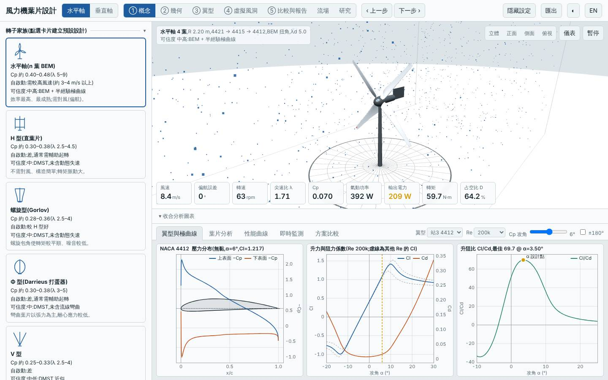
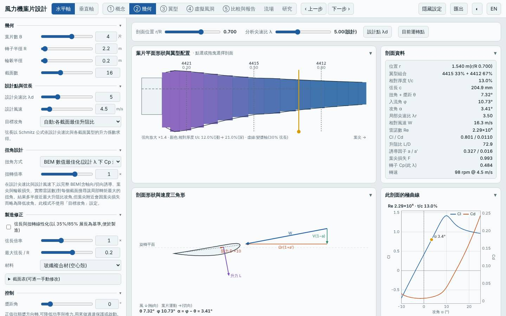
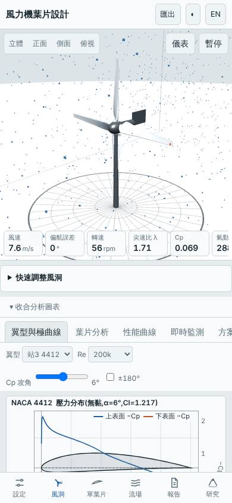

# 四葉低風速場址大轉子(R 2.2 m、Vd 4.5 m/s、λd 5、GFRP)

- 日期:2026-11-02
- 相對基準的變更:預設三葉水平軸 → 半徑 R 1.5 → 2.2 m、輪轂 Rhub 0.15 → 0.2 m、葉片數 3 → 4、λd 7 → 5、設計風速 Vd 8 → 4.5 m/s、`maxChord` 0.12 → 0.20 m;材料 GFRP、翼型站不變
- 基準:同模式預設設計,**本次風況改為 Weibull 平均 4 m/s、k 2**(為低風速場址設計,基準也在同風況下重算,故年發電量與其他設計的 5.5 m/s 數字不可直接比較)
- 前一次探索高風速場址;本次改探索「低風速場址 + 大轉子」,承接上次「下一次可以試」

## 假設

為年平均風速 4 m/s 的場址,把掃掠面積加大 115%、降低 λd 與設計風速並放寬弦長:起轉風速 < 2 m/s、4 m/s 可自啟動,年發電量比基準高 80% 以上;代價是質量大增(> 25 kg)、容量因數偏低、LCOE 不一定改善。

## 結果(模型預測,風況 4 m/s、k 2)

| 項目 | 本設計 | 基準(預設三葉) | 差異 |
|---|---|---|---|
| Cp,max | 0.502 @ λ 6.00 | 0.478 @ λ 7.25 | +5.0% |
| Cp ≥ 90% 的 λ 範圍 | 3.75–8.00 | — | |
| 年發電量(理想 MPPT)| 4364 kWh | 1932 kWh | +125.9% |
| 容量因數 / 發電機額定 | 6.8% / 7.3 kW | — | 偏低 |
| LCOE(概估)| 7.05 NT$/kWh | 6.77 | +4.1% |
| 轉子質量 | 37.3 kg | 4.33 kg | +762% |
| 起轉風速(靜摩擦估算)| 1.3 m/s | 3.73 m/s | −2.4 m/s |
| 模擬自啟動 3/4/5 m/s | 皆可 | 5 m/s 可 | 改善 |
| 最小安全係數 / 極端 | 62.9 / 4.52 | 5.97 / 2.65 | 充裕 |
| 葉尖撓度 | 3.2 mm | 34 mm | 大幅降低 |
| 雜訊(50 m)| 44.3 dB(A)| — | |
| MPPT 追蹤率 6 / 9 m/s | 94% / 42% | — | 9 m/s 追蹤不佳 |

介面驗證(`lab:ui`):介面 Cp,max 0.5019 與 Node 評估一致,掃掠面積 15.205 m²、質量 37.30 kg 一致;報告的虛擬風洞測試完成,桌面與手機版無 console 錯誤;截圖確認為四葉、R 2.2 m、λd 5.0 設定。

## 結論

大致成立:年發電量 +126%(遠超預期的 +80%)、起轉風速 1.3 m/s、3 m/s 起可自啟動、結構裕度充裕,Cp,max 還略升 5%。代價如預期:質量 37 kg(約 8.6 倍)、容量因數僅 6.8%,LCOE 反而 +4.1%——大轉子的資本支出增加幅度大於發電量增益在成本上的收益,且發電機額定(7.3 kW)遠高於 4 m/s 場址實際用得到的功率。另外 9 m/s 的 MPPT 追蹤率只有 42%,代表高風速時控制器/發電機配合不佳,但該風速在 4 m/s 場址出現機率低。適合發電量優先、可接受較高成本的低風速場址;若成本優先,應另外壓低發電機額定(本工具由 `autoMatchGen` 自動匹配,此處未手動覆寫)。

限制:半經驗極曲線非 XFOIL;低風速下低 Re 極曲線可能偏樂觀;起轉風速為靜摩擦估算;成本為概估;未含結構動態與塔影。所有數值為本工具的模型預測,非實測。

## 3D 模型

`model/` 內有 `make_model.mjs`(純 Node,以本工具 `hawtBlade` 放樣)產生的 `blade.stl`、`rotor.stl`(mm、轉子軸 Z),以及 `blender_import.py`。本次以 pip 安裝的 `bpy`(Blender 5.2 Python 模組,需 Python 3.13)實際執行,產生 `rotor.blend`(含 GFRP 材質、日光、相機)。

## 下一次可以試

- 同一低風速場址把 `Vd` 降到 4 並手動限制發電機額定(`load` 覆寫),看 LCOE 能否低於基準
- 垂直軸 `free` 類型尚未探索(r(z) 控制點外形)

## 截圖

   
