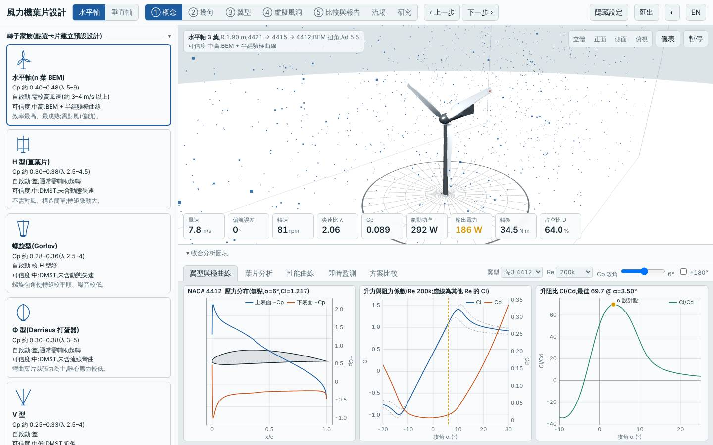
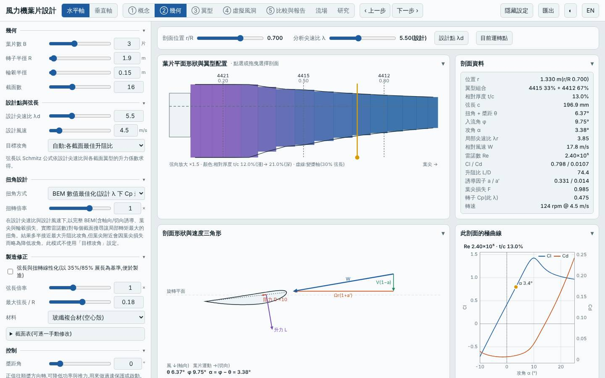
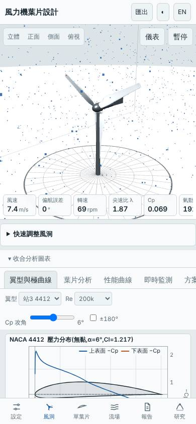

# 三葉低風速場址中型轉子加限額發電機(R 1.9 m、Vd 4.5 m/s、λd 5.5、額定 1.5 kW,Vavg 4 m/s)

日期:2026-11-03(UTC)。基準:預設三葉水平軸(同樣放在 Vavg 4 m/s、k 2 的風況下重算);另與前一個設計 `20261102-hawt-b4-lowwind`(四葉、R 2.2 m、自動匹配額定約 7.3 kW)對照。

本次相對基準的變更:三葉、R 1.9 m、Rhub 0.15 m、λd 5.5、Vd 4.5 m/s、弦長上限 0.18 m、GFRP;並以 `load.Pmax = 1500` 手動把發電機額定限制在 1.5 kW。風況改為 Vavg 4 m/s(場址設計,與 20261102 相同)。

## 假設

承接 20261102 的「下一次可以試」:大轉子在低風速場址 LCOE 反而 +4.1%、容量因數僅 6.8%,是因為發電機額定隨掃掠面積自動放大。改用中型轉子並把額定限制在 1.5 kW,預期年發電量仍比基準高 60% 以上、質量比大轉子少一半以上、容量因數提高、LCOE 低於基準;代價是高風速段被削峰、起轉風速約 2 m/s。

## 結果(模型預測,風況 4 m/s、k 2)

| 項目 | 本設計 | 基準(預設三葉) | 差異 | 20261102 大轉子 |
|---|---|---|---|---|
| Cp,max | 0.492 @ λ 6.50 | 0.478 @ λ 7.25 | +2.9% | 0.502 |
| Cp ≥ 90% 的 λ 範圍 | 4.25–8.50 | — | | 3.75–8.00 |
| 年發電量(理想 MPPT)| 2874 kWh | 1932 kWh | +48.7% | 4364 kWh |
| 容量因數 / 發電機額定 | 21.9% / 1.5 kW | — | | 6.8% / 7.3 kW |
| LCOE(概估)| 3.35 NT$/kWh | 6.77 | −50.5% | 7.05 |
| 轉子質量 | 21.5 kg | 4.33 kg | +396% | 37.3 kg |
| 起轉風速(靜摩擦估算)| 1.4 m/s | 3.73 m/s | −2.3 m/s | 1.3 m/s |
| 模擬自啟動 3/4/5 m/s | 皆可 | 5 m/s 可 | 改善 | 皆可 |
| 最小安全係數 / 極端 | 70.9 / 6.58 | 5.97 / 2.65 | 充裕 | 62.9 / 4.52 |
| 葉尖撓度 | 2.3 mm | 34 mm | 大幅降低 | 3.2 mm |
| 雜訊(50 m)| 45.4 dB(A)| — | | 44.3 |
| MPPT 追蹤率 6 / 9 m/s | 93% / 52% | — | 9 m/s 受額定削峰 | 94% / 42% |

介面驗證(`lab:ui`):介面 Cp,max 0.4921 與 Node 評估一致,掃掠面積 11.341 m²、質量 21.50 kg 一致;報告的虛擬風洞測試完成,桌面與手機版無 console 錯誤;截圖確認為三葉、R 1.90 m、λd 5.5 設定。

## 結論

部分成立。成立的部分:LCOE 3.35 NT$/kWh,比同風況基準低 50.5%、比 20261102 大轉子低 52%;容量因數由 6.8% 提高到 21.9%;質量 21.5 kg(比大轉子少 42%,但「少一半以上」的預期略未達);起轉風速 1.4 m/s、3 m/s 起可自啟動。未成立的部分:年發電量只比基準高 48.7%(預期 > 60%),因為 R 1.9 m 的掃掠面積(11.3 m²)比大轉子小 25%,且 1.5 kW 額定在 9 m/s 附近已削峰(MPPT 追蹤率 52% 是削峰造成,不是控制失效)。

學到的事:在低風速場址,LCOE 的主要槓桿是「發電機額定與轉子大小是否匹配」,而不是單純加大轉子。適合成本優先的低風速場址;若發電量優先,仍以 20261102 大轉子為佳。

模型限制:半經驗極曲線非 XFOIL;低風速下低 Re 極曲線可能偏樂觀;起轉風速為靜摩擦估算;成本為概估,發電機成本隨額定線性縮放的假設會直接影響 LCOE 差距;未含結構動態與塔影。所有數值為本工具的模型預測,非實測。

## 3D 模型

`model/` 內有 `make_model.mjs`(純 Node,以本工具 `hawtBlade` 放樣)產生的 `blade.stl`、`rotor.stl`(mm、轉子軸 Z),以及 `blender_import.py`。本次以 pip 安裝的 `bpy`(Blender 5.2 Python 模組)實際執行,產生 `rotor.blend`(含 GFRP 材質、日光、相機)。

## 下一次可以試

- 掃描 `load.Pmax`(1.0 / 2.0 / 3.0 kW)找 LCOE 最低點,確認 1.5 kW 是否接近最佳
- 垂直軸 `free` 沙漏形外形(兩端 1.0R、中段 0.75R)尚未探索

## 截圖

