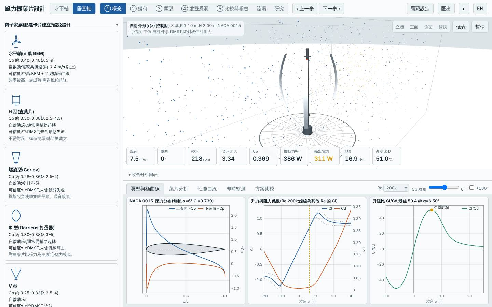
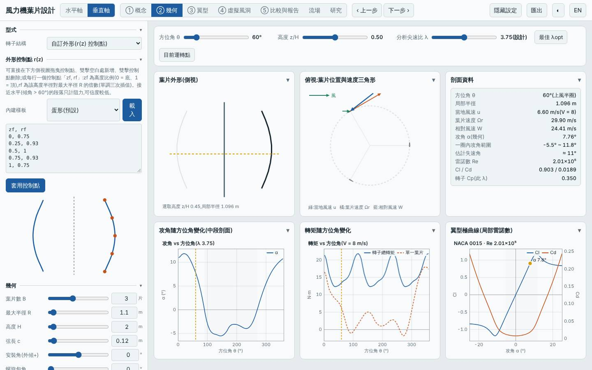
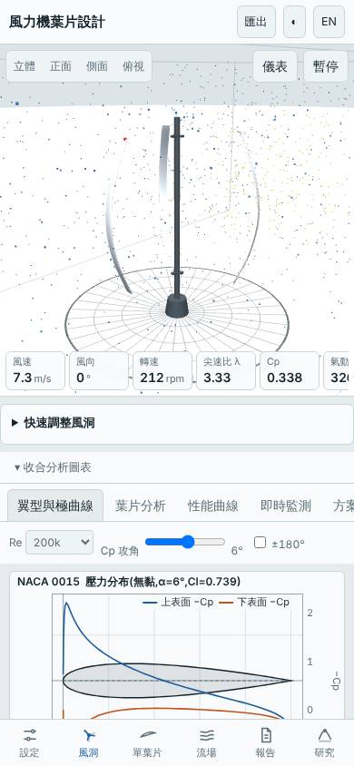

# 三葉桶形自訂外形垂直軸(r(z) 兩端收 25%、NACA 0015、開啟動態失速與流線彎曲)

日期:2026-11-03。相對基準(預設 H 型 R 1 m、H 2 m、三葉、c 0.15 m、NACA 0018)的變更:改用 `free` 家族,r(z) 控制點為中段 1.0R、四分位 0.93R、兩端 0.75R 的桶形;R 1.1 m(使掃掠面積與基準相同,約 4.0 m²)、c 0.12 m、翼型 NACA 0015、開啟動態失速與流線彎曲。

## 假設

兩端收小使離心彎曲負載與支撐臂較短、質量下降,中段維持最大半徑;不同高度葉段半徑不同,攻角不同步,預期 Cp,max 與 H 型相近(±5%)、質量下降、起轉風速略降。代價:陡斜段 DMST 只計阻力、可信度中低。(設計時把 R 放大到 1.1 m,所以掃掠面積並未如原先猜測的減少 8%,而是與基準持平。)

## 結果(模型預測,風況 5.5 m/s、k 2)

| 項目 | 本設計 | 基準(預設 H 型) | 差異 |
|---|---|---|---|
| Cp,max | 0.350 @ λ 3.75 | 0.334 @ λ 3.50 | +4.8% |
| Cp ≥ 90% 的 λ 範圍 | 3.25–4.50 | — | |
| 掃掠面積 | 4.01 m² | 約 4.0 m² | 持平 |
| 年發電量(理想 MPPT)| 1969 kWh | 1886 kWh | +4.4% |
| 容量因數 / 發電機額定 | 17.3% / 1.3 kW | — | |
| LCOE(概估)| 2.96 NT$/kWh | 3.22 | −8.1% |
| 轉子質量 | 4.78 kg | 10.38 kg | −54% |
| 起轉風速(靜摩擦估算)| 2.85 m/s | 2.70 m/s | +0.15 m/s(略差)|
| 模擬自啟動 3/4/5 m/s | 皆否 | 否 | 仍需輔助起轉 |
| MPPT 追蹤率 6 / 9 m/s | 97% / 96% | — | 良好 |

介面驗證(`lab:ui`):介面 Cp,max 0.3500 與 Node 評估一致,掃掠面積 4.007 m²、質量 4.78 kg 一致;報告的虛擬風洞測試完成,桌面與手機版無 console 錯誤;截圖確認為三葉桶形葉片。

## 結論

部分成立:Cp,max +4.8%、年發電量 +4.4%、質量 −54%、LCOE −8.1%,質量與成本的改善明確;但起轉風速反而略升(2.85 vs 2.70 m/s),且仍無法自行啟動,假設中「起轉風速略降」不成立。Cp +4.8% 落在預期的 ±5% 邊界,且一部分來自 NACA 0015 較薄翼型、動態失速與流線彎曲設定的差異(與基準並非單變量比較),不應解讀為桶形外形本身的功勞。質量大降主要來自弦長縮小與葉片較短的支撐。適合追求輕量、低成本且有輔助起轉的場合。

限制:半經驗極曲線非 XFOIL;自訂外形 DMST 陡斜段只計阻力;DMST 未完整含動態失速與流線彎曲,高 λ 偏樂觀;起轉風速為靜摩擦估算;成本為概估。所有數值為本工具的模型預測,非實測。

## 3D 模型

`model/` 內有 `make_model.mjs`(純 Node,以本工具 `vawtBlade` 放樣)產生的 `blade.stl`、`rotor.stl`(mm、轉子軸 Y),以及 `blender_import.py`。本次以 Python 3.13 虛擬環境安裝的 `bpy` 實際執行,產生 `rotor.blend`(含 GFRP 材質、日光、相機)。

## 下一次可以試

- 單變量對照:同樣桶形外形但翼型、弦長、動態失速設定都與基準相同,分離外形本身的貢獻
- 反向外形(腰部收窄的沙漏形,兩端 1.0R、中段 0.75R),看攻角不同步是否改善起轉

## 截圖

   
