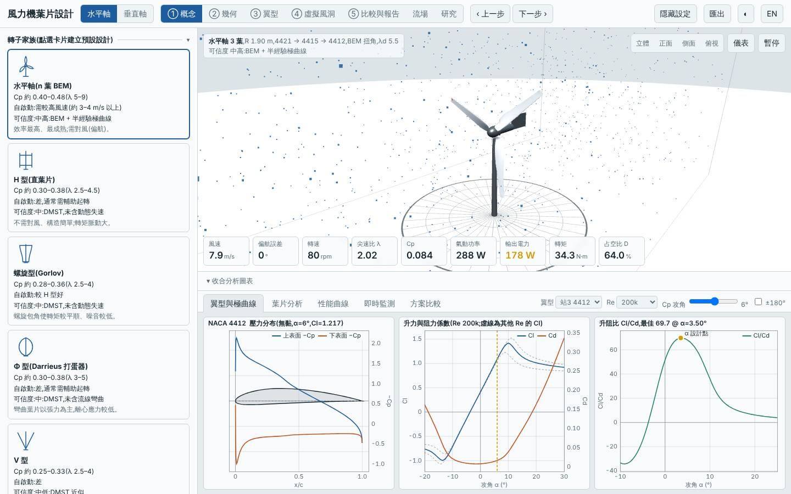
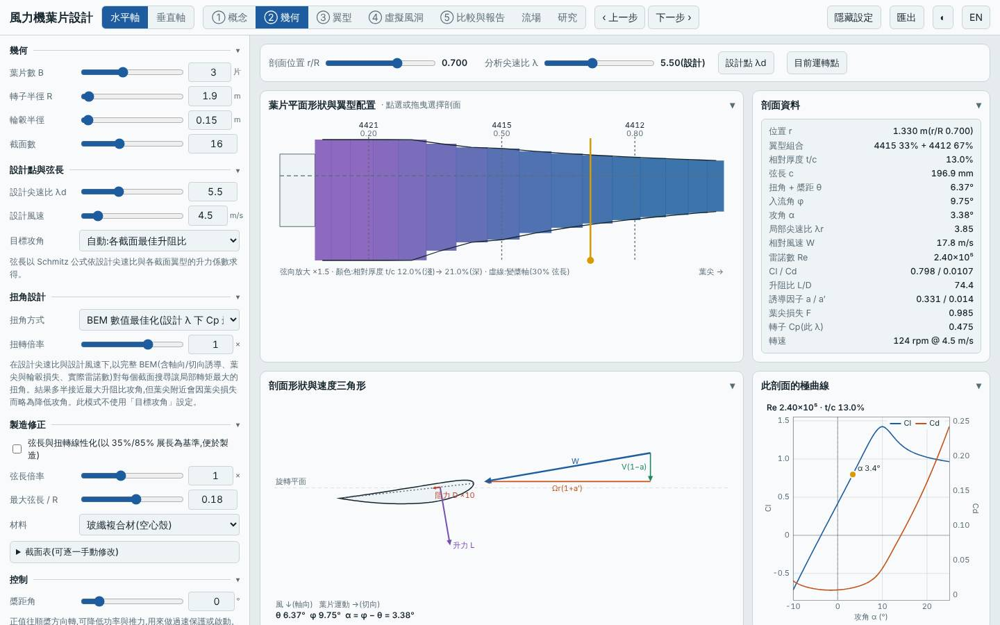
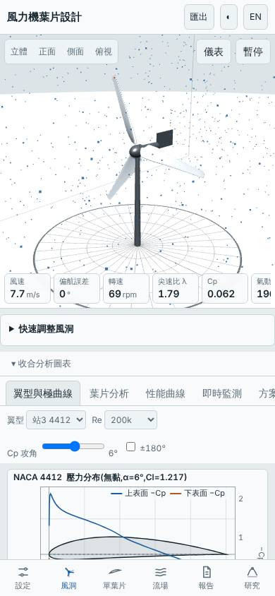

# 三葉低風速場址轉子限額 1.0 kW(深入研究:掃描發電機額定)

日期:2026-11-04(UTC)。**深入研究 ← parent `20261103-hawt-b3-lowwind-cap`**(R 1.9 m、λd 5.5、GFRP、額定 1.5 kW,Vavg 4 m/s)。基準:預設三葉水平軸(同風況重算)。

本次相對 parent 的變更:只有 `load.Pmax` 1500 → 1000 W,葉片幾何完全相同(Cp,max、質量、起轉風速、安全係數都不變)。

## 假設

parent 的 1.5 kW 不一定是 LCOE 最低點。預期在 Vavg 4 m/s 場址,額定降到約 1.0 kW 可讓自身場址 LCOE 再降約 8%,代價是年發電量約 −10%;但在標準場址(5.5 m/s)LCOE 會變差,因為最佳額定隨風速上移。

## 參數掃描(`lab/evaluate.mjs`,Node)

| 變體 | Cp,max | 年發電量 kWh(4 m/s)| LCOE(4 m/s)| 容量因數 | 標準場址年發電量 | 標準場址 LCOE | 質量 kg |
|---|---|---|---|---|---|---|---|
| R 1.9、Pmax 800 | 0.492 | 2392 | 3.06 | 34.1% | 3825 | 1.92 | 21.5 |
| **R 1.9、Pmax 1000(本設計)** | 0.492 | 2585 | 3.09 | 29.5% | 4372 | 1.83 | 21.5 |
| R 1.9、Pmax 1250 | 0.492 | 2757 | 3.20 | 25.2% | 4942 | 1.78 | 21.5 |
| R 1.9、Pmax 1500(parent)| 0.492 | 2874 | 3.35 | 21.9% | 5406 | 1.78 | 21.5 |
| R 1.9、Pmax 2000 | 0.492 | 3015 | 3.74 | 17.2% | 6114 | 1.85 | 21.5 |
| R 1.9、Pmax 3000 | 0.492 | 3136 | 4.65 | 11.9% | 7014 | 2.08 | 21.5 |
| R 1.7、Pmax 1250 | 0.482 | 2279 | 3.41 | 20.8% | 4357 | 1.78 | 14.8 |
| R 2.1、Pmax 1000 | 0.489 | 2940 | 3.12 | 33.6% | 4734 | 1.94 | 29.5 |
| R 2.1、Pmax 1250 | 0.489 | 3171 | 3.15 | 29.0% | 5402 | 1.85 | 29.5 |
| R 2.3、Pmax 1000 | 0.489 | 3271 | 3.22 | 37.3% | 5047 | 2.09 | 39.8 |

(另掃 R 1.7/2.1 的 1500、2000 W,皆不優於上列;起轉風速全部 1.4–1.44 m/s,最小安全係數 ≥ 60,不構成限制。)

## 相對 parent 的改善

| 項目 | 本設計 | parent | 變化 |
|---|---|---|---|
| 自身場址 LCOE(4 m/s)| 3.09 | 3.35 | −7.8% |
| 自身場址年發電量 | 2585 kWh | 2874 kWh | −10.1% |
| 標準場址 LCOE(5.5 m/s)| 1.83 | 1.78 | +2.8%(變差)|
| 標準場址年發電量 | 4372 kWh | 5406 kWh | −19.1% |
| 起轉風速 / 質量 | 1.4 m/s / 21.5 kg | 相同 | 無變化 |

介面驗證(`lab:ui`):介面 Cp,max 0.4921 與 Node 評估一致,掃掠面積 11.341 m²、質量 21.50 kg 一致;報告虛擬風洞測試完成,桌面與手機版無 console 錯誤。模擬 6 m/s 追蹤率 93%、9 m/s 輸出 1077 W(追蹤率 49%,為額定削峰所致,非控制失效)。

## 結論

**大致成立。** 在 Vavg 4 m/s 場址,額定 1.0 kW 使 LCOE 由 3.35 降到 3.09(−7.8%),年發電量 −10.1%,與預期(−8% / −10%)吻合;相對同風況基準 LCOE 約 −54%。LCOE 對 Pmax 的曲線在自身場址很平(800–1000 W 約 3.06–3.09),最低點約 0.8–1.0 kW;標準場址最低點在 1.25–1.5 kW,證實最佳額定隨風速上移。放大半徑(R 2.1 / 2.3)搭配 1.0 kW 並沒有更低的 LCOE,本家族在 R 1.9 m 附近已接近收斂。

適合 LCOE 優先、年均風速約 4 m/s 的場址;若風況可能較好或重視發電量,仍以 parent 的 1.5 kW 較穩健。

模型限制:成本為概估,發電機成本隨額定線性縮放的假設直接決定最佳 Pmax;低 Re 極曲線偏樂觀;起轉風速為靜摩擦估算;無結構動態與塔影。所有數值為本工具模型預測,非實測。

## 3D 模型

`model/` 內有 `make_model.mjs`(以本工具 `hawtBlade` 放樣)產生的 `blade.stl`、`rotor.stl`(mm、軸 Z),以及 `blender_import.py`;本次以 pip 的 `bpy` 實際執行,產生 `rotor.blend`。

## 下一次可以試

- 以 `Rhub`/`maxChord` 縮小根部弦長,看質量能否由 21.5 kg 再降 10% 以上而不傷 Cp,max
- 改 λd 5.0 與 6.0 搭配 1.0 kW,確認 Cp,max 與起轉風速的取捨(本掃描固定 λd 5.5)

## 截圖

