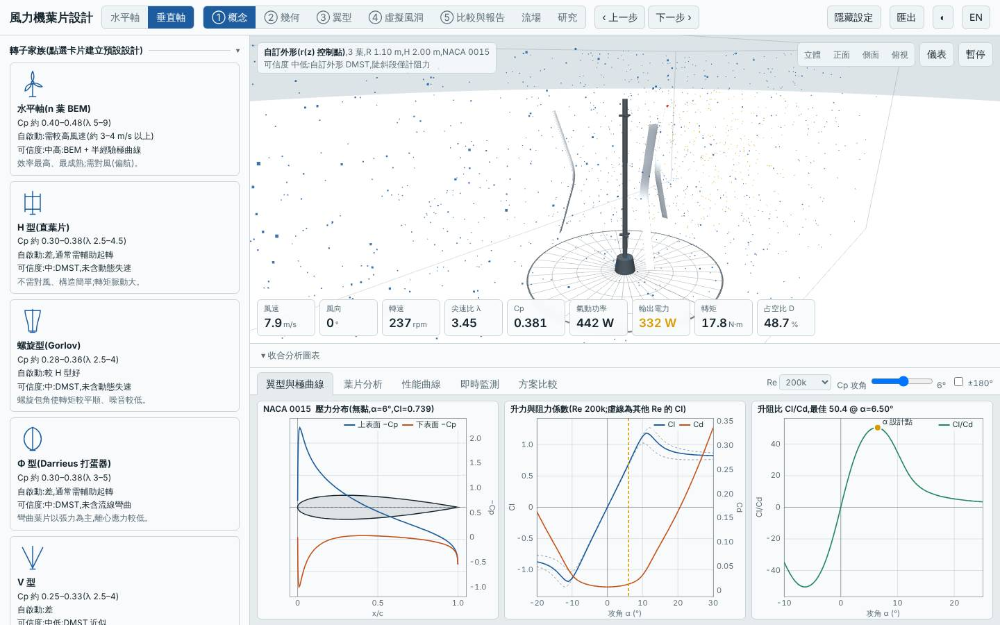
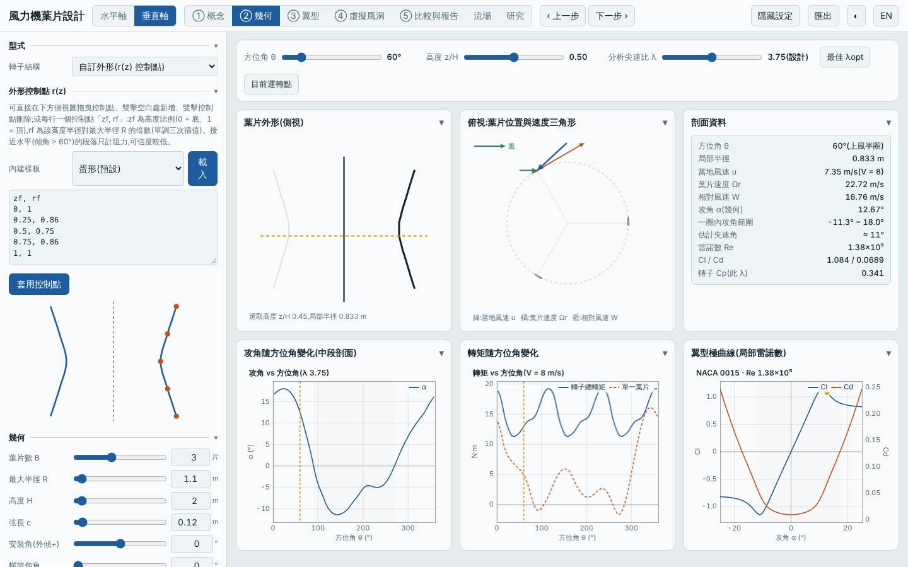
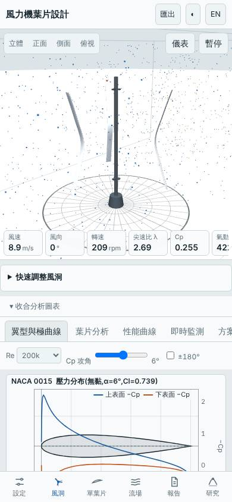

# 三葉沙漏形自訂外形垂直軸(r(z) 兩端 1.0R、腰部 0.75R、NACA 0015)

日期:2026-11-04(UTC)。基準:預設 H 型(R 1 m、H 2 m、三葉、c 0.15 m、NACA 0018);另與前一個設計 `20261103-vawt-free-barrel`(桶形)對照。

本次相對基準的變更:改用 `free` 家族,r(z) 控制點為兩端 1.0R、四分位 0.86R、腰部 0.75R 的沙漏形;R 1.1 m、c 0.12 m、NACA 0015、開啟動態失速與流線彎曲。**與桶形設計相比,只有外形(shapePts)不同**,其餘參數完全相同,因此可以分離外形的影響。

## 假設

把桶形反過來做成沙漏形:不同高度葉段半徑不同使攻角不同步,預期 Cp–λ 曲線較平緩、起轉風速略降;但腰部半徑小使平均掃掠半徑下降,預期 Cp,max 與年發電量低於桶形。

## 結果(模型預測,風況 5.5 m/s、k 2)

| 項目 | 沙漏形 | 桶形(20261103) | 基準(預設 H 型) |
|---|---|---|---|
| Cp,max | 0.341 @ λ 3.75 | 0.350 @ λ 3.75 | 0.334 @ λ 3.50 |
| Cp ≥ 90% 的 λ 範圍 | 3.25–4.50 | 3.25–4.50 | — |
| 掃掠面積 | 3.79 m² | 4.01 m² | 約 4.0 m² |
| 年發電量(理想 MPPT)| 1814 kWh(對基準 −3.9%)| 1969 kWh | 1886 kWh |
| 容量因數 / 發電機額定 | 17.3% / 1.2 kW | 17.3% / 1.3 kW | — |
| LCOE(概估)| 2.99 NT$/kWh(−7.1%)| 2.96 | 3.22 |
| 轉子質量 | 4.75 kg(−54%)| 4.78 kg | 10.38 kg |
| 起轉風速(靜摩擦估算)| 2.84 m/s | 2.85 m/s | 2.70 m/s |
| 模擬自啟動 3/4/5 m/s | 皆否 | 皆否 | 否 |
| MPPT 追蹤率 6 / 9 m/s | 96% / 98% | 97% / 96% | — |

介面驗證(`lab:ui`):介面 Cp,max 0.3407 與 Node 評估一致,掃掠面積 3.789 m²、質量 4.75 kg 一致;報告的虛擬風洞測試完成並下載;桌面與手機版無 console 錯誤;截圖確認為三葉自訂外形垂直軸。

## 結論

大致不成立(部分成立)。成立的部分:腰部收窄的預期代價如預測——掃掠面積比桶形小 5.4%,年發電量低 7.9%。不成立的部分:Cp,max(0.341 vs 桶形 0.350)只差 2.7%,Cp–λ 的 90% 範圍與最佳 λ 完全相同,起轉風速 2.84 vs 2.85 m/s 沒有差別,仍無法自行啟動,所以「攻角不同步可降低起轉風速、使曲線更平緩」沒有在模型中出現。質量(4.75 vs 4.78 kg)也幾乎相同,因為質量主要由弦長與葉片弧長決定。結論:沙漏形沒有優勢,同樣 R 下桶形較佳;外形(桶/沙漏)對模型預測的影響很小,遠小於弦長、翼型與掃掠面積的影響。

限制:半經驗極曲線非 XFOIL;自訂外形 DMST 陡斜段只計阻力,而沙漏形腰部的反向斜面正落在這個低可信度區;DMST 未完整含動態失速與流線彎曲;起轉風速為靜摩擦估算;成本為概估。所有數值為本工具的模型預測,非實測。

## 3D 模型

`model/` 內有 `make_model.mjs`(純 Node,以本工具 `vawtBlade` 放樣)產生的 `blade.stl`、`rotor.stl`(mm、轉子軸 Y),以及 `blender_import.py`。本次以 venv 內 pip 安裝的 `bpy` 實際執行,產生 `rotor.blend`(含 GFRP 材質、日光、相機)。

## 下一次可以試

- 水平軸 `load.Pmax` 掃描(1.0 / 2.0 / 3.0 kW)找 20261103 設計的 LCOE 最低點
- 水平軸 `twMode: schmitz` 搭配五站翼型(根部厚翼型到葉尖薄翼型),與 BEM 最佳化扭角比較

## 截圖

   
