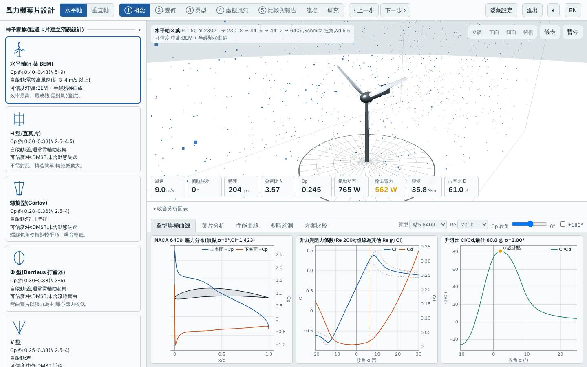
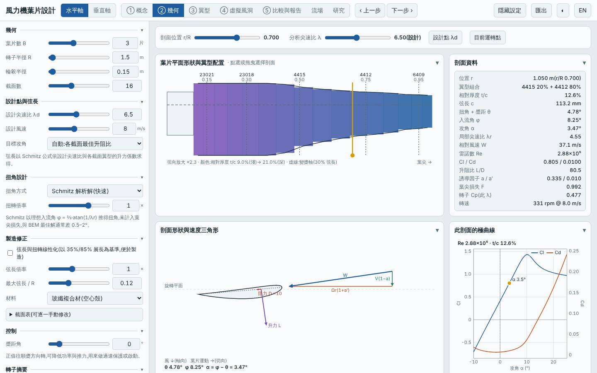
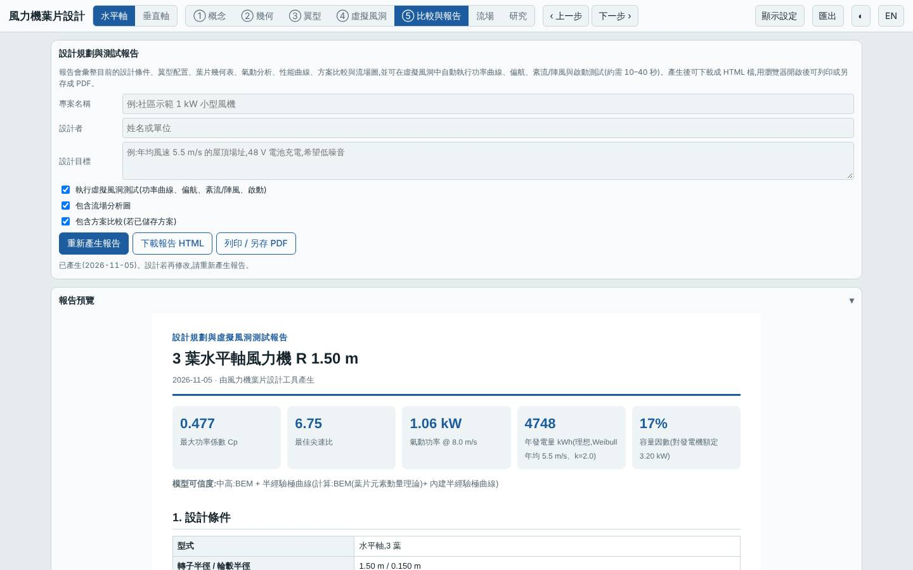

# 三葉五站翼型加 Schmitz 解析扭角(λd 6.5)

日期:2026-11-05(UTC)。探索新方向。基準:預設三葉水平軸(`20261027-baseline`)。

本次相對基準的變更:翼型站由 3 站改為 5 站(r/R 0.15 NACA 23021 → 0.30 NACA 23018 → 0.50 NACA 4415 → 0.75 NACA 4412 → 0.95 NACA 6409);扭角方式 BEM 最佳化 → Schmitz 解析(`twMode: "opt"`);設計尖速比 λd 7 → 6.5。其餘同預設(R 1.5 m、GFRP、Vavg 5.5 m/s、k 2)。

## 假設

Schmitz 解析扭角與 BEM 數值最佳化的 Cp,max 差距在 1% 內;根部加厚的 5 位數翼型提高低 Re 升力,使起轉風速由 3.7 降到約 3.3 m/s;代價是質量增加約 15%。預期年發電量與 LCOE 與基準差異在 ±2% 內。

## 參數掃描(`lab/evaluate.mjs`,標準場址,Node)

| 變體 | Cp,max | 年發電量 kWh | LCOE | 質量 kg | 起轉風速 |
|---|---|---|---|---|---|
| 基準(3 站、BEM、λd 7)| 0.478 | 4758 | 2.75 | 4.3 | 3.7 |
| 3 站 + Schmitz | 0.476 | 4740 | 2.76 | 4.3 | 3.8 |
| 5 站 + BEM | 0.480 | 4773 | 2.74 | 4.3 | 3.7 |
| 5 站 + Schmitz(λd 7)| 0.477 | 4751 | 2.75 | 4.3 | 3.7 |
| 5 站 + BEM、λd 6.5 | 0.480 | 4777 | 2.74 | 4.9 | 3.3 |
| **5 站 + Schmitz、λd 6.5(本設計)**| 0.477 | 4748 | 2.76 | 4.9 | 3.3 |
| 5 站 + Schmitz、maxChord 0.16 | 0.478 | 4759 | 2.76 | 5.9 | 3.5 |
| 5 站 + Schmitz、λd 6.5、槳距 +2° | 0.464 | 4613 | 2.77 | — | 2.7 |
| 5 站 + Schmitz、λd 6.5、槳距 −2° | 0.457 | 4557 | 2.80 | — | 4.6 |

## 結果(本設計 vs 基準)

| 項目 | 本設計 | 基準 | 差異 |
|---|---|---|---|
| Cp,max @ λ | 0.477 @ 6.75 | 0.478 @ 7.25 | −0.2% |
| 年發電量(5.5 m/s)| 4748 kWh | 4758 kWh | −0.2% |
| LCOE | 2.76 NT$/kWh | 2.75 | +0.4% |
| 質量 | 4.9 kg | 4.3 kg | +13% |
| 起轉風速 | 3.3 m/s | 3.7 m/s | −0.4 m/s |
| 最小 / 極端安全係數 | 8.72 / 3.40 | 5.97 / — | 改善 |
| 葉尖撓度 | 22.9 mm | — | — |
| 模擬 | 6 m/s 追蹤 95%、9 m/s 追蹤 97%;5 m/s 可自啟動,3、4 m/s 否 | 5 m/s 可自啟動 | 相同 |

介面驗證(`lab:ui`):介面 Cp,max 0.4769 與 Node 評估一致,掃掠面積 7.069 m²、質量 4.87 kg 一致;報告虛擬風洞測試完成,桌面與手機版無 console 錯誤。

## 結論

**大致成立。** Schmitz 解析扭角與 BEM 最佳化的 Cp,max 差 0.003(0.6%,在 1% 內),翼型站數增加對 Cp 的影響同樣在 ±0.5% 內,年發電量與 LCOE 與基準幾乎相同。起轉風速由 3.7 降到 3.3 m/s 主要來自 λd 降低(弦長變大),質量 +13%,但自啟動門檻(模擬)沒有改變:仍要 5 m/s。槳距 ±2° 都使 Cp,max 降 3–4%,0° 已是最佳;+2° 可把起轉風速壓到 2.7 m/s,但付出 −2.9% 年發電量。

適合:需要在沒有 BEM 最佳化工具的情況下手算扭角的場合,或想在不傷發電量的前提下略降起轉風速;此設計不是效能躍進。

過程中發現:`docs/BLADE_LAB.md` 寫扭角方式 `schmitz`,但程式實際代碼是 `opt`;寫錯時 `lab:eval` 不報錯、數值走到與 `opt` 相同的分支,介面卻顯示 `undefined`。已改用 `opt` 並開 issue 記錄。

模型限制:極曲線為半經驗模型,起轉風速為靜摩擦估算,低 Re 偏樂觀;5 位數翼型的極曲線同樣由面板法估算,非 XFOIL。所有數值為本工具模型預測,非實測。

## 3D 模型

`model/` 內有 `make_model.mjs`(以本工具 `hawtBlade` 放樣)產生的 `blade.stl`、`rotor.stl`(mm、軸 Z),以及 `blender_import.py`;本次以 pip 的 `bpy`(Python 3.13)實際執行,產生 `rotor.blend`。

## 下一次可以試

- 垂直軸 H 型加 `pitch`(固定預設槳距 ±3°)與 NACA 0021 厚翼型,檢視起轉風速能否降到 2.5 m/s 以下
- 水平軸材料 `wood` 搭配線性扭角與 λd 6,找出最低成本(LCOE)的易製造組合

## 截圖

