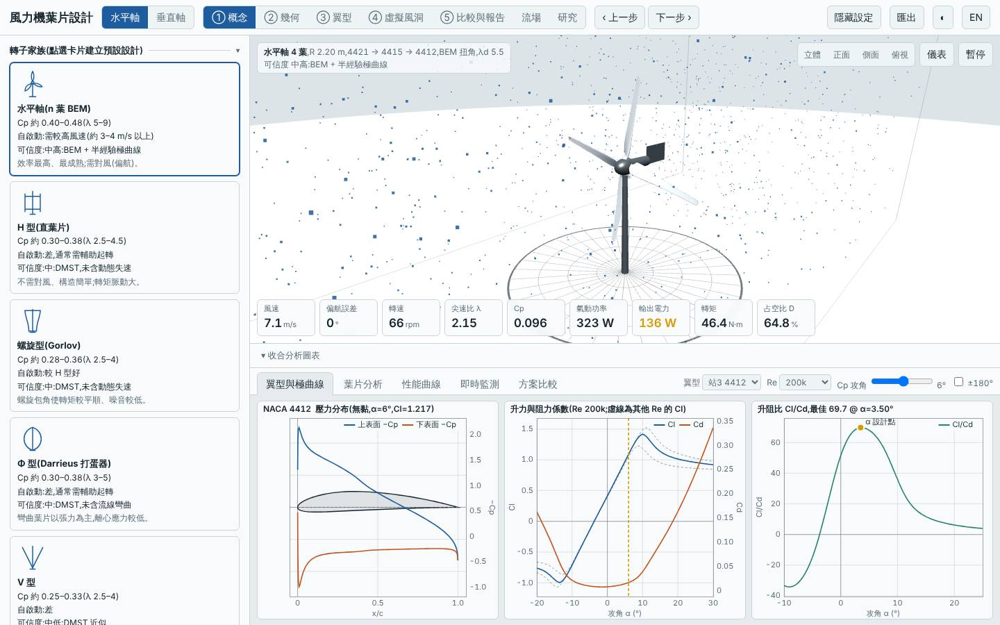
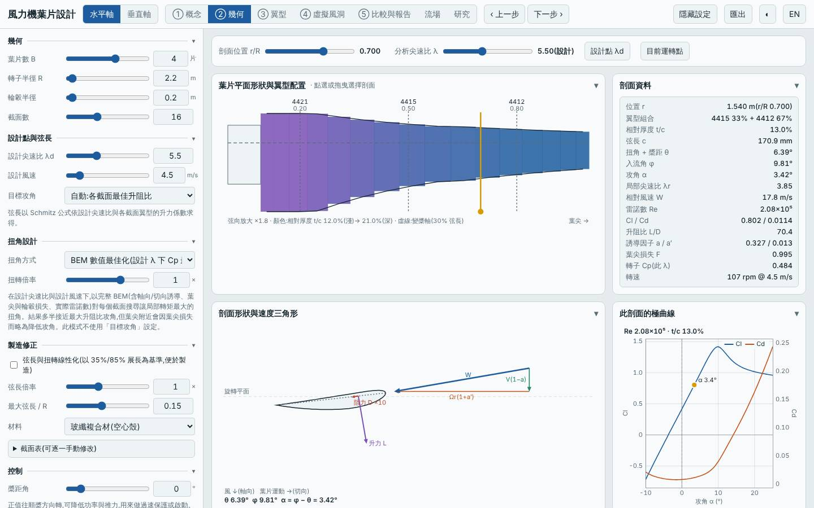
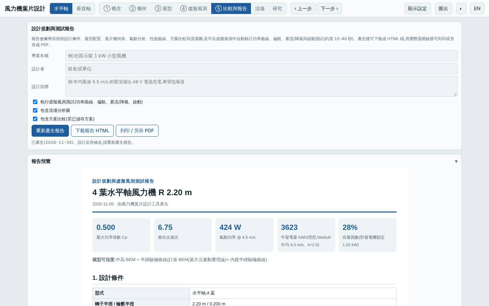
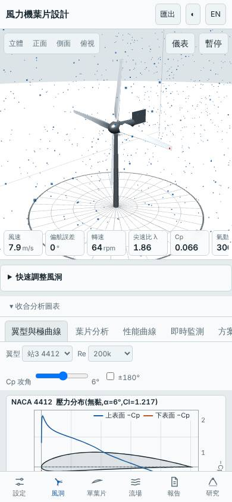

# 四葉低風速場址大轉子限額 1.5 kW(深入研究:掃描 Pmax、λd、弦長上限)

日期:2026-11-05(UTC)。**深入研究 ← parent `20261102-hawt-b4-lowwind`**(R 2.2 m、B 4、λd 5、Vd 4.5 m/s、GFRP、自動匹配額定 7.3 kW,Vavg 4 m/s)。基準:預設三葉水平軸(同風況重算)。

本次相對 parent 的變更:`load.Pmax` 7300 → 1500 W、`tsr` 5 → 5.5、`maxChord` 0.20 → 0.15;R、B、Vd、翼型、材料不變。

## 假設

parent 的自動額定 7.3 kW 遠大於低風速場址用得到的功率(容量因數 6.8%),LCOE 因此偏高。限制額定在 1.5 kW,並同時把 λd 降到 5.5、弦長上限降到 0.15 m(減質量),預期自身場址 LCOE 降 50% 以上、標準場址 LCOE 也低於 parent 的 2.86;代價是年發電量約 −15–20%、起轉風速略升但仍 < 2 m/s。

## 參數掃描(`lab/evaluate.mjs`,Node)

| 變體 | Cp,max | 年發電量 kWh(4 m/s)| LCOE(4 m/s)| 標準場址年發電量 | 標準場址 LCOE | 起轉風速 | 質量 kg | 最小安全係數 / 極端 |
|---|---|---|---|---|---|---|---|---|
| parent(Pmax 7300 自動)| 0.502 | 4364 | 7.05 | 10758 | 2.86 | 1.25 | 37.3 | 62.9 / 4.52 |
| Pmax 3000 | 0.502 | 4175 | 3.97 | 8673 | 1.91 | 1.25 | 37.3 | 62.9 / 4.52 |
| Pmax 2000 | 0.502 | 3906 | 3.39 | 7298 | 1.82 | 1.25 | 37.3 | 62.9 / 4.52 |
| Pmax 1500 | 0.502 | 3632 | 3.20 | 6289 | 1.85 | 1.25 | 37.3 | 62.9 / 4.52 |
| Pmax 1000 | 0.502 | 3150 | 3.16 | 4932 | 2.02 | 1.25 | 37.3 | 62.9 / 4.52 |
| Pmax 1500、R 2.0 | 0.489 | 3097 | 3.32 | 5675 | 1.81 | 1.29 | 26.7 | 56.4 / 4.29 |
| Pmax 1500、R 2.4 | 0.498 | 4066 | 3.22 | 6750 | 1.94 | 1.26 | 49.6 | 68.1 / 5.24 |
| Pmax 1500、B 3 | 0.481 | 3524 | 3.37 | 6169 | 1.92 | 1.32 | 43.3 | 116 / 9.31 |
| Pmax 2000、Vd 4 | 0.502 | 3906 | 3.39 | 7298 | 1.81 | 1.13 | 36.5 | 71.3 / 4.31 |
| Pmax 1500、λd 5.5 | 0.493 | 3582 | 3.12 | 6234 | 1.79 | 1.42 | 27.7 | 34.6 / 3.02 |
| Pmax 1500、λd 6 | 0.494 | 3592 | 3.04 | 6245 | 1.75 | 1.62 | 21.3 | 20.9 / 2.21 |
| Pmax 1200、λd 5.5 | 0.493 | 3337 | 3.06 | 5486 | 1.86 | 1.42 | 27.7 | 34.6 / 3.02 |
| **Pmax 1500、λd 5.5、弦長 ≤ 0.15(本設計)** | 0.500 | 3623 | 3.07 | 6279 | 1.77 | 1.39 | 26.4 | 34.6 / 3.02 |
| Pmax 1500、λd 6、弦長 ≤ 0.15 | 0.494 | 3592 | 3.04 | 6245 | 1.75 | 1.62 | 21.3 | 20.9 / 2.21 |
| Pmax 1500、λd 5.5、R 2.4 | 0.495 | 4054 | 3.10 | 6737 | 1.87 | 1.41 | 37.4 | 38.7 / 3.24 |
| Pmax 1500、λd 5.5、木材 | 0.493 | 3582 | 2.92 | 6234 | 1.68 | 1.42 | 29.4 | 29.5 / 2.51 |

λd 6 的 LCOE 略低但起轉風速升到 1.62 m/s、極端安全係數降到 2.2,取捨後選 λd 5.5。木材 LCOE 最低,但那是換材料(成本表差異),不是葉片設計本身,不納入本設計;列出供參考。

## 相對 parent 的改善

| 項目 | 本設計 | parent | 變化 |
|---|---|---|---|
| 自身場址 LCOE(4 m/s)| 3.07 | 7.05 | −56% |
| 自身場址年發電量 | 3623 kWh | 4364 kWh | −17% |
| 標準場址 LCOE(5.5 m/s)| 1.77 | 2.86 | −38% |
| 標準場址年發電量 | 6279 kWh | 10758 kWh | −42% |
| 起轉風速 | 1.4 m/s | 1.25 m/s | 略升,3 / 4 / 5 m/s 模擬皆可自啟動 |
| 質量 | 26.4 kg | 37.3 kg | −29% |
| Cp,max | 0.500 @ λ 6.75 | 0.502 @ λ 6.0 | 持平 |
| 最小 / 極端安全係數 | 34.6 / 3.02 | 62.9 / 4.52 | 下降但仍充裕 |

## 介面驗證

`lab:ui` 全數通過:介面 Cp,max 0.5001 與 Node 一致,掃掠面積 15.205 m²、質量 26.36 kg 一致;報告虛擬風洞測試完成;桌面與手機版無 console 錯誤。模擬 6 m/s 輸出 830 W、追蹤率 94%;9 m/s 輸出 1544 W(額定削峰,追蹤率 52% 屬預期);3/4/5 m/s 靜止起步皆自啟動。已目視檢查 blade.jpg(幾何頁 B 4、R 2.2、λd 5.5、最大弦長 0.15)與 tunnel.jpg(四葉轉子)。

## 結論

**大致成立。** 自身場址 LCOE 由 7.05 降到 3.07(−56%,預期 −50%)、標準場址 2.86 → 1.77,質量 −29%,Cp,max 不變,年發電量 −17%(落在預期 15–20%),起轉風速 1.4 m/s(< 2 m/s)。主要收益來自「限額」,λd 與弦長的調整只貢獻小幅質量與 LCOE 改善。與 #180 的三葉 R 1.9 m 限額 1.0 kW 版本相比,本設計年發電量高得多(自身場址 3623 vs 2585 kWh)但 LCOE 略低(3.07 vs 3.09 幾乎持平),標準場址 LCOE 1.77 優於其 1.83。

適合年均風速約 4 m/s、重視 LCOE 與發電量並接受 26 kg 轉子的場址。

模型限制:成本為概估,發電機成本隨額定縮放的假設直接決定最佳 Pmax;低 Re 極曲線偏樂觀;起轉風速為靜摩擦估算;無結構動態與塔影。所有數值為本工具模型預測,非實測。

## 3D 模型

`model/` 內有 `make_model.mjs`(以本工具 `hawtBlade` 放樣)產生的 `blade.stl`、`rotor.stl`(mm、軸 Z、四葉),以及 `blender_import.py`;本次以 pip 的 `bpy` 實際執行,產生 `rotor.blend`。

## 下一次可以試

- 低風速場址改用變槳或被動槳距限功率,取代單純限額,看高風速段能否保留更多發電量
- 四葉 R 2.2 m 改成 `twMode: schmitz` 或線性化葉片,檢視製造簡化對 LCOE 的代價

## 截圖

