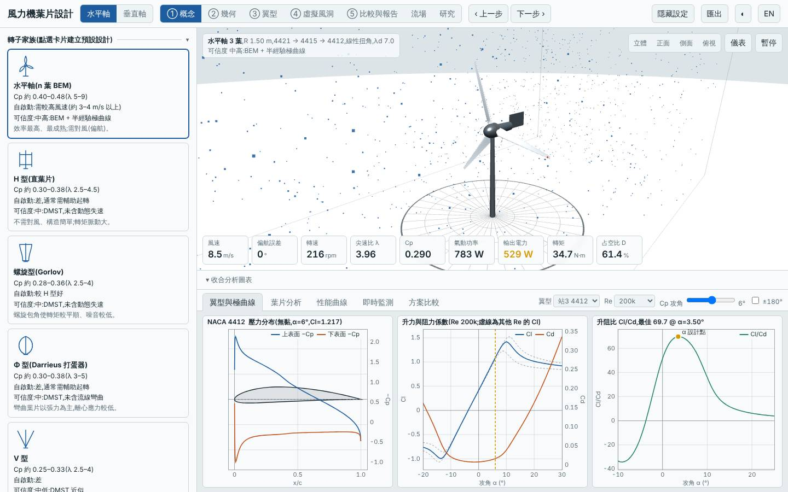
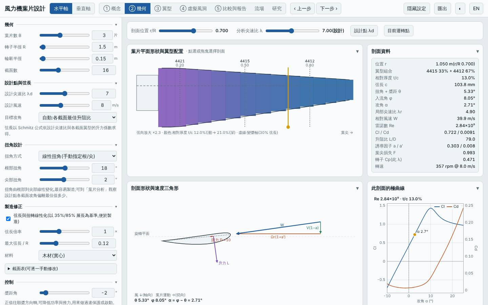
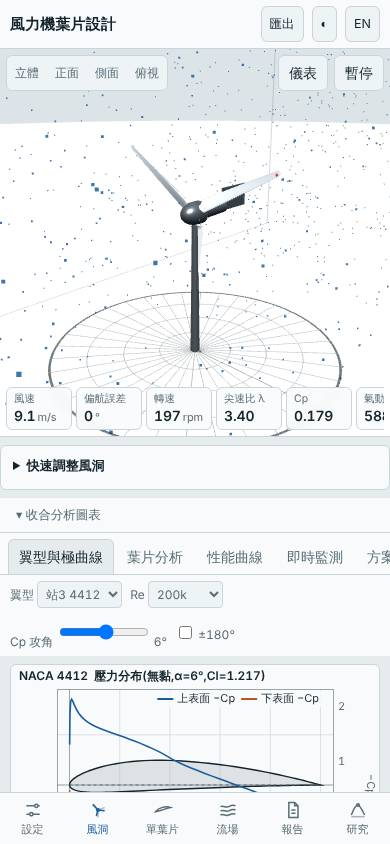

# 三葉線性化木製葉片加固定負槳距 −2°

- 日期:2026-11-06
- 相對 `20261101-hawt-b3-linear` 的變更:僅 `pitch` 0° → −2°(葉片幾何、扭角 18° → 2°、木材、B 3、λd 7、R 1.5 m 均不變);另與預設基準比較
- 基準:同模式預設設計(`20261027-baseline`)與前一版線性化葉片,同風況 Weibull 5.5 m/s、k 2
- 承接 `20261106-vawt-h-b4-toeout`「下一次可以試」:水平軸 `pitch` 掃描搭配 `linearize`

## 假設

線性扭角在葉尖偏大,固定槳距 −2° 應可補回部分 Cp(預期 +3–5%);代價是起轉風速上升,且過大負槳距會使外側失速、Cp 下降。

## 槳距掃描(Node,其餘參數同線性化設計)

| 槳距 | Cp,max | 最佳 λ | 年發電量 kWh | LCOE | 起轉風速 m/s |
|---|---|---|---|---|---|
| −5° | 0.443 | 6.00 | 4413 | 2.789 | 8.91 |
| −4° | 0.457 | 6.25 | 4559 | 2.772 | 5.77 |
| −3° | 0.468 | 6.75 | 4648 | 2.719 | 4.47 |
| **−2°** | **0.471** | 7.25 | **4699** | 2.760 | 3.70 |
| −1° | 0.467 | 7.50 | 4638 | 2.724 | 3.22 |
| 0°(前一版) | 0.451 | 7.25 | 4484 | 2.745 | 2.93 |
| +2° | 0.396 | 6.50 | 3954 | 2.862 | 2.50 |
| +4° | 0.336 | 5.50 | 3356 | 2.979 | 2.24 |

## 結果(模型預測)

| 項目 | 本設計 | 前一版線性化(0°) | 預設基準 |
|---|---|---|---|
| Cp,max | 0.471 @ λ 7.25 | 0.451 | 0.478 |
| 年發電量(理想 MPPT) | 4699 kWh | 4484(本設計 +4.8%) | 4758(−1.2%) |
| LCOE(概估) | 2.76 NT$/kWh | 2.74 | 2.75 |
| 轉子質量 | 4.50 kg | 4.50 kg | 4.33 kg |
| 起轉風速 | 3.70 m/s | 2.93 m/s | 3.73 m/s |
| 模擬自啟動 3/4/5 m/s | 否/否/是 | 否/是/是 | 否/否/是 |
| 6 m/s、9 m/s MPPT 追蹤率 | 95%、97% | 95%、97% | 95%、97% |
| 最小安全係數 / 極端 | 7.03 / 2.65 | 7.03 / 2.65 | 5.97 |

## 介面驗證

`npm run lab:ui`:介面 Cp,max 0.4713 與 `lab:eval` 一致、掃掠面積 7.069 m²、質量 4.50 kg 一致,報告下載與虛擬風洞測試通過,桌面與手機版無 console 錯誤。截圖確認槳距欄位為 −2°、剖面表扭角 5.33°(r/R 0.7)。

## 結論:大致成立

固定槳距 −2° 把線性化葉片的 Cp,max 從 0.451 補回 0.471(+4.4%),年發電量 +4.8%,回到預設基準的 98.8%,質量不變,等於免費找回大部分線性化損失。代價與預期相符:起轉風速 2.93 → 3.70 m/s,又回到與基準相同、4 m/s 無法自啟動(線性化版原本的起轉優勢被換掉)。LCOE 持平(額定隨 Cp 上升而放大,CAPEX 增加抵銷)。槳距有明顯的甜蜜點:−3° 以上 Cp 與起轉風速都惡化(−5° 起轉 8.9 m/s)。適合風速較高、不在意低風速自啟動的場址;低風速場址應保持 0° 或搭配輔助起轉。

## 模型限制

固定槳距在模型中視為整支葉片的剛性偏轉,不含槳距調整誤差與葉片變形;起轉風速為靜摩擦估算,對剖面低攻角極曲線敏感。所有數值為本工具模型預測,不是實測。

## 下一次可以試

- 以 BEM 最佳扭角(非線性)搭配槳距 −2° ~ +2° 掃描,看線性扭角的損失是否只靠槳距就能完全補平
- 四葉或五葉的線性化葉片,測試較大實度能否在負槳距下維持較低起轉風速

## 3D 模型

`model/`:`blade.stl`、`rotor.stl`(單位 mm)、`make_model.mjs`、`blender_import.py`,以及用 bpy 5.2 實際匯入產生的 `rotor.blend`。

## 截圖

   
