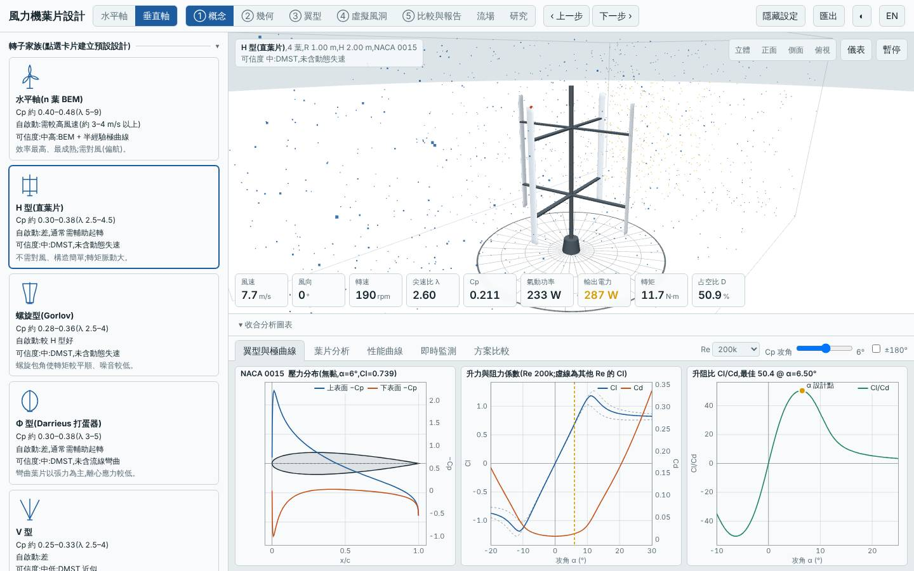
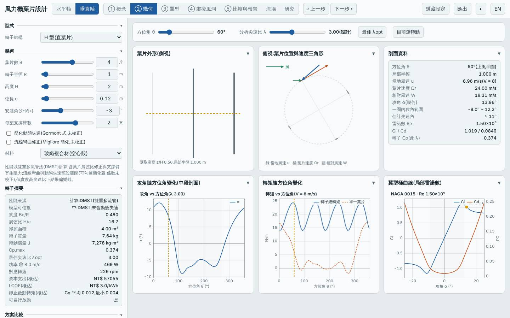
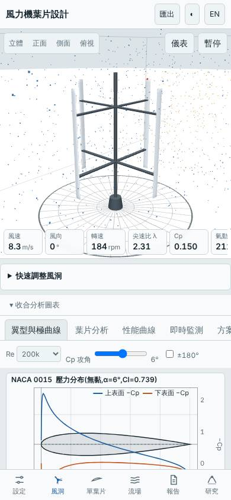

# 四葉 H 型垂直軸負槳距 −3°(弦長 0.12 m、NACA 0015)

日期:2026-11-06(UTC)。基準:預設 H 型(R 1 m、H 2 m、三葉、c 0.15 m、NACA 0018、槳距 0°)。

本次相對基準的變更:葉片數 3 → 4、弦長 0.15 → 0.12 m(實度 Bc/R 0.45 → 0.48,相近)、翼型 NACA 0018 → 0015、**安裝角(槳距)0° → −3°**。非單變量比較;事前以 Node 掃描確認槳距效應(NACA 0018、B3:−2° 0.360、−3° 0.355、−4° 0.343、+3° 0.237,−6° 下降)。

## 假設

H 型葉片在上風側與下風側攻角符號相反,預設槳距 0° 不是 DMST 的最佳點。預期固定負槳距使 Cp,max 提升約 5–8%;四葉細弦降低質量;代價是起轉風速上升、仍需輔助起轉。

## 結果(模型預測,風況 5.5 m/s、k 2)

| 項目 | 本設計 | 基準(預設 H 型) | 差異 |
|---|---|---|---|
| Cp,max | 0.374 @ λ 3.00 | 0.334 @ λ 3.50 | +11.9% |
| Cp ≥ 90% 的 λ 範圍 | 2.75–3.50 | 2.75–4.00 | — |
| 掃掠面積 | 4.0 m² | 4.0 m² | 0 |
| 年發電量(理想 MPPT)| 2101 kWh | 1886 kWh | +11.4% |
| 容量因數 / 發電機額定 | 17.1% / 1.4 kW | 16.6% / 1.3 kW | — |
| LCOE(概估)| 2.99 NT$/kWh | 3.22 | −7.1% |
| 轉子質量 | 7.64 kg | 10.38 kg | −26% |
| 起轉風速(靜摩擦估算)| 2.81 m/s | 2.70 m/s | +0.1 |
| 模擬自啟動 3/4/5 m/s | 皆否 | 否 | 持平 |
| MPPT 追蹤率 6 / 9 m/s | 94% / 97% | — | — |

介面驗證(`lab:ui`):介面 Cp,max 0.3735 與 Node 評估一致,掃掠面積 4.000 m²、質量 7.64 kg 一致;報告的虛擬風洞測試完成並下載;桌面與手機版無 console 錯誤;截圖確認為四葉 H 型、安裝角 −3°。

## 結論

大致成立。Cp,max 提升 11.9%(高於預期 5–8%,其中一部分來自四葉細弦與 0015 翼型,不全是槳距)、年發電量 +11.4%、質量 −26%、LCOE −7.1%;起轉風速僅 +0.1 m/s,仍無法自行啟動(與預期相符)。在垂直軸中年發電量與 LCOE 都位居前緣。適合有輔助起轉(或電動起轉)且想用最簡單的固定結構提高產出的場合。

限制:半經驗極曲線非 XFOIL;DMST 未含動態失速與流線彎曲,高 λ 偏樂觀(可信度中);負槳距的最佳值對模型極曲線敏感,實機趨勢未驗證;起轉風速為靜摩擦估算;成本為概估。所有數值為本工具的模型預測,非實測。

## 3D 模型

`model/` 內有 `make_model.mjs`(純 Node,以本工具 `vawtBlade` 放樣)產生的 `blade.stl`、`rotor.stl`(mm、轉子軸 Y),以及 `blender_import.py`;已用 pip 安裝的 `bpy` 實際執行,產生 `rotor.blend`(含 GFRP 材質、日光、相機)。模型只含葉片、輪轂與主軸,未含支撐臂。

## 下一次可以試

- 同一組參數開啟 `dynStall` 與 `curvature`(掃描時 Cp,max 降至 0.352),檢視負槳距優勢在較保守模型下是否仍在
- 水平軸 `pitch` 掃描搭配 `linearize`,看固定槳距能否補償線性化的 Cp 損失

## 截圖

   
