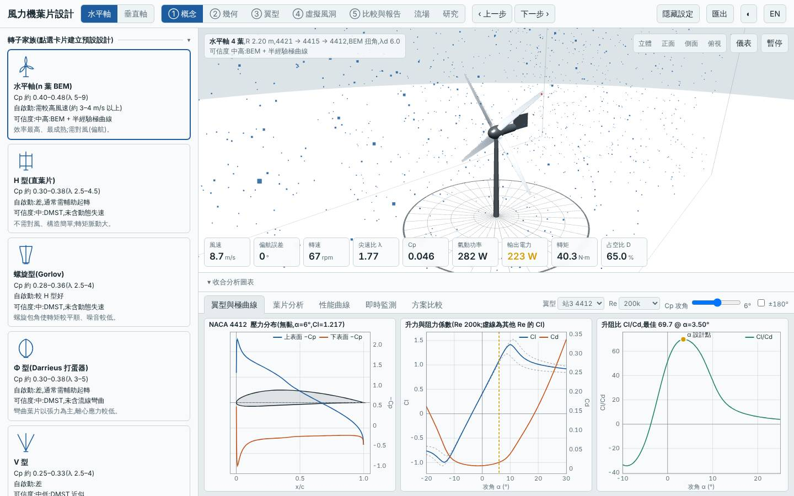
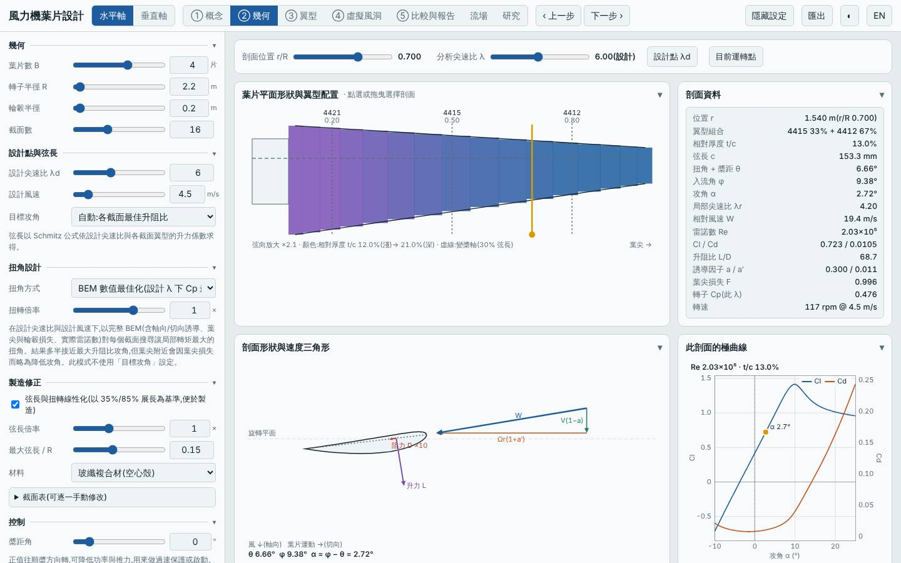
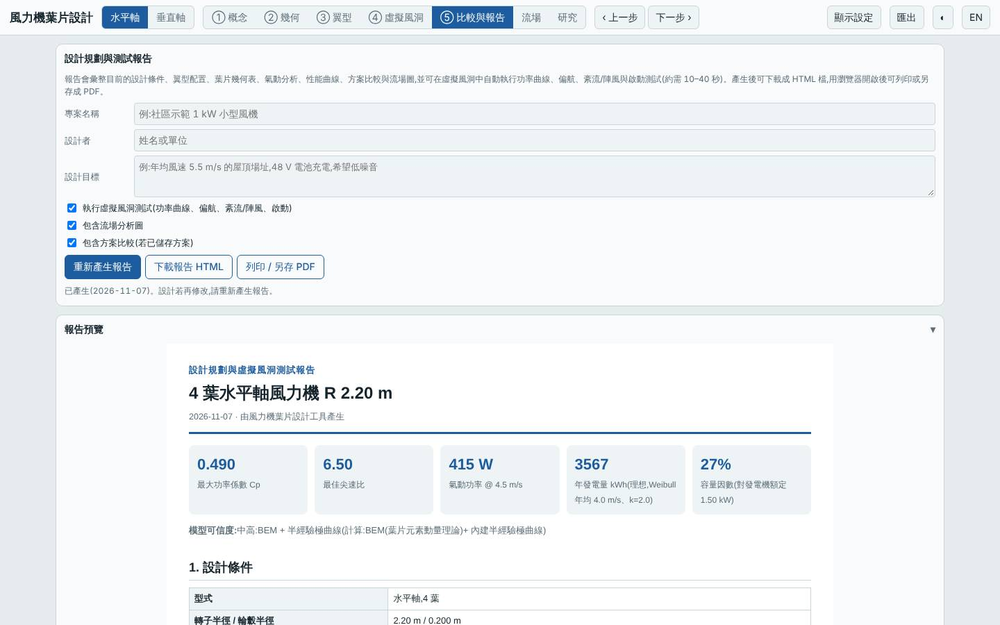
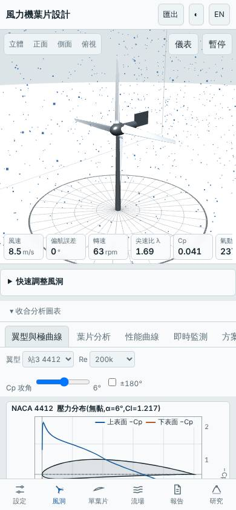

# 四葉低風速限額 1.5 kW 轉子改線性化葉片(深入研究:掃描扭角方式、線性化、λd、槳距)

日期:2026-11-07(UTC)。**深入研究 ← parent `20261105-hawt-b4-lowwind-p1500`**(R 2.2 m、B 4、λd 5.5、Pmax 1.5 kW、弦長上限 0.15 m、GFRP,Vavg 4 m/s)。基準:預設三葉水平軸(同風況重算)。

本次相對 parent 的變更:開啟 `linearize`(弦長與扭角線性化)、`tsr` 5.5 → 6;其餘不變。

## 假設

parent 的弦長與扭角是 BEM 最佳化的曲線外形,製造較複雜。改成線性化並把 λd 升到 6 以降質量,預期 Cp,max 損失 ≤ 2.5%、標準場址年發電量損失 ≤ 1%、質量 −20% 以上、標準場址 LCOE 不高於 parent 的 1.77;代價是起轉風速升到約 1.7 m/s、極端安全係數下降但仍 > 3。

## 參數掃描(`lab/evaluate.mjs`,Pmax 1500 W、R 2.2、B 4、弦長 ≤ 0.15)

| 變體 | Cp,max | 年發電量 kWh(4 m/s)| LCOE(4 m/s)| 標準場址年發電量 | 標準場址 LCOE | 起轉風速 | 質量 kg | 最小安全係數 / 極端 |
|---|---|---|---|---|---|---|---|---|
| parent(BEM、λd 5.5)| 0.500 | 3623 | 3.07 | 6279 | 1.77 | 1.39 | 26.4 | 34.6 / 3.02 |
| Schmitz 解析扭角 | 0.497 | 3605 | 3.09 | 6259 | 1.78 | 1.45 | 26.4 | 34.8 / 3.02 |
| 線性化 | 0.489 | 3567 | 3.10 | 6217 | 1.78 | 1.47 | 25.1 | 48.7 / 4.25 |
| 線性化 + 木材 | 0.489 | 3567 | 2.92 | 6217 | 1.67 | 1.47 | 26.7 | 41.7 / 3.53 |
| 線性扭角 20→0° | 0.482 | 3526 | 3.16 | 6172 | 1.80 | 1.63 | 26.4 | 31.0 / 3.02 |
| 線性化 + Schmitz | 0.490 | 3570 | 3.10 | 6220 | 1.78 | 1.47 | 25.1 | 47.7 / 4.25 |
| 線性化 + λd 5 | 0.489 | 3566 | 3.20 | 6216 | 1.83 | 1.28 | 32.4 | 78.6 / 5.45 |
| 線性化 + 槳距 −1° | 0.486 | 3547 | 3.12 | 6195 | 1.79 | 1.64 | 25.1 | 48.7 / 4.25 |
| 線性化 + 槳距 +1° | 0.484 | 3536 | 3.13 | 6183 | 1.79 | 1.33 | 25.1 | 48.7 / 4.25 |
| **線性化 + λd 6(本設計)** | 0.490 | 3567 | 3.02 | 6217 | 1.73 | 1.66 | 18.6 | 30.7 / 3.18 |

木材 LCOE 最低,但那是換材料(成本表差異),不納入本設計。

## 相對 parent 的改善

| 項目 | 本設計 | parent | 變化 |
|---|---|---|---|
| 自身場址 LCOE(4 m/s)| 3.02 | 3.07 | −1.6% |
| 自身場址年發電量 | 3567 kWh | 3623 kWh | −1.5% |
| 標準場址 LCOE(5.5 m/s)| 1.73 | 1.77 | −2.3% |
| 標準場址年發電量 | 6217 kWh | 6279 kWh | −1.0% |
| 起轉風速 | 1.7 m/s | 1.4 m/s | 略升,3 / 4 / 5 m/s 模擬皆可自啟動 |
| 質量 | 18.6 kg | 26.4 kg | −30% |
| Cp,max | 0.490 @ λ 6.5 | 0.500 @ λ 6.75 | −2.0% |
| 最小 / 極端安全係數 | 30.7 / 3.18 | 34.6 / 3.02 | 持平(極端略升) |

## 介面驗證

`lab:ui` 全數通過:介面 Cp,max 0.4895 與 Node 一致,掃掠面積 15.205 m²、質量 18.59 kg 一致;報告虛擬風洞測試完成;桌面與手機版無 console 錯誤。模擬 6 m/s 輸出 829 W、追蹤率 96%;9 m/s 輸出 1491 W(額定削峰,追蹤率 51% 屬預期);3/4/5 m/s 靜止起步皆自啟動。已目視檢查 blade.jpg(幾何頁 B 4、R 2.2、λd 6、線性化已勾選)與 tunnel.jpg(四葉轉子)。

## 結論

**大致成立。** 假設的各項都達成:Cp,max −2.0%(門檻 2.5%)、標準場址年發電量 −1.0%(門檻 1%)、質量 −30%、標準場址 LCOE 1.77 → 1.73、起轉風速 1.7 m/s、極端安全係數 3.18。線性化本身只付出約 2% 的 Cp,質量與 LCOE 的收益主要來自 λd 6(弦長變小)。扭角方式(Schmitz)與槳距微調都沒有帶來改善。LCOE 改善幅度(−2.3%)在成本概估的不確定範圍內,實質結論是「線性化葉片在這個轉子上幾乎沒有氣動代價,且製造更簡單、質量更輕」。

適合年均風速約 4 m/s、希望葉片易製造且輕量的場址。

模型限制:成本為概估;低 Re 極曲線偏樂觀;起轉風速為靜摩擦估算;無結構動態與塔影。所有數值為本工具模型預測,非實測。

## 3D 模型

`model/` 內有 `make_model.mjs`(以本工具 `hawtBlade` 放樣)產生的 `blade.stl`、`rotor.stl`(mm、軸 Z、四葉)與 `blender_import.py`;本次以 pip 的 `bpy` 實際執行,產生 `rotor.blend`(GFRP 材質)。

## 下一次可以試

- 變槳或被動槳距限功率取代單純限額(目前工具僅支援固定槳距,需先確認是否有此功能)
- 弦長上限降到 0.12 m 並配合 λd 6.5,檢視質量與安全係數的下限

## 截圖

