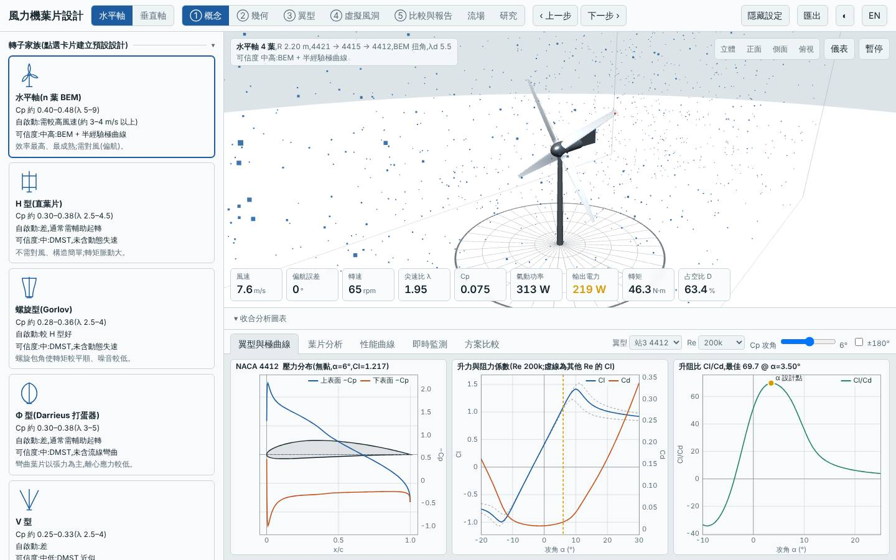
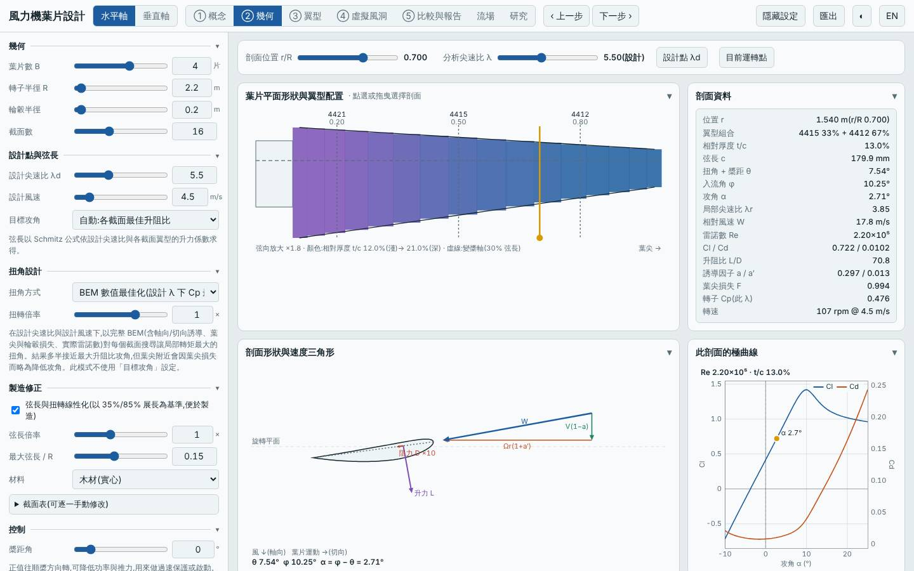
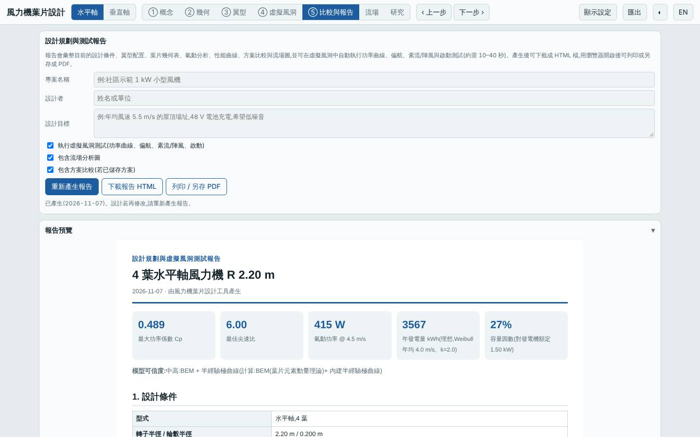
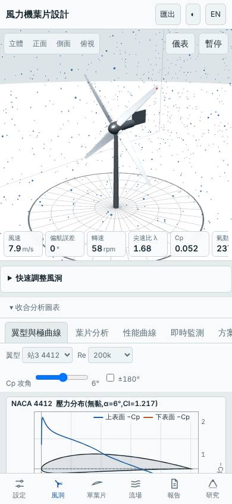

# 四葉低風速大轉子限額 1.5 kW 線性化木製葉片(深入研究:扭角方式、線性化、材料、槳距掃描)

日期:2026-11-07(UTC)。**深入研究 ← parent `20261105-hawt-b4-lowwind-p1500`**(R 2.2 m、B 4、λd 5.5、Vd 4.5 m/s、弦長上限 0.15 m、Pmax 1500 W、GFRP、BEM 最佳扭角,Vavg 4 m/s)。基準:預設三葉水平軸(同風況重算)。

本次相對 parent 的變更:`hawt.linearize` 開啟(弦長與扭角線性化,以 35%/85% 展長為基準)、`hawt.material` gfrp → wood;其餘不變。

## 假設

parent 為 BEM 最佳扭角與弦長的 GFRP 葉片,製造複雜。改用線性化葉片並以木材製作,預期 Cp,max 下降約 2%、年發電量 −1~2%,但製造成本降低使自身場址 LCOE 低於 parent 的 3.07、標準場址低於 1.77;起轉風速仍低於 2 m/s、極端安全係數仍大於 2。

## 參數掃描(`lab/evaluate.mjs`,Node)

| 變體 | Cp,max | 年發電量 kWh(4 m/s)| LCOE(4 m/s)| 標準場址年發電量 | 標準場址 LCOE | 起轉風速 | 質量 kg | 最小安全係數 / 極端 |
|---|---|---|---|---|---|---|---|---|
| parent(BEM、GFRP)| 0.500 | 3623 | 3.07 | 6279 | 1.77 | 1.39 | 26.4 | 34.6 / 3.02 |
| Schmitz 扭角 | 0.497 | 3605 | 3.09 | 6259 | 1.78 | 1.45 | 26.4 | 34.8 / 3.02 |
| 線性化(線性弦長 + 線性扭角 18°→2°)| 0.490 | 3570 | 3.10 | 6221 | 1.78 | 1.48 | 25.1 | 48.3 / 4.25 |
| 線性化(BEM 扭角取線性近似)| 0.489 | 3567 | 3.10 | 6217 | 1.78 | 1.47 | 25.1 | 48.7 / 4.25 |
| **線性化 + 木材(本設計)** | 0.489 | 3567 | 2.92 | 6217 | 1.67 | 1.47 | 26.7 | 41.7 / 3.53 |
| 槳距 −2° | 0.477 | 3501 | 3.18 | 6144 | 1.81 | 1.90 | 26.4 | 34.6 / 3.02 |
| 槳距 +2° | 0.474 | 3485 | 3.19 | 6126 | 1.82 | 1.25 | 26.4 | 34.6 / 3.02 |
| 線性化 + 槳距 −2° | 0.476 | 3494 | 3.17 | 6136 | 1.80 | 1.85 | 25.1 | 48.7 / 4.25 |

槳距 ±2° 都使 Cp,max 下降 5% 左右(設計點已接近最佳槳距),此方向不值得再試。純氣動上線性化讓 LCOE +1.1%,而木材的成本表差異才是 LCOE 下降的來源(材料換成木材,比「葉片設計」本身更像成本假設),下方結論會分開說明。

## 相對 parent 的改善

| 項目 | 本設計 | parent | 變化 |
|---|---|---|---|
| 自身場址 LCOE(4 m/s)| 2.92 | 3.07 | −4.9% |
| 自身場址年發電量 | 3567 kWh | 3623 kWh | −1.5% |
| 標準場址 LCOE(5.5 m/s)| 1.67 | 1.77 | −5.6% |
| 標準場址年發電量 | 6217 kWh | 6279 kWh | −1.0% |
| 起轉風速 | 1.5 m/s | 1.4 m/s | 略升,3 / 4 / 5 m/s 模擬皆可自啟動 |
| 質量 | 26.7 kg | 26.4 kg | +1.3% |
| Cp,max | 0.489 @ λ 6.0 | 0.500 @ λ 6.75 | −2.1% |
| 最小 / 極端安全係數 | 41.7 / 3.53 | 34.6 / 3.02 | 提高 |
| 噪音(50 m)| 44.3 dB | 46.8 dB | −2.5 dB(最佳 λ 降低)|

## 介面驗證

`lab:ui` 全數通過:介面 Cp,max 0.4895 與 Node 一致,掃掠面積 15.205 m²、質量 26.69 kg 一致;報告虛擬風洞測試完成;桌面與手機版無 console 錯誤。模擬 6 m/s 輸出 811 W、追蹤率 94%;9 m/s 輸出 1401 W(額定削峰,追蹤率 48% 屬預期);3/4/5 m/s 靜止起步皆自啟動。已目視檢查 blade.jpg(B 4、R 2.2、λd 5.5、勾選線性化、材料木材、最大弦長 0.15)與 tunnel.jpg(四葉轉子)。

## 結論

**大致成立。** Cp,max −2.1%、年發電量 −1.0~−1.5%(預期 −1~2%),自身場址 LCOE 3.07 → 2.92(−4.9%)、標準場址 1.77 → 1.67(−5.6%),起轉風速 1.5 m/s(< 2),極端安全係數 3.53(> 2)。標準場址 LCOE 1.67 是目前水平軸排行榜最低。

重要保留:LCOE 的改善完全來自**木材的成本表**,線性化本身只讓 LCOE 微升 1.1%(氣動損失略大於其節省的製造成本)。本工具只有 Cp、質量、材料單價的簡化成本模型,沒有計入複雜扭角葉片的製造工時,因此線性化對製造成本的好處在此被低估。適合重視易製造、可木工自製、年均風速約 4 m/s 的場址。

模型限制:成本為概估;木材取各向同性等效參數;低 Re 極曲線偏樂觀;起轉風速為靜摩擦估算;無結構動態與塔影。所有數值為本工具模型預測,非實測。

## 3D 模型

`model/` 內有 `make_model.mjs`(以本工具 `hawtBlade` 放樣)產生的 `blade.stl`、`rotor.stl`(mm、軸 Z、四葉),以及 `blender_import.py`;本次以 pip 的 `bpy` 實際執行,產生 `rotor.blend`(木材材質)。

## 下一次可以試

- 把木材線性化葉片換成 `pitch` 之外的被動限功率(例如更高的 Pmax 對應較小轉子),看標準場址年發電量與 LCOE 的取捨
- 在木材線性化葉片上改用 `arc:5` 圓弧板翼型站(根部),檢視更簡單的翼型對起轉風速與製造性的影響

## 截圖

