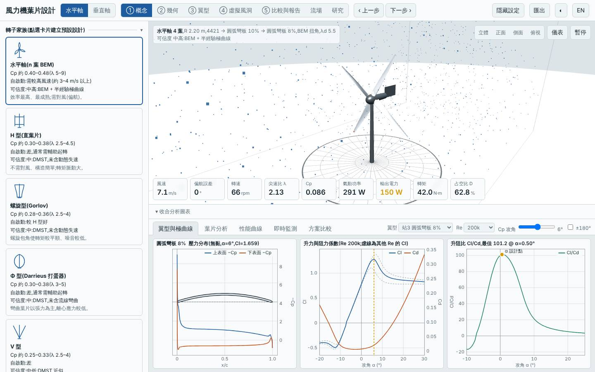
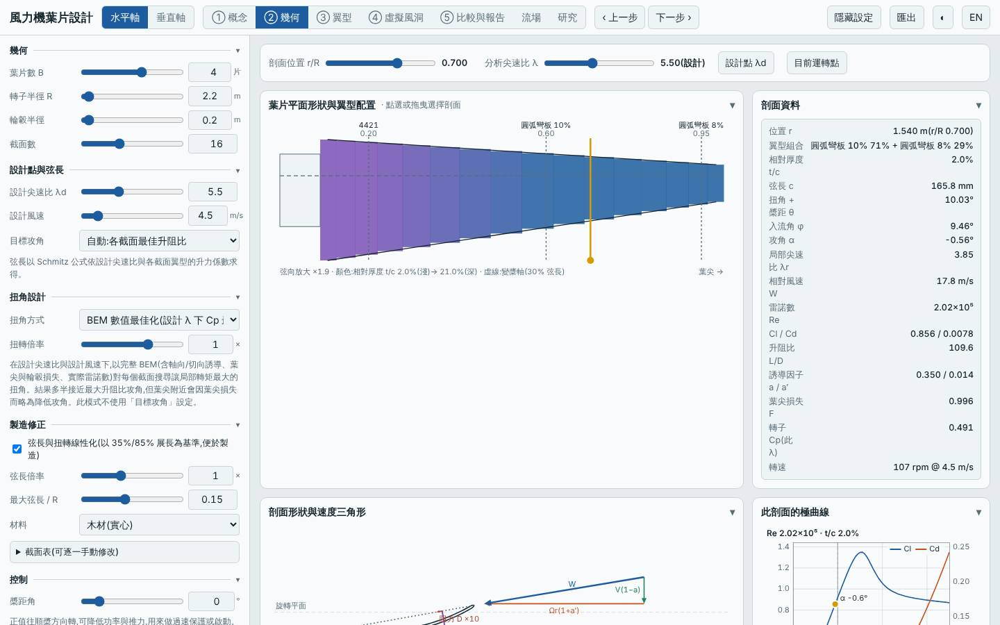
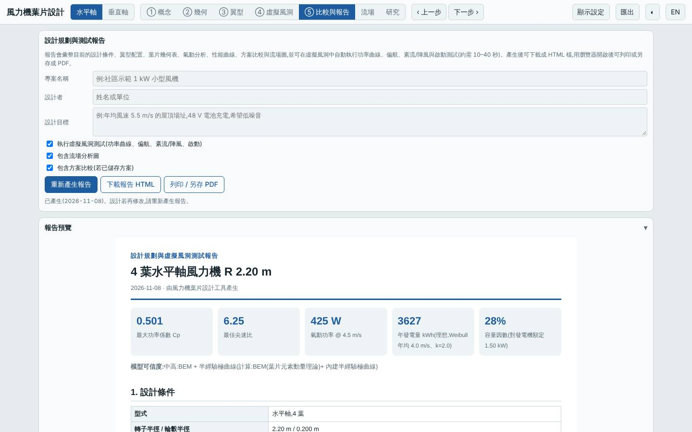
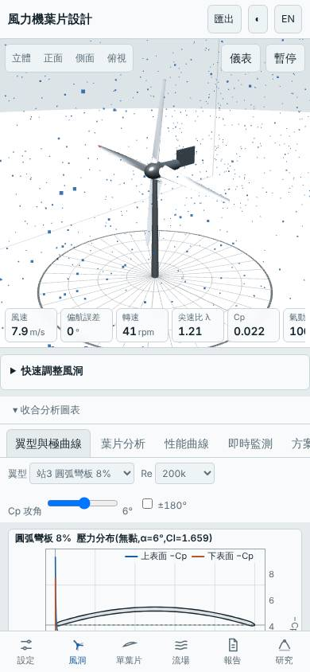

# 四葉低風速大轉子線性化木製葉片:根部 4421 + 中外段圓弧板(arc:10 → arc:8)

日期:2026-11-08(UTC)。**探索**。基準:預設三葉水平軸(同風況重算);另與上一輪 `20261107-hawt-b4-lowwind-linwood`(同轉子、全 NACA 4 位數翼型)對照。

相對 linwood 的變更:翼型站由預設(NACA 4 位數)改為 r/R 0.2 = `n4:4421`、0.6 = `arc:10`、0.95 = `arc:8`;其餘(R 2.2 m、B 4、λd 5.5、Vd 4.5 m/s、弦長上限 0.15 m、Pmax 1500 W、木材、線性化、Vavg 4 m/s)不變。

## 假設

linwood 的「下一次可以試」建議改用圓弧板。圓弧板在本工具的低 Re 極曲線模型下升阻比高於 NACA 4 位數,因此預期 Cp,max +2%、質量 −30%、標準場址 LCOE −2%、起轉風速維持 < 2 m/s;代價是圓弧板很薄,預期極端工況安全係數大幅下降,甚至低於 1(結構不可行)。這個代價是否致命是本實驗要驗證的重點。

## 參數掃描(`lab/evaluate.mjs`,Node,木材線性化 R 2.2 m)

| 變體 | Cp,max | 標準場址年發電量 kWh | 標準場址 LCOE | 起轉風速 | 質量 kg | 最小 / 極端安全係數 |
|---|---|---|---|---|---|---|
| linwood(全 NACA 4 位數)| 0.489 | 6217 | 1.67 | 1.47 | 26.7 | 41.7 / 3.53 |
| 4421 + 4412 + arc:8 | 0.490 | 6218 | 1.67 | 1.44 | 24.8 | 18.1 / 1.90 |
| 0024 + arc:10 + arc:8 | 0.493 | 6238 | 1.67 | 1.53 | 26.0 | 8.3 / 0.79 |
| 4421 + arc:8 + arc:8 | 0.502 | 6287 | 1.64 | 1.47 | 20.9 | 6.2 / 0.56 |
| **4421 + arc:10 + arc:8(本設計)** | 0.501 | 6284 | 1.63 | 1.60 | 17.9 | 6.1 / **0.58** |
| 全 arc:8(根到尖)| 0.502 | 6289 | 1.60 | 1.46 | 4.5 | 5.3 / 0.32 |
| 全 arc:5 | 0.497 | 6259 | 1.61 | 1.36 | 5.5 | 3.6 / 0.18 |
| 全 arc:8 + CFRP | 0.502 | 6289 | 1.68 | 1.46 | 2.8 | 8.5 / 0.51 |
| 全 arc:8 + GFRP | 0.502 | 6289 | 1.61 | 1.46 | 4.3 | 4.3 / 0.26 |
| 全 arc:8 + 鋁 | 0.502 | 6289 | 1.61 | 1.46 | 4.9 | 3.7 / 0.22 |

只有「外段仍用 4412」的變體能把極端安全係數維持在 1.5 以上,但那時 Cp 增益消失(+0.2%)。換成 CFRP、GFRP、鋁也不能讓全圓弧板葉片通過極端工況。

## 結果(本設計)

| 項目 | 本設計 | linwood | 預設基準 |
|---|---|---|---|
| Cp,max @ λ | 0.501 @ 6.25 | 0.489 @ 6.0 | 0.478 @ 7.25 |
| 年發電量(4 m/s)| 3627 kWh | 3567 kWh | — |
| LCOE(4 m/s,NT$/kWh)| 2.83 | 2.92 | — |
| 標準場址年發電量 / LCOE | 6284 kWh / 1.63 | 6217 kWh / 1.67 | 4758 kWh / 2.75 |
| 質量 | 17.9 kg | 26.7 kg | 4.3 kg |
| 起轉風速 | 1.6 m/s | 1.47 m/s | 3.7 m/s |
| 最小 / 極端安全係數 | 6.11 / **0.58** | 41.7 / 3.53 | 5.97 / — |
| 葉尖撓度 | 28 mm | 5 mm | — |
| 模擬 | 6 m/s 847 W(追蹤 96%);9 m/s 1426 W(額定削峰);3/4/5 m/s 皆自啟動 | | |

## 介面驗證

`lab:ui` 全數通過:介面 Cp,max 0.5010 與 Node 一致,掃掠面積 15.205 m²、質量 17.87 kg 一致,報告下載且含虛擬風洞功率曲線測試,桌面與手機版無 console 錯誤。已目視檢查 blade.jpg(B 4、R 2.2、站 4421 / 圓弧彎板 10% / 圓弧彎板 8%、線性化勾選、木材、剖面厚度 2.0%)與 tunnel.jpg(四葉轉子、翼型為圓弧彎板 8%)。

## 結論

**氣動部分成立、結構上不成立。** Cp,max 比 linwood +2.4%(預期 +2%)、標準場址 LCOE −2.4%(預期 −2%)、質量 −33%(預期 −30%)、起轉風速仍 < 2 m/s;但極端工況安全係數 0.58 < 1,依規則標記為**結構不可行**,不列入排名。圓弧板厚度僅 2%,根部再用 4421 也無法讓中外段承受極端彎矩;換 CFRP/GFRP/鋁、不線性化都不能救。在 R 2.2 m 的大轉子上,圓弧板的薄壁與弦長(0.15 m 以下)是限制,圓弧板的氣動優勢無法兌現。

模型限制:圓弧板極曲線是半經驗估計(低 Re 優勢可能偏樂觀);結構為單根梁、各向同性等效參數的簡化,極端載荷為概估;成本為概估;起轉風速為靜摩擦估算。所有數值為本工具模型預測,非實測。

## 3D 模型

`model/` 內有 `make_model.mjs`(以本工具 `hawtBlade` 放樣)產生的 `blade.stl`、`rotor.stl`(mm、軸 Z、四葉),以及 `blender_import.py`;本次以 pip 的 `bpy` 5.2 實際執行,產生 `rotor.blend`(木材材質)。

## 下一次可以試

- 圓弧板配合較大弦長上限(`maxChord` 0.25 m 以上)縮小轉子半徑,看厚度/弦長比是否能讓極端安全係數回到 1 以上,同時保有 Cp 優勢
- 在中小型(R 1.0 m)水平軸上試圓弧板,載荷隨 R 的平方以上下降,可能是圓弧板真正可行的尺度

## 截圖

   
