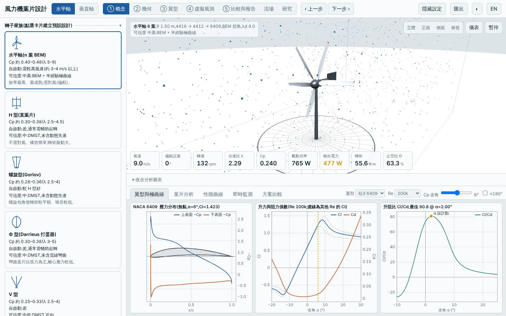
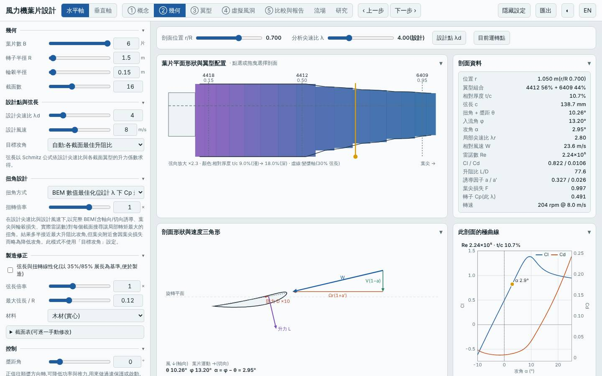
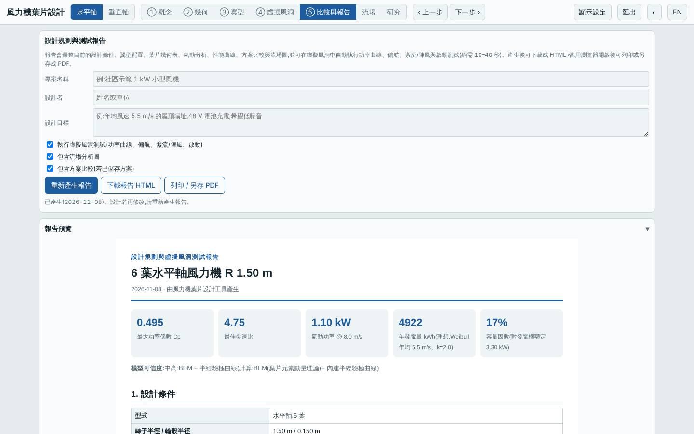
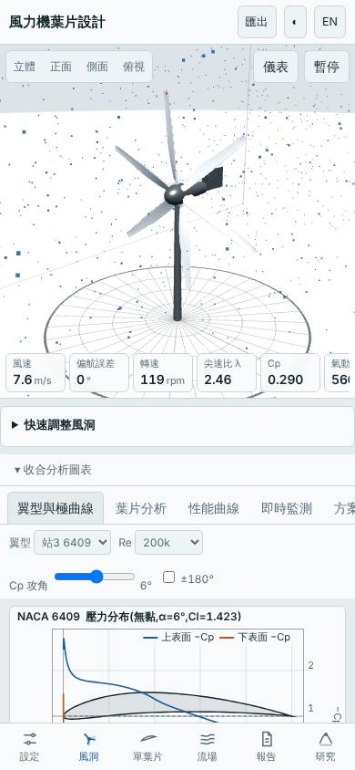

# 六葉低尖速比木製轉子(λd 4、根部 4418 / 中段 4412 / 葉尖 6409)

- 日期:2026-11-08
- 相對基準的變更:3 葉 → 6 葉、設計尖速比 7 → 4、材料玻纖 → 木材;翼型站為根部(r/R 0.15)NACA 4418、中段(0.5)NACA 4412、葉尖(0.95)NACA 6409;半徑、風況、發電機皆沿用預設
- 基準:預設三葉水平軸(同風況 Weibull 5.5 m/s、k 2,R 1.5 m)
- 與既有設計的差異:此前低風速設計多為 4–5 葉且大半徑或限額發電機;本次維持基準半徑,只以「葉片數與尖速比」探索小轉子的自啟動與成本

## 假設

預設轉子在 4 m/s 無法自啟動(起轉風速 3.7 m/s)。把葉片數增至 6、λd 降到 4,總實度提高、起轉力矩變大,同時以較厚三站翼型與木材控制結構與成本。預期起轉風速 < 2 m/s、3 m/s 可自行啟動、年發電量不低於基準、Cp,max 不低於 0.48;代價是質量約 +100%,LCOE 預期持平或略低。

## 結果(模型預測,與基準比較)

| 項目 | 本設計 | 基準 | 差異 |
|---|---|---|---|
| Cp,max | 0.495 @ λ 4.75 | 0.478 @ λ 7.25 | +3.5% |
| 年發電量(理想 MPPT,標準場址)| 4922 kWh | 4758 kWh | +3.4% |
| LCOE(概估)| 2.72 NT$/kWh | 2.75 | −1.1% |
| 轉子質量 | 10.1 kg | 4.3 kg | +135% |
| 起轉風速(靜摩擦估算)| 1.9 m/s | 3.7 m/s | −1.8 m/s |
| 模擬自啟動(靜止起步 60 s)| 3、4、5 m/s 皆可 | 僅 5 m/s 可 | 改善 |
| MPPT 追蹤率 6 / 9 m/s | 95% / 97% | 95% / 97% | 持平 |
| 50 m 雜訊 | 37.5 dB(A) | 46.7 dB(A) | −9.2 dB |
| 最小安全係數(額定 / 極端)| 16.2 / 1.79 | 5.97 / 2.65 | 極端風速餘裕下降 |
| 葉尖撓度 | 11.4 mm | 34 mm | 較小 |

介面驗證:以「方案載入」流程載入建置後的網頁,介面 Cp,max 0.4947 與 Node 評估一致,掃掠面積 7.069 m²、質量 10.09 kg 一致,報告的虛擬風洞測試正常完成,桌面與手機版無 console 錯誤;截圖確認為 6 葉、4418/4412/6409 的配置。

## 結論

假設大致成立:起轉風速 3.7 → 1.9 m/s、3 m/s 即可自啟動,Cp,max 與年發電量各約 +3.5%,LCOE 小幅 −1.1%,雜訊低約 9 dB。代價比預期更明顯:質量 +135%,極端風速安全係數由 2.65 降到 1.79(仍 > 1,但低於 1.5 以上的舒適區邊緣),所以木材 6 葉在強風下餘裕不大。適合**低風速、需要自行啟動且在意噪音**的小型場合;若著重經濟性,優勢僅在 1% 等級,在模型誤差內。

限制:極曲線為半經驗模型,小弦長的低 Re(10⁵ 量級)可能偏樂觀;6 葉間的尾流互相干擾 BEM 未計入;結構評估只含根部彎曲與簡化撓度,不含疲勞;木材成本為概估。所有數值為模型預測,非實測。

## 3D 模型

`model/` 內含單葉片 `blade.stl`(mm)、六葉轉子 `rotor.stl`、產生腳本 `make_model.mjs`,以及 Blender 匯入腳本 `blender_import.py`;`rotor.blend` 已實際以 pip 安裝的 bpy 執行腳本產生。

## 下一次可以試

- 6 葉 + GFRP 或加大半徑 1.8 m,找出極端安全係數回到 ≥ 2 且成本最低的組合
- 6 葉改線性化葉片(線性弦長與扭角)以降低製造成本,觀察 Cp,max 損失

## 截圖

   
