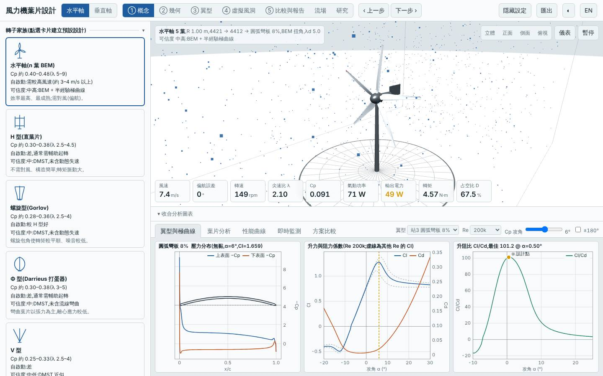
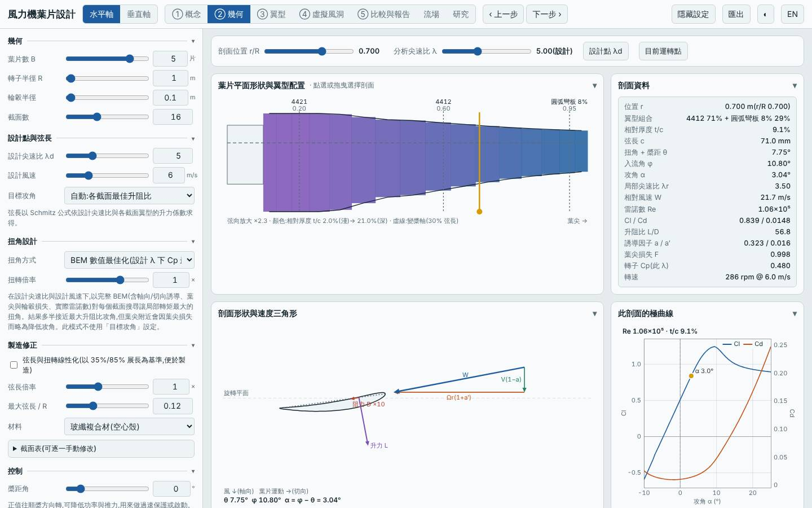
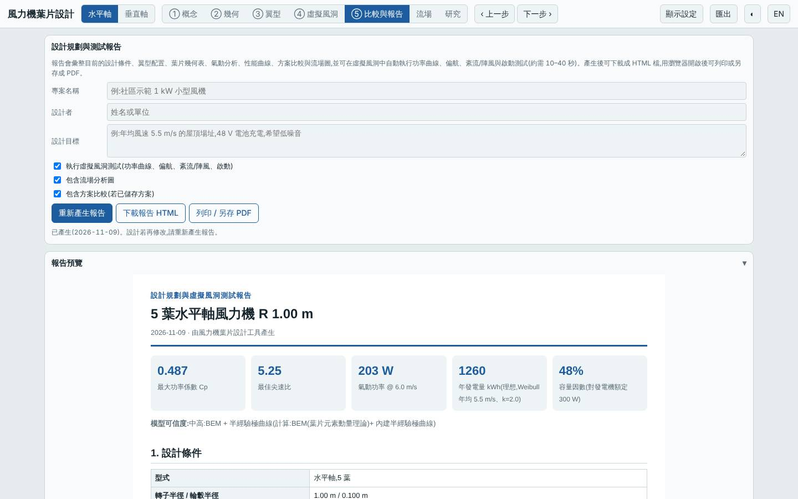
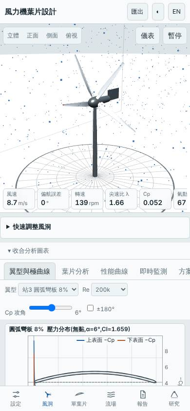

# 五葉小型轉子(R 1.0 m):外段圓弧板 + 中段 4412 混合翼型玻纖葉片,限額 300 W

日期:2026-11-09(UTC)。**探索**。基準:預設三葉水平軸(R 1.5 m,同風況重算);另與上一輪 `20261108-hawt-b4-lowwind-arcmid` 的結論對照。

設計:R 1.0 m、輪轂 0.1 m、B 5、λd 5、Vd 6 m/s、弦長上限 0.12 m、玻纖空心殼、Pmax 300 W;翼型站 r/R 0.2 = `n4:4421`、0.6 = `n4:4412`、0.95 = `arc:8`;標準場址(Vavg 5.5 m/s、k 2)。

## 假設

arcmid 實驗發現全圓弧板在 R 2.2 m 結構不可行,並建議到小尺度(R 1.0 m)再試。預期:載荷隨 R 的平方以上下降,外段圓弧板(低 Re 升阻比較高)可使 Cp,max +1~2%;五葉(λd 5)降低單葉片負載、起轉風速降到約 1.9 m/s;代價是極端安全係數下降但仍 > 1。事先的 Node 掃描(9 個變體)顯示**全圓弧板在 R 1.0 m 仍然結構不可行**(極端安全係數 0.04–0.5,不論 GFRP/CFRP/木/鋁/PLA),所以只有「根部厚翼型 + 中段 4412 + 外段圓弧板」的混合配置有機會通過。

## 參數掃描(`lab/evaluate.mjs`,Node,R 1.0 m、標準場址、300 W)

| 變體 | Cp,max | 年發電量 kWh | LCOE | 起轉風速 | 質量 kg | 最小 / 極端安全係數 |
|---|---|---|---|---|---|---|
| 三葉 4421/4412/4412 木 | 0.470 | 1239 | 1.66 | 2.44 | 1.65 | 15.3 / 2.68 |
| 三葉 4421/4412/arc:8 木 | 0.477 | 1248 | 1.65 | 2.42 | 1.55 | 10.6 / 2.17 |
| 五葉 4421/4412/4412 木 | 0.480 | 1251 | 1.65 | 1.92 | 2.33 | 15.4 / 2.02 |
| 五葉 4421/4412/arc:8 木 | 0.487 | 1260 | 1.64 | 1.93 | 2.19 | 9.0 / 1.35 |
| **五葉 4421/4412/arc:8 GFRP(本設計)** | 0.487 | 1260 | 1.68 | 1.93 | 2.06 | 11.6 / **1.75** |
| 五葉 4421/arc:10/arc:8 CFRP,弦長上限 0.15 | 0.491 | 1265 | 1.82 | 1.97 | 1.25 | 3.5 / 0.50(不可行)|
| 三葉全 arc:8 GFRP | 0.485 | 1257 | 1.62 | 2.51 | 0.27 | 1.02 / 0.13(不可行)|
| 三葉全 arc:8 CFRP | 0.485 | 1257 | 1.64 | 2.51 | 0.18 | 2.04 / 0.26(不可行)|
| 五葉全 arc:8 GFRP | 0.495 | 1269 | 1.61 | 1.89 | 0.38 | 1.65 / 0.15(不可行)|

## 結果(本設計)

| 項目 | 本設計 | 預設基準(R 1.5 m、三葉)| 差異 |
|---|---|---|---|
| Cp,max @ λ | 0.487 @ 5.25 | 0.478 @ 7.25 | +2.0% |
| 年發電量(標準場址)| 1260 kWh | 4758 kWh | −73.5%(掃掠面積 3.14 vs 7.07 m²)|
| 每 m² 年發電量 | 401 kWh/m² | 673 kWh/m² | 基準受益於不限額 |
| LCOE(NT$/kWh)| 1.68 | 2.75 | −38.9% |
| 容量因數 | 47.9%(限額 300 W)| — | — |
| 質量 | 2.06 kg | 4.33 kg | −52% |
| 起轉風速 | 1.93 m/s | 3.73 m/s | 3/4/5 m/s 皆自啟動 |
| 最小 / 極端安全係數 | 11.6 / 1.75 | 5.97 / — | 可行 |
| 葉尖撓度 | 11 mm | — | |
| 雜訊(50 m)| 38 dB | — | |
| 模擬 | 6 m/s 163 W(追蹤 92%);9 m/s 237 W(追蹤 40%,限額削峰)| | |

註:LCOE 較低主要來自轉子小(資本支出 NT$19,250);年發電量因面積小遠低於基準,兩者不是同尺度比較。

## 介面驗證

`lab:ui` 全數通過:介面 Cp,max 0.4874 與 Node 一致,掃掠面積 3.142 m²、質量 2.06 kg 一致,報告下載且含虛擬風洞功率曲線測試,桌面與手機版無 console 錯誤。已目視檢查 tunnel.jpg(五葉轉子、翼型為圓弧彎板 8%)與 blade.jpg(B 5、R 1.0、站 4421 → 4412 → 圓弧彎板 8%、玻纖複合材)。

## 結論

**部分成立。** 混合配置結構可行(極端安全係數 1.75),Cp,max 比同轉子全 NACA 4 位數(五葉 4412 外段)高 1.5%(0.480 → 0.487,預期 +1~2%)、起轉風速 1.93 m/s(預期約 1.9)。圓弧板的增益全部來自外段,且氣動收益僅 +0.7 至 +1.5%,質量只省 4–6%——遠小於全圓弧板的 −90% 質量,因為真正省質量的部分(中段與根部)都因結構限制而不能換。推翻的部分:全圓弧板在 R 1.0 m 仍不可行,「縮小尺度就能讓圓弧板可行」不成立。適合:極小型、低成本、需 2 m/s 即啟動的離網轉子。

模型限制:圓弧板極曲線是半經驗估計(低 Re 優勢可能偏樂觀,而 R 1.0 m、弦長約 0.07–0.12 m 的 Re 只有約 10⁵,正在這個偏樂觀區);結構為單根梁、各向同性等效參數,極端載荷為概估;成本為概估;起轉風速為靜摩擦估算。9 m/s 追蹤率 40% 是額定限額(300 W)削峰所致,不是追蹤失敗。所有數值為本工具模型預測,非實測。

## 3D 模型

`model/` 內有 `make_model.mjs`(以本工具 `hawtBlade` 放樣)產生的 `blade.stl`、`rotor.stl`(mm、軸 Z、五葉),以及 `blender_import.py`;本次以 pip 的 `bpy` 5.2 實際執行,產生 `rotor.blend`(玻纖材質)。

## 下一次可以試

- 單葉片外段只做圓弧板、改用 `maxChord` 0.16 m 的 CFRP/GFRP 混合外段,看極端安全係數是否仍 > 1 同時質量再降
- 在同一個 R 1.0 m 轉子改試四葉 λd 6 或加固定負槳距,看與五葉的起轉風速/Cp 取捨

## 截圖

   
