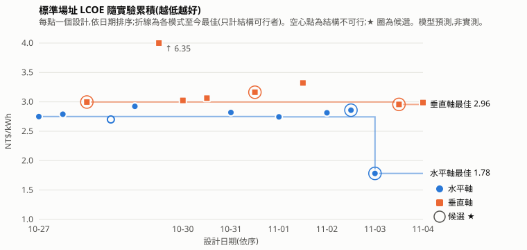

# 葉片設計實驗排行榜

由 `node lab/leaderboard.mjs` 自動產生,請勿手改。規則見 `docs/BLADE_LAB.md`;候選清單見 [CANDIDATES.md](CANDIDATES.md),全部數據見 [stats.csv](stats.csv)。
數值是本工具模型的預測(半經驗極曲線 + BEM/DMST、理想 MPPT 年發電量),不是 XFOIL、CFD 或實測;只適合方案間相對比較。

- **標準場址**欄位:每個設計都在 Weibull 平均 5.5 m/s、k 2 下重算(發電機額定照常自動匹配,設計檔明確指定的 `load` 設定保留),為其他場址設計的方案也能直接比較。
- 水平軸與垂直軸分表排名;粗體為該表最佳,★ 為深入研究候選:位在柏拉圖前緣(在標準場址 LCOE、標準場址年發電量、起轉風速三項上沒有被同模式其他可行設計全面勝過),且綜合分數為同模式前 3 名;「前緣」欄標出所有前緣設計。
- 綜合分數 0–100:三項目標在同模式可行設計中的正規化平均(100 = 三項都最好);「結構不可行」的設計不列入排名。

## 水平軸(17 個)

| 設計 | 家族 | 路線 | Cp,max @ λ | 標準場址年發電量 kWh | 標準場址 LCOE NT$/kWh | 原場址年發電量 / LCOE | 質量 kg | 起轉風速 | 模擬自啟動 | 最小安全係數 | 綜合分數 | 前緣 | 標記 | 介面驗證 |
|---|---|---|---|---|---|---|---|---|---|---|---|---|---|---|
| ★ [四葉低風速大轉子限額 1.5 kW 線性化木製葉片(深入研究:扭角方式、線性化、材料、槳距掃描,R 2.2 m,Vavg 4 m/s)](20261107-hawt-b4-lowwind-linwood/README.md) | 水平軸葉片 | 深入 ← `20261105-hawt-b4-lowwind-p1500` | 0.489 @ 6.00 | 6217 | **1.67** | 3567 / 2.92(4 m/s) | 26.7 | 1.5 m/s | 3 m/s | 41.69 | **83** | 是 | 場址 4 m/s | 通過 |
| ★ [四葉低風速場址大轉子限額 1.5 kW(深入研究:掃描 Pmax、λd、弦長上限,R 2.2 m,Vavg 4 m/s)](20261105-hawt-b4-lowwind-p1500/README.md) | 水平軸葉片 | 深入 ← `20261102-hawt-b4-lowwind` | 0.500 @ 6.75 | 6279 | 1.77 | 3623 / 3.07(4 m/s) | 26.4 | 1.4 m/s | 3 m/s | 34.59 | 81 | 是 | 場址 4 m/s | 通過 |
| ★ [四葉低風速限額 1.5 kW 轉子改線性化葉片(深入研究:掃描扭角方式、線性化、λd、槳距,R 2.2 m,Vavg 4 m/s)](20261107-hawt-b4-lowwind-lin/README.md) | 水平軸葉片 | 深入 ← `20261105-hawt-b4-lowwind-p1500` | 0.490 @ 6.50 | 6217 | 1.73 | 3567 / 3.02(4 m/s) | 18.6 | 1.7 m/s | 3 m/s | 30.68 | 80 | 是 | 場址 4 m/s | 通過 |
| [三葉低風速場址中型轉子加限額發電機(R 1.9 m、Vd 4.5 m/s、λd 5.5、額定 1.5 kW,Vavg 4 m/s)](20261103-hawt-b3-lowwind-cap/README.md) | 水平軸葉片 | 探索 | 0.492 @ 6.50 | 5406 | 1.78 | 2874 / 3.35(4 m/s) | 21.5 | 1.4 m/s | 3 m/s | 70.89 | 77 | — | 場址 4 m/s | 通過 |
| [三葉低風速場址轉子限額 1.0 kW(深入研究:掃描發電機額定,R 1.9 m、λd 5.5,Vavg 4 m/s)](20261104-hawt-b3-lowwind-p1000/README.md) | 水平軸葉片 | 深入 ← `20261103-hawt-b3-lowwind-cap` | 0.492 @ 6.50 | 4372 | 1.83 | 2585 / 3.09(4 m/s) | 21.5 | 1.4 m/s | 3 m/s | 70.89 | 73 | — | 場址 4 m/s | 通過 |
| [四葉低風速場址大轉子(R 2.2 m、Vd 4.5 m/s、λd 5、GFRP,Vavg 4 m/s)](20261102-hawt-b4-lowwind/README.md) | 水平軸葉片 | 探索 | **0.502** @ 6.00 | **10758** | 2.86 | 4364 / 7.05(4 m/s) | 37.3 | **1.3 m/s** | 3 m/s | 62.92 | 68 | 是 | 場址 4 m/s | 通過 |
| [五葉小型轉子(R 1.0 m、λd 5)外段圓弧板 + 中段 4412 混合翼型玻纖葉片,限額 300 W](20261109-hawt-b5-r1-arctip/README.md) | 水平軸葉片 | 探索 | 0.487 @ 5.25 | 1260 | 1.68 | 同左 | 2.1 | 1.9 m/s | 3 m/s | 11.56 | 62 | — | — | 通過 |
| [五葉低風速轉子(λd 4.5、CFRP、根部加厚)](20261028-hawt-b5-cfrp-thick/README.md) | 水平軸葉片 | 探索 | 0.493 @ 5.25 | 4906 | 2.92 | 同左 | 5.1 | 2.2 m/s | 3 m/s | 33.15 | 40 | — | — | 通過 |
| [四葉低尖速比(λd 5.5)](20261027-hawt-b4-lowtsr/README.md) | 水平軸葉片 | 探索 | 0.486 @ 6.00 | 4845 | 2.79 | 同左 | 6.7 | 2.7 m/s | 4 m/s | 12.93 | 40 | — | — | 通過 |
| [三葉易製造線性化葉片(線性弦長與線性扭角、木材)](20261101-hawt-b3-linear/README.md) | 水平軸葉片 | 探索 | 0.451 @ 7.25 | 4484 | 2.74 | 同左 | 4.5 | 2.9 m/s | 4 m/s | 7.03 | 39 | — | — | 通過 |
| [三葉五站翼型加 Schmitz 解析扭角(λd 6.5,根部 5 位數厚翼型到葉尖 6409)](20261105-hawt-b3-schmitz-5st/README.md) | 水平軸葉片 | 探索 | 0.477 @ 6.75 | 4748 | 2.76 | 同左 | 4.9 | 3.3 m/s | 5 m/s | 8.72 | 37 | — | — | 通過 |
| [基準:預設三葉水平軸](20261027-baseline/README.md) | 水平軸葉片 | 探索 | 0.478 @ 7.25 | 4758 | 2.75 | 同左 | 4.3 | 3.7 m/s | 5 m/s | 5.97 | 34 | — | 基準 | 通過 |
| [三葉線性化木製葉片加固定負槳距 −2°](20261106-hawt-b3-linear-pitchm2/README.md) | 水平軸葉片 | 探索 | 0.471 @ 7.25 | 4699 | 2.76 | 同左 | 4.5 | 3.7 m/s | 5 m/s | 7.03 | 34 | — | — | 通過 |
| [兩葉高尖速比水平軸(λd 9、薄翼型、CFRP)](20261031-hawt-b2-hightsr/README.md) | 水平軸葉片 | 探索 | 0.470 @ 9.25 | 4684 | 2.82 | 同左 | 1.4 | 5.6 m/s | > 5 m/s | 5.47 | 20 | — | 需輔助起轉 | 通過 |
| [三葉高風速場址轉子(Vd 11 m/s、λd 8、弦長上限 0.10 m、CFRP)](20261102-hawt-b3-highwind/README.md) | 水平軸葉片 | 探索 | 0.475 @ 8.00 | 4727 | 2.81 | 9497 / 1.40(7.5 m/s) | 1.9 | 6.5 m/s | > 5 m/s | 3.05 | 15 | — | 需輔助起轉、場址 7.5 m/s | 通過 |
| [五葉圓弧板低風速轉子(λd 4.5、木材)](20261028-hawt-b5-arcplate/README.md) | 水平軸葉片 | 探索 | 0.494 @ 5.25 | 4915 | 2.70 | 同左 | 2.9 | 2.1 m/s | 3 m/s | 1.15 | — | — | 結構不可行 | 通過 |
| [四葉低風速大轉子線性化木製葉片:根部 4421 + 中外段圓弧板(arc:10→arc:8,Vavg 4 m/s)](20261108-hawt-b4-lowwind-arcmid/README.md) | 水平軸葉片 | 探索 | 0.501 @ 6.25 | 6284 | 1.63 | 3627 / 2.83(4 m/s) | 17.9 | 1.6 m/s | 3 m/s | 6.11 | — | — | 結構不可行、場址 4 m/s | 通過 |

## 垂直軸(9 個)

| 設計 | 家族 | 路線 | Cp,max @ λ | 標準場址年發電量 kWh | 標準場址 LCOE NT$/kWh | 原場址年發電量 / LCOE | 質量 kg | 起轉風速 | 模擬自啟動 | 最小安全係數 | 綜合分數 | 前緣 | 標記 | 介面驗證 |
|---|---|---|---|---|---|---|---|---|---|---|---|---|---|---|
| ★ [四葉 H 型垂直軸負槳距 −3°(弦長 0.12 m、NACA 0015)](20261106-vawt-h-b4-toeout/README.md) | H 型(直葉片) | 探索 | 0.374 @ 3.00 | **2101** | 2.99 | 同左 | 7.6 | 2.8 m/s | > 5 m/s | — | **67** | 是 | 需輔助起轉 | 通過 |
| ★ [四葉細長螺旋型垂直軸(弦長 0.10 m)](20261027-vawt-helical-b4-slender/README.md) | 螺旋型(Gorlov) | 探索 | 0.365 @ 3.50 | 2060 | 3.00 | 同左 | 5.3 | 2.8 m/s | > 5 m/s | — | 67 | 是 | 需輔助起轉 | 通過 |
| ★ [三葉桶形自訂外形垂直軸(r(z) 兩端收 25%、NACA 0015、開啟動態失速與流線彎曲)](20261103-vawt-free-barrel/README.md) | 自訂外形(r(z) 控制點) | 探索 | 0.350 @ 3.75 | 1969 | **2.96** | 同左 | 4.8 | 2.9 m/s | > 5 m/s | — | 64 | 是 | 需輔助起轉、可信度中低 | 通過 |
| [兩葉 Φ 型垂直軸放大(R 1.5 m、開啟流線彎曲與動態失速)](20261030-vawt-phi-b2-r15/README.md) | Φ 型(Darrieus 打蛋器) | 探索 | 0.343 @ 5.50 | 1941 | 3.02 | 同左 | 5.7 | 2.8 m/s | > 5 m/s | — | 64 | — | 需輔助起轉 | 通過 |
| [三葉 V 型垂直軸(頂端 R 2 m、弦長 0.12 m、NACA 0018)](20261031-vawt-v-b3-r2/README.md) | V 型 | 探索 | 0.332 @ 6.00 | 1882 | 3.16 | 同左 | 7.8 | 2.7 m/s | > 5 m/s | — | 62 | 是 | 需輔助起轉、可信度中低 | 通過 |
| [三葉沙漏形自訂外形垂直軸(r(z) 兩端 1.0R、腰部 0.75R、NACA 0015)](20261104-vawt-free-hourglass/README.md) | 自訂外形(r(z) 控制點) | 探索 | 0.341 @ 3.75 | 1814 | 2.99 | 同左 | 4.7 | 2.8 m/s | > 5 m/s | — | 60 | — | 需輔助起轉、可信度中低 | 通過 |
| [三葉 Φ 型(打蛋器)垂直軸(弦長 0.12 m、NACA 0015)](20261030-vawt-phi-b3/README.md) | Φ 型(Darrieus 打蛋器) | 探索 | **0.379** @ 4.00 | 1431 | 3.06 | 同左 | 6.7 | 2.5 m/s | > 5 m/s | — | 56 | 是 | 需輔助起轉 | 通過 |
| [三葉 V 型垂直軸(弦長 0.12 m、NACA 0018)](20261101-vawt-v-b3/README.md) | V 型 | 探索 | 0.307 @ 4.50 | 866 | 3.32 | 同左 | 6.1 | 2.4 m/s | > 5 m/s | — | 43 | 是 | 需輔助起轉、可信度中低 | 通過 |
| [三葉 Savonius 阻力型垂直軸(重疊比 0.25、端板)](20261029-vawt-savonius-b3/README.md) | Savonius 阻力型 | 探索 | 0.159 @ 0.65 | 626 | 6.35 | 同左 | 37.8 | **0.7 m/s** | 3 m/s | — | 33 | 是 | 可信度中低 | 通過 |

共 26 個設計(探索 22、深入 4)。
